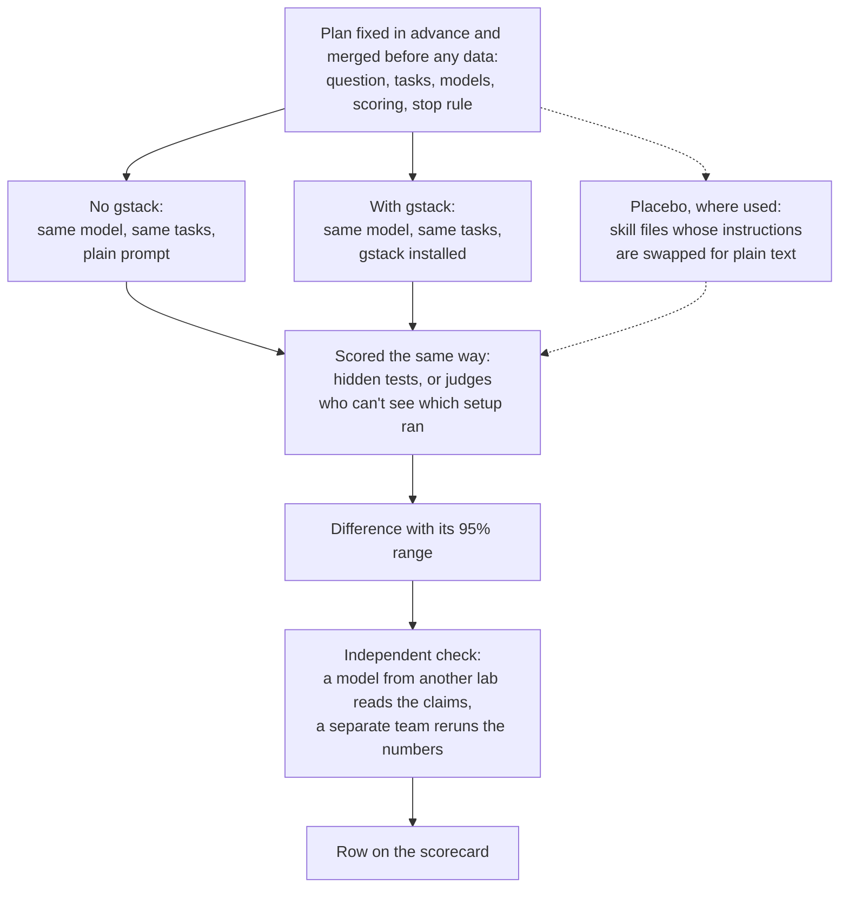

# gstack-evals

gstack-evals tests whether [gstack](https://github.com/garrytan/gstack), a set of skills and hooks for coding agents such as Claude Code, makes an agent do better than the same model with no gstack.

So far, gstack's full code review found more known blocking bugs than the same model without it. gstack's skill-routing overhaul got Opus 5.5 to open a skill more often, and one rewritten skill description did the same for GPT-6.1 Sol. Opening a skill is not the same as solving more tasks. Every other checked comparison showed no difference we could measure or got no verdict, and one scored lower without the drop being confirmed.

This page has four parts: [the scorecard](#scorecard), [what we learned](#what-we-learned), [how a test works](#how-a-test-works) and [how to run it yourself](#run-it-yourself). [What we're testing next](#what-were-testing-next) follows them.

## Scorecard

Each row ran the same model or models on the same tasks with and without gstack, or with two versions of gstack, and passed two independent checks. Differences are in percentage points. The brackets hold the 95% range: if it includes zero, we can't tell the two setups apart.

| Skill | Model | What we measured | No gstack | With gstack | Difference [95% range] | Verdict | Report |
|---|---|---|---|---|---|---|---|
| /review, full procedure¹ | Opus 5.5 | Share of 84 chances (42 known blocking bugs, each reviewed twice) flagged as blocking | 3.6% (3 of 84) | 26.2% (22 of 84) | **+22.6** [+11.0, +33.7] | helps | [post](wiki/board/2026-11-04-geva-281-r2-after-pin-results-home-field.md) |
| Skill-routing overhaul² | Opus 5.5 | Opened /investigate on its own | no skill to open | 0 of 80 before, 17 of 80 after | **+21.3** [+12.5, +30.0] | helps (opens only) | [post](wiki/board/2026-11-06-geva-350-l1-overhaul-results/README.md) |
| Skill-routing overhaul² | GPT-6.1 Sol | Opened /investigate on its own | no skill to open | 52 of 80 before, 59 of 80 after | **+8.8** [-3.8, +22.5] | no verdict³ | [post](wiki/board/2026-11-08-geva-353-l1-sol-particle-results/README.md) |
| /investigate description that says when to use it⁴ | Opus 5.5, GPT-6.1 Sol and particle-1, combined | Opened a skill on its own | no skill to open | Sol: 9.5% old wording, 27.0% new; Opus, particle-1: none | **+5.9** [+1.4, +10.8] | helps, carried by Sol (opens only) | [post](wiki/board/2026-11-02-geva-153-run-d-discovery-results/README.md) |
| plan-ceo-review⁵ | Opus 5.5 | Named the plan's deciding issue in its top three | 34.3% | 34.3% | **+0.0** [-7.3, +7.2] | no difference we could measure | [post](wiki/board/2026-11-08-geva-402-ceo-stage-2-results/README.md) |
| plan-ceo-review with its gate hook⁵ | Opus 5.5 | As above | 34.1% | 34.1% | **+0.0** [-6.0, +6.0] | no difference we could measure | [post](wiki/board/2026-11-08-geva-402-ceo-stage-2-results/README.md) |
| plan-ceo-review⁵ | GPT-6.1 Sol | As above | 15.5% | 15.5% | **+0.0** [-6.0, +6.0] | no difference we could measure | [post](wiki/board/2026-11-08-geva-402-ceo-stage-2-results/README.md) |
| plan-ceo-review with its gate hook⁵ | GPT-6.1 Sol | As above | 15.5% | 19.0% | **+3.6** [-1.2, +8.3] | no difference we could measure | [post](wiki/board/2026-11-08-geva-402-ceo-stage-2-results/README.md) |
| plan-ceo-review⁵ | particle-1 | As above | 22.6% | 13.1% | **-9.5** [-17.9, -1.2] | lower, not confirmed⁶ | [post](wiki/board/2026-11-08-geva-402-ceo-stage-2-results/README.md) |
| plan-ceo-review with its gate hook⁵ | particle-1 | As above | 22.6% | 21.4% | **-1.2** [-10.7, +8.3] | no difference we could measure | [post](wiki/board/2026-11-08-geva-402-ceo-stage-2-results/README.md) |
| plan-eng-review and autoplan⁷ | Opus 5.5 | Solved unpublished coding tasks (hidden tests) | 100% (22 of 22) | not reported | not reported | couldn't test yet | [post](wiki/board/2026-11-06-geva-364-g-admission-results/README.md) |

**Reading the table.** A skill is a written procedure the agent can open, and a hook is a small program that can stop the agent until a rule is met. "On its own" means the task didn't name the skill, and the routing and description rows compare an older and a newer gstack. [Skills and models explained](docs/all-results.md#reading-the-table).

1. Nearly all test bugs came from reviews by gstack or its close relatives, so the test may suit gstack. A gstack session cost 8.9 times as much. [Full note](docs/all-results.md#review-full-procedure)
2. These rows count opens for a newer gstack's hooks and skill descriptions against the older one. Pass rates showed no change we could measure, and the test was too small to see one. [Full note](docs/all-results.md#skill-routing-overhaul)
3. No verdict: the small pilot that decides whether a test goes ahead stopped this one. [Full note](docs/all-results.md#skill-routing-overhaul-on-gpt-61-sol)
4. All of the gain came from Sol, whose own change wasn't the planned comparison, and Sol's old-wording rate pools gstack with a placebo. Solving tasks wasn't tested. [Full note](docs/all-results.md#investigate-description-that-says-when-to-use-it)
5. The score is whether a review named the issue that later decided the plan's fate, not whether the plan got better. The gate hook checks the review's steps. [Full note](docs/all-results.md#plan-ceo-review)
6. The stricter test fixed in advance didn't pass, so this isn't a confirmed loss. [Full note](docs/all-results.md#plan-ceo-review-on-particle-1)
7. Plain Opus solved every finished trial, leaving no room for a gain, so the comparison never ran. An automatic check saw no sign of Opus running these skills' steps when asked. [Full note](docs/all-results.md#plan-eng-review-and-autoplan)

Every row passed a read by a model from another lab and a rerun by a separate team ([/review's checks](wiki/board/2026-11-09-geva-421-r2-independent-checks.md), [the claim check](wiki/board/2026-11-09-geva-431-claim-check-corrections.md)); [all results](docs/all-results.md) lists the rest. Some linked posts print an older, stronger verdict, and the claim check's wording, used here, is the current one.

## What we learned

- **We learned that a skill can only help once it runs, and installed skills often don't run.** gstack's full /review flagged known blocking bugs as blocking in 26.2% of 84 chances (42 bugs, each reviewed twice), against 3.6% for plain Opus 5.5, but in most sessions it ran only after a gstack hook blocked the agent for skipping it. The test bugs came mostly from reviews by gstack or its close relatives, so the gain may be smaller on other bugs. Without a push, agents often ignored skills: in one test where no task named a skill, Opus 5.5 and particle-1 opened none in 363 trials with gstack installed. You should make sure the steps that matter actually run, for example with a hook (we haven't run the full review with its hook switched off, so this is advice, not a result), and check that a skill ran before you judge whether it helped.
- **We learned that gstack's planning skills haven't shown a gain on anything we've measured.** plan-ceo-review made no difference we could measure on Opus 5.5 or GPT-6.1 Sol, and scored lower on particle-1 without that drop being confirmed. With no gstack, Opus 5.5 solved every finished trial of the coding tasks we built for plan-eng-review and autoplan (22 of 22), so those skills had no room to show a gain. You should test an add-on on tasks the plain model fails, and score what the skill is for: our plan test scored whether a review named a plan's deciding issue, not whether the plan got better. We are building those tests now.
- **We learned that telling a model when to use a skill made one model open it more often, and not the others.** Rewriting /investigate's description to say when to use it raised how often agents opened a skill by 5.9 points across three models [+1.4, +10.8], all of it on GPT-6.1 Sol, whose own change is exploratory. Opus 5.5 and particle-1 opened nothing either way. You should test a skill's wording on every model you ship it to, and remember that opening a skill is not the same as doing better.

## How a test works

- **The plan comes first.** A preregistration, a plan fixed in advance, names the question, tasks, models, scoring, stop rule and spend cap. It merges in its own pull request before any result, so the git history shows what was decided before the data.
- **There is always a no-gstack setup.** Since 2026-10-31 every comparison includes a setup with the same model, tasks and agent program, no gstack installed and a plain prompt. Many add a placebo: gstack's skill files with their instructions swapped for plain text of the same length, so the agent sees the same skill list but gets no procedure.
- **Test answers stay private.** Unpublished tasks, hidden tests and answer keys never enter this repo, so models can't learn them from here. The repo keeps only their counts and fingerprints (digests), so anyone given the files later can check they didn't change.
- **A run that hits its spend cap stops** and is reported as incomplete. It is never rerun to change a verdict.

## Run it yourself

These steps check the code and the records. They need [Bun](https://bun.sh) and the [age](https://github.com/FiloSottile/age) encryption tool, which one test uses, but no API key. Rerunning a paid experiment is covered below them.

1. Clone the repo: `git clone https://github.com/garrytan/gstack-evals.git && cd gstack-evals`
2. Install the dependencies: `bun install --frozen-lockfile`
3. Run the tests: `bun test`. They make no model calls, and CI runs them on every pull request.
4. Run the other checks CI runs: `bun run typecheck && bun run errors:check && bun run wiki:check`
5. List what the eval tool can do: `bin/gstack-evals --help`. It is the command-line tool that runs these evals. Commands that call a model need your own keys and a spend cap, and `bin/gstack-evals explain <code>` explains any error code it prints.
6. Build an index of every plan and result: `bun run wiki:index`, then open wiki/INDEX.md.

To rerun a paid experiment, follow the "Replicate it" section of its post, with your own provider keys and your own model bill. A step that needs the unpublished tasks can't run outside the team that holds them, and the post says so.

## What we're testing next

- **Plan reviews judged by what happened after release.** Does gstack's developer-experience plan review make a new developer feature easier to adopt, judged by the install, error, docs and upgrade trouble real developers hit later? [Plan](wiki/plans/2026-11-09-geva-417-devex-review-intentions-prereg/README.md), and [what the planning skills are meant to do](wiki/research/2026-11-09-geva-412-plan-mode-intentions/README.md).
- **A rule as a hook against the same rule as text.** Is "run a test after your last edit before you stop" followed more often when a gstack hook enforces it than when it sits in a skill's text? [Plan](wiki/plans/2026-11-09-geva-448-harness-mechanics-prereg/README.md).
- **A widely shared prompt about hidden state.** Does asking an agent to find the implicit state machines in a codebase, the hidden states a program moves between, turn up real bugs? [Pilot](wiki/board/2026-11-09-geva-492-state-machine-prompt-pilots.md).
- **pstack's checked models of that state.** Does a second step that writes those states down as a precise model and has a tool check every path, as Lauren Tan's pstack skills do, turn the prompt into a bug finder? [Pilot](wiki/board/2026-11-09-geva-492-state-machine-prompt-pilots.md).

## Other research

We also replayed a claim that an agent's small decisions can go to Jev (jev-1.13.0), a fast decision model, with particle-1 taking the ones Jev was unsure of. On all 8 decision points we replayed from gstack, gbrain (Garry Tan's memory system for agents) and a private game, that routing cost 0.2% to 6.8% of what the model each project uses today costs. But particle-1 alone matched or beat that routing on 7 and measurably beat today's model on 4, and the routing lost accuracy on gstack's grading calls, where a model scores work against a checklist (-9.9 points [-18.5, -1.2]). This was an exploratory replay with 39 to 296 held-back items per decision point, not a test planned in advance. [Report](wiki/research/2026-11-09-geva-421-jev-decision-routing/README.md).

We then tested that claim on a coding agent, in a test planned in advance. Routing a coding agent's small decisions to Jev, then particle-1, made it cost more, not less, on both Opus 5.5 and GPT-6.1 Sol, with no measurable change in task success, and particle-1 alone matched the router. The agent was mini-swe-agent, an open-source coding agent, working on 279 real GitHub issues. A separate team has since rerun its headline numbers from the per-task rows and no verdict changed, though one secondary interval bound, the upper end of one time-ratio range, didn't reproduce within random-draw noise. A model from another lab read the article version of these claims. A correction note narrows how the post explains the result. [Results](wiki/research/2026-11-12-geva-501-decision-routing-results/README.md), [correction](wiki/board/2026-11-12-geva-531-decision-routing-correction.md), [plan](wiki/plans/2026-11-09-geva-411-decision-routing-prereg/README.md).

## More

- [All results](docs/all-results.md): every result, including the ones still waiting for their checks, the corrections, and the words the posts use.
- [Reading this repo](docs/reading-this-repo.md): how the repo is laid out, how to find every finding, and what the codes in posts mean.
- [Why this repo is open](wiki/board/2026-11-09-geva-422-why-this-repo-is-open.md).
- Read [CONTRIBUTING.md](CONTRIBUTING.md) before you open an issue or a pull request, and report security problems privately, as [SECURITY.md](SECURITY.md) describes. The licence is MIT ([LICENSE](LICENSE)); vendored code keeps its own notices, listed in [NOTICE.md](NOTICE.md).

## Disclosures

gstack is Garry Tan's own project.

gbrain is Garry Tan's own project.

The private game repository is also Garry Tan's own project.

Disclosure: Y Combinator, which Garry Tan runs, is an investor in Particle, which makes particle-1.

Disclosure: OpenAI began through YC Research, which was started by Sam Altman, a former president of Y Combinator. Garry Tan runs Y Combinator.
