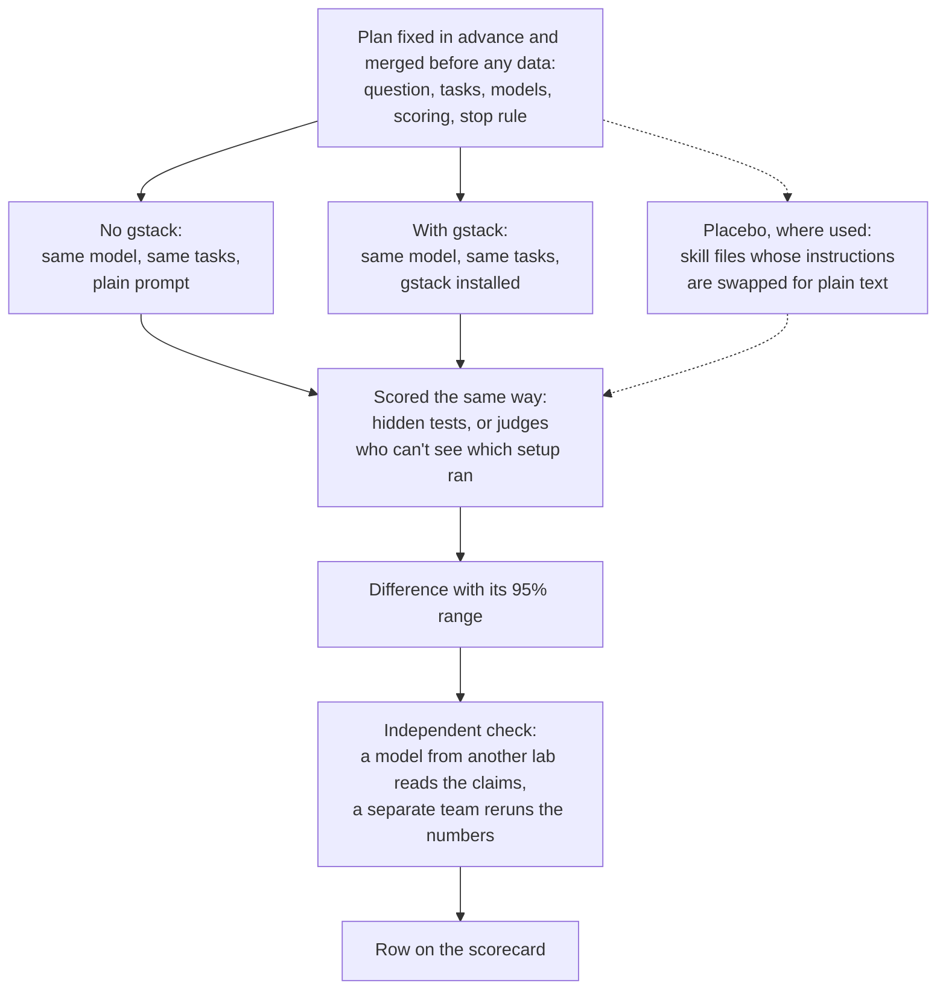

# gstack-evals

gstack-evals tests whether [gstack](https://github.com/garrytan/gstack), a set of skills and hooks for coding agents such as Claude Code, makes an agent do better than the same model with no gstack.

This page has four parts: [the scorecard](#scorecard), [what we learned](#what-we-learned), [how a test works](#how-a-test-works) and [how to run it yourself](#run-it-yourself). [What we're testing next](#what-were-testing-next) follows them.

## Scorecard

Each row ran one model on the same tasks with and without gstack, or with two versions of gstack, and passed two independent checks before it got here. Differences are in percentage points. The brackets hold the 95% range: if it includes zero, we can't tell the two setups apart.

| Skill | Model | What we measured | No gstack | With gstack | Difference [95% range] | Verdict | Report |
|---|---|---|---|---|---|---|---|
| /review, full procedure¹ | Opus 5.5 | Share of known blocking bugs it flagged as blocking | 3.6% (3 of 84) | 26.2% (22 of 84) | **+22.6** [+11.0, +33.7] | helps | [post](wiki/board/2026-11-04-geva-281-r2-after-pin-results-home-field.md) |
| Routing overhaul² | Opus 5.5 | Opened /investigate when the task didn't name it | no skill to open | 0 of 80 before, 17 of 80 after | **+21.3** [+12.5, +30.0] | helps (opens only) | [post](wiki/board/2026-11-06-geva-350-l1-overhaul-results/README.md) |
| Routing overhaul² | GPT-6.1 Sol | Opened /investigate when the task didn't name it | no skill to open | 52 of 80 before, 59 of 80 after | **+8.8** [-3.8, +22.5] | no verdict³ | [post](wiki/board/2026-11-08-geva-353-l1-sol-particle-results/README.md) |
| /investigate's description, rewritten to say when to use it⁴ | Opus 5.5, GPT-6.1 Sol and particle-1, pooled | Opened a gstack skill when the task didn't name one | no skill to open | Sol: 9.5% old wording, 27.0% new; Opus and particle-1: none | **+5.9** [+1.4, +10.8] | helps on Sol only (opens only) | [post](wiki/board/2026-11-02-geva-153-run-d-discovery-results/README.md) |
| plan-ceo-review⁵ | Opus 5.5 | Named the issue that decided a real plan, in its top three | 34.3% | 34.3% | **+0.0** [-7.3, +7.2] | no difference we could measure | [post](wiki/board/2026-11-08-geva-402-ceo-stage-2-results/README.md) |
| plan-ceo-review, gate on⁵ | Opus 5.5 | As above | 34.1% | 34.1% | **+0.0** [-6.0, +6.0] | no difference we could measure | [post](wiki/board/2026-11-08-geva-402-ceo-stage-2-results/README.md) |
| plan-ceo-review⁵ | GPT-6.1 Sol | As above | 15.5% | 15.5% | **+0.0** [-6.0, +6.0] | no difference we could measure | [post](wiki/board/2026-11-08-geva-402-ceo-stage-2-results/README.md) |
| plan-ceo-review, gate on⁵ | GPT-6.1 Sol | As above | 15.5% | 19.0% | **+3.6** [-1.2, +8.3] | no difference we could measure | [post](wiki/board/2026-11-08-geva-402-ceo-stage-2-results/README.md) |
| plan-ceo-review⁵ | particle-1 | As above | 22.6% | 13.1% | **-9.5** [-17.9, -1.2] | lower, not confirmed⁶ | [post](wiki/board/2026-11-08-geva-402-ceo-stage-2-results/README.md) |
| plan-ceo-review, gate on⁵ | particle-1 | As above | 22.6% | 21.4% | **-1.2** [-10.7, +8.3] | no difference we could measure | [post](wiki/board/2026-11-08-geva-402-ceo-stage-2-results/README.md) |
| plan-eng-review and autoplan⁷ | Opus 5.5 | Solved held-out coding tasks, judged by hidden tests | 100% (22 of 22) | not reported | not reported | couldn't test yet | [post](wiki/board/2026-11-06-geva-364-g-admission-results/README.md) |

1. Each of the 42 known blocking bugs, in 33 review units, was reviewed twice. 41 of the 42 came from reviews by gstack-family tools, so the test may suit gstack. In 42 of the 66 gstack sessions the full procedure ran only after a gstack hook blocked the agent; 24 ran it unprompted. A gstack session cost 8.9 times as much as one with no gstack.
2. The overhaul is gstack v1.94.39.0, which adds a hook that names the right skill for the task, hooks that enforce a skill's steps and rewritten skill descriptions, tested as one package against v1.93.22.0. With no gstack there is no skill to open. These rows count opens, not solved tasks: pass rates showed no change we could measure (Opus, prompt not naming the skill: -2.5 [-7.5, +2.5]; Sol, prompt asking for it: +0.0 [-5.0, +5.0]), and the test was too small to see one. On Opus every open came on one of the 19 tasks the new hook sent to the skill, and none came with the new hooks switched off.
3. The run's own entry check didn't admit this comparison, so it has no verdict. Room wasn't the problem: at Sol's 65.0% starting rate the test could see a gain of 18.6 points, inside the 20 points it was looking for, and with the new hooks switched off Sol opened the skill in 88.8% of sessions (71 of 80).
4. This compares the rewritten description with the shipped one. All of the gain came from Sol, and Sol's own change is exploratory. Opus 5.5 and particle-1 opened nothing in 363 eligible trials. No effect on solving tasks was tested. The test used 37 Terminal-Bench 2 tasks, one trial per task per setup.
5. On 84 real product plans, the score is whether a review named the deciding issue, not whether the plan got better, so it can't show the skill failing at its main job. [A new test](wiki/plans/2026-11-08-geva-403-product-value-prereg/README.md) asks whether plans get better for real users. "Gate on" is a later gstack with its review gate switched on, a hook that checks the review's steps. Each row's rates cover the reviews that comparison keeps, so Opus's no-gstack rate differs slightly between its two rows.
6. Its 95% range sits below zero, but it fails the significance test fixed in advance, which corrects for testing two versions on each model. So it isn't a confirmed loss.
7. The plan needed plain Opus to solve between 20% and 80% of trials, to leave room for a gain. It solved every valid trial (95% range 84.6% to 100%, on 11 of 12 tasks), so the comparison never ran. Asked to use these skills, Opus showed no sign of running their steps in any scored session (0 of 18 for plan-eng-review, 0 of 23 for autoplan), by our detector's count.

Every row passed a read by a model from another lab and a rerun of its numbers by a separate team; [/review's checks](wiki/board/2026-11-09-geva-421-r2-independent-checks.md) and [the claim check](wiki/board/2026-11-09-geva-431-claim-check-corrections.md) record them. Some linked posts still print an older, stronger verdict, because a merged post never changes. The claim check's wording, used here, is the current reading. Results still waiting for their checks are listed, without numbers, in [all results](docs/all-results.md).

## What we learned

- **We learned that a skill can only help once it runs, and installed skills often don't run.** gstack's full /review flagged 26.2% of known blocking bugs against 3.6% for plain Opus 5.5, but in most sessions it ran only after a gstack hook blocked the agent for skipping it. The test bugs came mostly from gstack-family tools, so the gain may be smaller on other bugs. Without a push, agents often ignored skills: in one test where no task named a skill, Opus 5.5 and particle-1 opened none in 363 trials with gstack installed. You should enforce the steps that matter with a hook, and check that a skill ran before you judge whether it helped.
- **We learned that a frontier model already does much of the work on its own.** With no gstack, Opus 5.5 solved every valid trial of the coding tasks we built to test the planning skills (22 of 22), so no planning skill could show a gain there. GPT-6.1 Sol needed no new hook to find /investigate: it opened the skill in 88.8% of sessions with gstack's new hooks switched off. You should test an add-on on tasks the plain model fails, or it has no room to show anything. We are building harder tasks now.
- **We learned that telling a model when to use a skill helped one model and not the others.** Rewriting /investigate's description to say when to use it raised how often agents opened a skill by 5.9 points pooled [+1.4, +10.8], all of it on GPT-6.1 Sol. Opus 5.5 and particle-1 opened nothing either way. You should test a skill's wording on every model you ship it to, and remember that an open is not a better result.

## How a test works

- **The plan comes first.** A preregistration, a plan fixed in advance, names the question, tasks, models, scoring, stop rule and spend cap. It merges in its own pull request before any result, so the git history shows what was decided before the data.
- **There is always a no-gstack setup.** Since 2026-10-31 every comparison includes a setup with the same model, tasks and agent program, no gstack installed and a plain prompt. Many add a placebo: gstack's skill files with their instructions swapped for plain text of the same length, so the agent sees the same skill list but gets no procedure.
- **Answers stay sealed.** Held-out tasks, hidden tests and answer keys never enter this repo. It keeps only their counts and digests, so you can check later that nothing changed.
- **A run that hits its spend cap stops** and is reported as incomplete. It is never rerun to change a verdict.

## Run it yourself

You need [Bun](https://bun.sh). No API key is needed for these steps.

1. Clone the repo: `git clone https://github.com/garrytan/gstack-evals.git && cd gstack-evals`
2. Install the dependencies: `bun install --frozen-lockfile`
3. Run the tests: `bun test`. They make no model calls, and CI runs them on every pull request.
4. Run the other checks CI runs: `bun run typecheck && bun run errors:check && bun run wiki:check`
5. List what the eval tool can do: `bin/gstack-evals --help`. It is the command-line rig behind these evals. Commands that call a model need your own keys and a spend cap, and `bin/gstack-evals explain <code>` explains any error code it prints.
6. Build an index of every plan and result: `bun run wiki:index`, then open wiki/INDEX.md.

To rerun a paid result, follow the "Replicate it" section of its post, with your own provider keys and your own model bill. A step that needs held-out material can't run outside the team that holds it, and the post says so.

## What we're testing next

- **Plan reviews judged by what happened after release.** Does gstack's developer-experience plan review make a new developer feature easier to adopt? Each review is graded against the install, error, docs and upgrade trouble real developers hit after the feature shipped. [Plan](wiki/plans/2026-11-09-geva-417-devex-review-intentions-prereg/README.md), and [what the planning skills are meant to do](wiki/research/2026-11-09-geva-412-plan-mode-intentions/README.md).
- **A rule as a hook against the same rule as text.** Is "run a test after your last edit before you stop" followed more often when a gstack hook enforces it than when it sits in a skill's text? The same test asks whether a second plain attempt beats gstack's /verify at equal spend. [Plan](wiki/plans/2026-11-09-geva-448-harness-mechanics-prereg/README.md).
- **Small decisions routed to cheaper models.** Does sending a coding agent's small, fixed-choice decisions to a fast decision model, with a cheaper model behind it, cut the bill without losing task success? [Plan](wiki/plans/2026-11-09-geva-411-decision-routing-prereg/README.md).
- **A viral prompt about implicit state machines.** Does asking an agent to find the implicit state machines in a codebase turn up real bugs? [Pilot](wiki/board/2026-11-09-geva-492-state-machine-prompt-pilots.md).
- **pstack's generated checks.** Does a second step that writes a formal model of that state and checks it, as Lauren Tan's pstack does, turn the prompt into a bug finder? A preregistered test is being built. [Pilot](wiki/board/2026-11-09-geva-492-state-machine-prompt-pilots.md).
- **autoplan on harder tasks.** Plain Opus solved our earlier planning tasks, so the next test uses larger features and first checks that plain Opus doesn't already solve them. [Plan](wiki/plans/2026-11-08-geva-397-autoplan-larger-features-prereg/README.md).

## Other research

Routing an agent's small decisions to Jev (jev-1.13.0), a fast decision model, with particle-1 taking the ones Jev was unsure of, cost 0.2% to 6.8% of today's model on all 8 decision points we replayed from gstack, gbrain and a private game. But particle-1 alone matched or beat that routing on 7 and measurably beat today's model on 4, and the routing lost accuracy on gstack's rubric-grading calls (-9.9 points [-18.5, -1.2]). This was an exploratory replay with 39 to 296 held-out items per decision point, not a preregistered test. [Report](wiki/research/2026-11-09-geva-421-jev-decision-routing/README.md).

## More

- [All results](docs/all-results.md): every result, including the ones still waiting for their checks, the corrections, and the words the posts use.
- [Reading this repo](docs/reading-this-repo.md): how the repo is laid out, how to find every finding, and what the codes in posts mean.
- [Why this repo is open](wiki/board/2026-11-09-geva-422-why-this-repo-is-open.md).
- Read [CONTRIBUTING.md](CONTRIBUTING.md) before you open an issue or a pull request, and report security problems privately, as [SECURITY.md](SECURITY.md) describes. The licence is MIT ([LICENSE](LICENSE)); vendored code keeps its own notices, listed in [NOTICE.md](NOTICE.md).

## Disclosures

gstack is Garry Tan's own project.

gbrain is Garry Tan's own project.

The private game repository is also Garry Tan's own project.

Disclosure: Y Combinator, which Garry Tan runs, is an investor in Particle, which makes particle-1.

Disclosure: OpenAI began through YC Research, which was started by Sam Altman, a former president of Y Combinator. Garry Tan runs Y Combinator.
