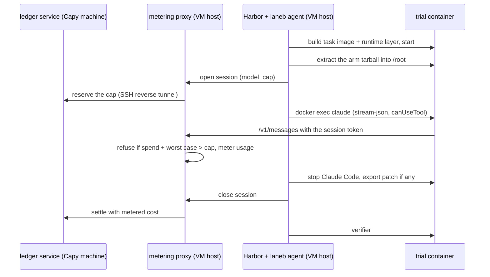

# quick/laneb: Lane B quick look on public tasks

GSTA-12's exploratory runner for one question: on Terminal-Bench 2.0 tasks graded by execution, does gstack beat no skills and a length-matched placebo, on Opus 5.5 and on cheap models? The preregistration is the wiki post [2026-10-28-gsta-12-laneb-quick-prereg](../../wiki/plans/2026-10-28-gsta-12-laneb-quick-prereg.md). Results go in a separate pull request.

It is a quick runner, written so M2a can keep the parts that hold up. It grows the U8 Harbor spike ([finding](../../wiki/board/2026-10-28-gsta-10-harbor-spike-lane-b-runner.md)) into something that spends money safely.

## How a trial runs

## Pieces

| Path | What it does |
|---|---|
| `runner/proxy.ts` | Anthropic Messages proxy. Holds the provider keys; containers hold only a per-session token. Rewrites the model to the cell's model, refuses provider-side tools, refuses a request when spend plus that request's worst case would pass the session cap, meters usage from streamed and plain responses, injects OpenRouter's `provider` pin for DeepSeek. |
| `runner/ledger.ts` | Append-only ledger in integer micro-dollars: approval row first, a reserve per session (idempotent by id, refused past the cap), one settle per reserve. `serve` exposes it on 127.0.0.1 for the proxy. |
| `runner/agent/laneb_agent.py` | Harbor agent. Claude Code runs inside the container over `docker exec -i`, driven by the Agent SDK outside it. Extracts the arm during agent setup (off the event loop, outside the agent timer), opens and closes the metered session, wraps the instruction in the arm-neutral prompt, answers AskUserQuestion from `usersim.py`, and on any exit kills Claude Code and settles. An error after at least one metered request still gets graded; an error before any is an infrastructure failure. |
| `runner/prompt-wrapper.md` | The one prompt wrapper, identical across arms. |
| `runner/materialize.ts` | Turns registry task directories into runnable ones: the task image plus a runtime layer (Claude Code 2.1.312, Node, Bun) that is identical across arms, and the per-phase network policy. Also converts SWE-bench Verified tasks to a separate verifier that grades the exported patch (not used in this run). |
| `runner/prepare-run.ts` | Builds one batch's run directory: the tasks in `tasks/final.json` materialized and checked against their pinned digests, the arm tarballs, the proxy config, the JobConfig with VM paths, and a manifest with the git head and every digest. |
| `runner/route-check.sh` | The first paid step: the smoke task once per model through the real proxy and ledger, arm none. |
| `runner/grid.ts` | Writes a Harbor JobConfig: every task by every (model, arm). Harbor orders trials task by task, so a cap stop leaves complete, paired task blocks. |
| `runner/launch.sh`, `vm-bootstrap.sh`, `vm-run.sh` | One batch on a fresh Ubicloud VM: bootstrap, keys to a 0600 file over stdin, proxy plus Harbor on the VM, ledger service here through a reverse tunnel, results pulled back, VM destroyed on any exit. |
| `runner/smoke.sh`, `fake_upstream.ts`, `smoke-task/` | Keyless end-to-end test: fake upstream, proxy, scratch ledger, Harbor, agent, real Claude Code, separate verifier. |
| `arms/` | The gstack arm build and the seeded placebo generator. |
| `tasks/` | The task pre-screen scripts and the fixed list with digests; the write-up is the wiki post [2026-10-28-gsta-12-tb2-task-selection](../../wiki/research/2026-10-28-gsta-12-tb2-task-selection.md). `final.json` is the list after oracle checks, with each dropped task and why. |
| `analysis/analyze.ts` | Pass rates with task-clustered bootstrap intervals, paired contrasts, cost per success, share of the Opus gap closed, skill-open rates. |
| `config/` | Proxy routes and prices, and the cells with their session caps. |

## Checks

Keyless: `bun test quick/laneb` and `npx tsc --noEmit -p quick/laneb/tsconfig.json`. `NETWORK=public bash quick/laneb/runner/smoke.sh` needs Docker and Harbor (`uv tool install "harbor @ git+https://github.com/harbor-framework/harbor@f3a5a923f6d722472c9e797af836ae4425fb215f" --with claude-agent-sdk==0.2.174`).

## What M2a should know

- Keep: the proxy's session tokens and worst-case refusal, the ledger's integer money and idempotent reserves, the agent's always-settle exit path, the task-major job order, the runtime layer appended to PATH.
- Replace: the hand-written batch specs with the plan's prereg plumbing, and the Python usersim with the shared simulator.
- Known gaps: no non-root agent user; arms are extracted at trial start rather than baked; DeepSeek is metered at peak price; Claude Code's own `max_tokens` of 128k forces a large per-request worst case, so the agent sets `CLAUDE_CODE_MAX_OUTPUT_TOKENS` (32000) in the container; the worst case takes input tokens from count_tokens on the Anthropic routes and counts one token per request byte on OpenRouter or when counting fails, so long sessions stop short of their cap.
