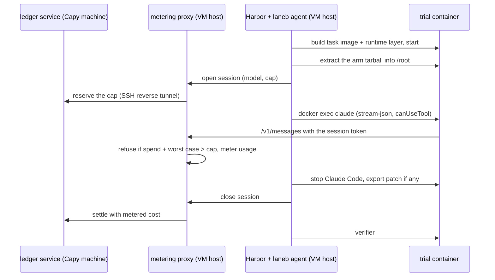

# quick/laneb: Lane B quick look on public tasks

GSTA-12's exploratory runner for one question: on Terminal-Bench 2.0 tasks graded by execution, does gstack beat no skills and a length-matched placebo, on Opus 5.5 and on cheap models? The preregistration is the wiki post [2026-10-28-gsta-12-laneb-quick-prereg](../../wiki/plans/2026-10-28-gsta-12-laneb-quick-prereg.md). Results go in a separate pull request.

It is a quick runner, written so M2a can keep the parts that hold up. It grows the U8 Harbor spike ([finding](../../wiki/board/2026-10-28-gsta-10-harbor-spike-lane-b-runner.md)) into something that spends money safely.

## How a trial runs

## Pieces

| Path | What it does |
|---|---|
| `runner/proxy.ts` | Anthropic Messages proxy. Holds the provider keys; containers hold only a per-session token. Rewrites the model to the cell's model, refuses provider-side tools and any body field outside the set Claude Code sends (`mcp_servers`, `container`, OpenRouter's `plugins` and routing fields), drops unlisted `anthropic-beta` values, refuses a `max_tokens` that is not a positive integer, refuses image and document blocks with a url or file source (tool_use inputs are not checked), refuses a request when spend plus that request's worst case would pass the session cap, answers a retryable 529 instead when token counting failed and the byte bound would pass the cap or the request carries image or document blocks (OpenRouter requests with media still go on the byte bound, a known gap), meters usage from streamed and plain responses, and charges the worst case when it cannot (a body cut mid-read, a 200 without usage, a failure after the request may have reached the provider). Enforces the batch cap when a session opens, never mid-session. Opens sessions idempotently by `open_key`: a retried open gets the same session and no second reserve. Injects OpenRouter's `provider` pin for DeepSeek. Close writes the session row before it settles, retries the settle, and leaves a failed one for the next close or `close-all`. On a session's first forwarded request it records whether the CLI expanded a slash command and which ones (`cmd_expanded`, `cmd_names` in the session row), with no change to cost accounting. |
| `runner/ledger.ts` | Append-only ledger in integer micro-dollars: approval row first, a reserve per session (idempotent by id, refused past the cap), one settle per reserve. `serve` exposes it on 127.0.0.1 for the proxy; `reconcile` settles open reserves from a run's `proxy-sessions.jsonl`. `open` lists the open reserve ids, and `reserve` and `settle` write one row each, such as `launch.sh`'s VM blocks; `reserve` refuses an id the item already holds. |
| `runner/agent/laneb_agent.py` | Harbor agent. Claude Code runs inside the container over `docker exec -i`, driven by the Agent SDK outside it. Extracts the arm during agent setup (off the event loop, outside the agent timer), opens and closes the metered session (an open that times out or gets a 5xx is retried with the same `open_key`), wraps the instruction in the arm-neutral prompt, answers AskUserQuestion from `usersim.py`, and on any exit kills Claude Code, closes the session (which settles) and writes `laneb-summary.json`, each step even when an earlier one fails. Evaluator evidence goes to `evaluator/` beside the trial's `agent/` directory, which Harbor mounts read-write in the container. Setup refuses a container that still holds `NET_RAW` or `NET_ADMIN`. A session that closes with no ok response raises `LanebInfraError`, the only agent error Harbor reruns; any other error after a model response is graded as it stands. Its `system_prompt` option (`sdk-default`: the SDK sends `--system-prompt ""`; `claude-code-preset`: Claude Code's own system prompt) and `session_kind` option (`unattended` passes `GSTACK_SESSION_KIND` to the container's claude) go in the session-open meta, the init record of `sdk-messages.jsonl` and `laneb-summary.json`. Its `told_skill` option opens the prompt with `/<skill> ` (`runner/agent/prompt_builder.py`), so the CLI expands that skill; it is recorded the same way. |
| `runner/prompt-wrapper.md` | The one prompt wrapper, identical across arms. |
| `runner/materialize.ts` | Turns registry task directories into runnable ones: the task image plus a runtime layer (Claude Code 2.1.312, Node, Bun) that is identical across arms, and the per-phase network policy. Also converts SWE-bench Verified tasks to a separate verifier that grades the exported patch, which R3's `swebv-r3` task set uses; `loadSwebvTasks` checks the id list and digests against the preregistered sha256. |
| `runner/prepare-run.ts` | Builds one batch's run directory: the tasks in `tasks/final.json` materialized and checked against their pinned digests, the arm tarballs, the proxy config, the JobConfig with VM paths, and a manifest with the git head and every digest. An arms entry may set the agent's `system_prompt` (`sdk-default`, the default, or `claude-code-preset`) and `session_kind` (unset by default, or `unattended`) per arm, as in `gstack:system_prompt=claude-code-preset:session_kind=unattended`; the manifest records both for every arm. `told=<skill>` opens that arm's prompt with `/<skill> `. Env `TASK_SET` (`tb2`, the default, or `swebv-r3`, materialized from a harbor-datasets checkout in `SWEBV`), `TASKS`, `CELLS` and `ARM_MANIFESTS` pick the task set, a subset, the cells file and the arm manifest directory. |
| `runner/route-check.sh` | The first paid step: the smoke task once per model through the real proxy and ledger, arm none. |
| `runner/grid.ts` | Writes a Harbor JobConfig: every task by every (model, arm). Harbor orders trials task by task, so a cap stop leaves complete, paired task blocks. Reruns only `LanebInfraError` and Harbor's environment-start and agent-setup timeouts, and adds `agent-caps.compose.yaml`, which drops `NET_RAW` and `NET_ADMIN` from every trial's main container. |
| `runner/launch.sh`, `vm-bootstrap.sh`, `vm-run.sh` | One batch on a fresh Ubicloud VM: bootstrap, keys to a 0600 file over stdin, every image the tasks build from pulled first (R3 amendment 3's rule 3: 6 tries, and a pull refused while Docker Hub's rate limit is used up waits for the window, up to 3 hours per image, instead of using a try; `out/pulls.tsv` logs each image, and one that still fails is infra, listed in `out/pull-fails.txt`, and `vm-run.sh` exits 10 before any model call), an oracle gate that needs reward 1 on every task, proxy plus Harbor on the VM, ledger service here through a reverse tunnel, results pulled back once `vm-run.sh` has finished, checked by file count, and open reserves reconciled. `launch.sh` refuses a run dir that already holds `pulled/`. The VM is destroyed only after a confirmed pull, or when no batch started on it. If the pull still fails after three attempts, the VM is kept, and `launch.sh` exits 7 and prints the commands to pull, reconcile and destroy it. An interrupt before the batch starts destroys the VM; a later one stops Harbor, lets the sessions close and settle, then pulls. With `VM_USD_PER_HOUR` and `VM_RESERVE_HOURS` set, the VM's hours are reserved in the ledger in blocks, the first before the VM starts (a refusal exits 9 with no VM); a refused or unreserved later block stops the batch and writes `vm-cap-stop`, and the blocks settle once the VM is down. With a `STOP_ON_CAP` file in the run dir, `vm-run.sh` also stops Harbor on a latched cap stop and writes `out/cap-stop.json`. That watcher and `out/proxy-status-end.json` read the proxy's `GET /totals`, the control route that carries `sessions`, `open_sessions` and `cap_stop`. |
| `runner/smoke.sh`, `fake_upstream.ts`, `smoke-task/` | Keyless end-to-end test: fake upstream, proxy, scratch ledger, Harbor, agent, real Claude Code, separate verifier. |
| `arms/` | The gstack arm build, the seeded placebo generator, and the stacks round's pstack and pstack-placebo arms (`arms/stacks.ts`). |
| `runner/skill-map.stacks.json` | The stacks round's told skill per arm and task: `investigate` for gstack and its placebo, `pstack:poteto-mode` for pstack and its placebo. |
| `tasks/` | The task pre-screen scripts and the fixed list with digests; the write-up is the wiki post [2026-10-28-gsta-12-tb2-task-selection](../../wiki/research/2026-10-28-gsta-12-tb2-task-selection.md). `final.json` is the list after oracle checks, with each dropped task and why. `swebv-r3.txt` and `swebv-r3.json` are R3's 93 SWE-bench Verified ids and their digests, written and checked by `swebv_r3.py`. `swebv-r3-drop.json` is R3's drop list as R3 amendment 3's drop-list.py.txt writes it (GEVA-177's r3-drop-list.json): band tasks left out of the screen's run, its oracle job and its coverage, each with its reason and both oracle passes' evidence and digests; `runner/materialize.ts` pins its sha256, and the pilot still draws from the whole band. |
| `analysis/analyze.ts` | Pass rates with task-clustered bootstrap intervals, paired contrasts, cost per success, share of the Opus gap closed, skill-open rates. A trial is graded on its verifier reward; a trial without one scores 0 if a model response reached the agent (reported again with those trials dropped), and is infra otherwise. Cost comes from the proxy's session rows (`sessions` in the config: each run's `out/proxy-sessions.jsonl`); a trial without a row has a missing cost, never $0. |
| `r3/` | R3 (GEVA-101 prereg): `screen.ts` runs one model's R3a screen and pilot (prepare, run, analyze): Opus 5.5 on ledger item `r3a-screen` by default, or `--model gpt-6.1-sol` on its own item `r3a-sol` (R3 amendment, section 6). `route-check.ts` is Sol's first paid step on `r3a-sol`: a smoke session and a told /investigate session, each retried once after a route-side failure (a failure on our side ends it incomplete, Captain ruling A1), with a record the screen reads before it binds the item. `exposure.ts` exports one record per trial with its outcome, cost and procedure-gate booleans. |
| `config/` | Proxy routes and prices (including particle-1 and GPT-6.1 Sol on OpenRouter), and the cells with their session caps (`cells.r3.json` for R3). |

## Checks

Keyless: `bun test quick/laneb` (its agent tests run `tests/agent_test.py` under `python3`, and `tests/agent_sdk_test.py` under the real `claude-agent-sdk` at `runner/vm-bootstrap.sh`'s pin, which the test installs into a venv in the temp dir; `tests/r3.test.ts` runs `tests/agent_r3_sdk_test.py` the same way) and `npx tsc --noEmit -p quick/laneb/tsconfig.json`. `NETWORK=public bash quick/laneb/runner/smoke.sh` needs Docker and Harbor (`uv tool install "harbor @ git+https://github.com/harbor-framework/harbor@f3a5a923f6d722472c9e797af836ae4425fb215f" --with claude-agent-sdk==0.2.174`).

## What M2a should know

- Keep: the proxy's session tokens and worst-case refusal, the ledger's integer money and idempotent reserves, the agent's always-settle exit path, the task-major job order, the runtime layer appended to PATH.
- Replace: the hand-written batch specs with the plan's prereg plumbing, and the Python usersim with the shared simulator.
- Known gaps: the agent runs as root (Terminal-Bench tasks install packages and configure services), in a container without `NET_RAW` or `NET_ADMIN`; processes the agent starts are recorded at the phase boundary but keep running into the public verifier phase, because some tasks grade services the agent leaves running; arms are extracted at trial start rather than baked; DeepSeek is metered at its own endpoint's weekday peak price ($0.30 in, $1.20 out per 1M tokens, `config/proxy.json`), while the main rig's metering proxy routes it only to inference-net at fp8 ($0.08 in, $0.55 out; `src/runner/pricing/prices.ts`); Claude Code's own `max_tokens` of 128k forces a large per-request worst case, so the agent sets `CLAUDE_CODE_MAX_OUTPUT_TOKENS` (32000) in the container; the worst case counts input at `count_tokens` plus 64 tokens on Anthropic routes and at one token per request byte on OpenRouter or when counting fails, so long sessions stop short of their cap.
