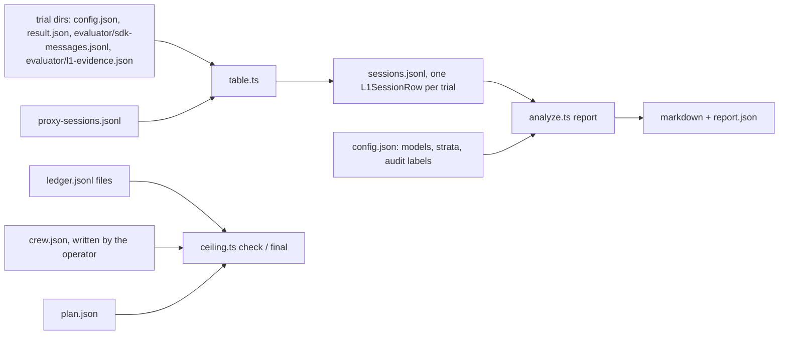

# quick/laneb/l1: probes, analysis and ceiling check for L1

Build unit U2 of the L1 superseding preregistration ([2026-11-03-geva-254-l1-overhaul-prereg-2000](../../../wiki/plans/2026-11-03-geva-254-l1-overhaul-prereg-2000/README.md), section 10). Everything here is keyless: it reads files Lane B already writes and makes no model or Capy API call.



## Pieces

| Path | What it does |
|---|---|
| `probes.ts` | Probes L and I (#169 7.6) over one SDK message log, the S13 background count, the contract hook's block, the read audit for none sessions, and the turn-cap and model-output checks. Probe L passes on a Skill call naming investigate whose base directory lies in the arm's gstack install (a task checkout's own skill never counts), or on a Read or Bash of an `investigate/SKILL.md` whose result holds the first 200 characters of the arm's installed copy. Probe I reads #169 7.2's items 1 to 4: the DEBUG REPORT with its labels, edits and the test rule. A Bash call counts as an edit through #169 7.2's write list (redirects and `tee` inside the work tree, `sed -i`, `perl -i`, `patch`, `git apply` and `git checkout` of paths), after `cd`, `env`, reserved words, subshells and `sh -c` are unwrapped. The S13 count is a background shell, agent or task still running at the final result, so a TaskStop or a kill ends it. |
| `table.ts` | Builds the per-session table from Lane B's trial directories and the proxy's session rows: arm, instrument, part, task, repository, outcome (graded, infra, cap stop or contaminated, section 6), pass and adherence, both probes, S13, the read audit, the allowance and turn-cap stops, and the evidence fields. A verifier reward is the `rewards` entry named `reward`, or the only entry when there is just one, and counts only as a number or a string that reads as one; null, an empty string or any other value is no reward, so the session is infra unless a stop makes it a graded fail. `route_hook` comes from the proxy's session rows (below), and the transcript's reading of the hook is kept as `route_hook_transcript`. It refuses a pin whose `investigate/SKILL.md` prefix differs from the frozen digest, and stamps each row with the sha256 of the `probes.ts` that scored it. |
| `analyze.ts` | One entry from that table to every endpoint: B1 (also on the routed stratum), B3, O5 and the secondaries, each under #169 7.5's coverage rule, both 95% intervals (by task and by repository), the sign-flip p, Holm over B1 and B3, the behavior admission, the gate reading, O5's descriptive line, the probe audit and every verdict branch. Coverage counts only planned sessions (a planned task, up to the planned replicates of each), so an empty plan, such as an empty routed stratum or fit stratum, gives no outcome. The probe audit passes only when the labels hold one label for each session of this table's audit sample, each with the probe value the table carries. Every MDD is read from the merged `power.txt`, pinned by sha256. `audit-sample` lists the sessions the blind reader labels. It refuses a table whose rows were scored by another `probes.ts`, and a table with a row that misses a field the analysis reads or holds the wrong type, repeats a trial, names a model the config does not, or is not a planned session: a planned task and arm of its instrument (pilot: before-u and before-t; smoke: the other four arms, on pilot tasks; F1: all seven; TB2: five), with no more graded sessions on a task and arm than the plan's replicates. So every reader sees only planned sessions. S11 prints how many sessions the proxy and the transcript disagree on about the route hook. |
| `ceiling.ts` | Section 9's ceiling check before each launch, with its holdback, and the final read before the results post. A crew file or plan with a missing, negative or non-numeric amount, or an unknown line or status, exits 2 instead of passing, and so do a missing ledger file and a done item with no ledger rows. `--void-ledger <ledger.jsonl>` (repeatable) passes the ledger of a run voided before any session ran (Amendment D's pilot-opus run 92231acce642809f): its settled and open reserved spend is added to the sum (`check` prints it as `voided runs: $x`; `final` folds it into the all-in figure without a line of its own), it places no item and never counts against an item's cap, and a path given as both `--ledger` and `--void-ledger` exits 2. |
| `audit.ts` | Amendment C's two read-audit procedures for the none arm, run on pulled trial dirs before anyone reads a score. `xargs` compares `probes.ts` with `probes-8e6795a.ts` (main's line-wide xargs rule from before #218, pinned by sha256) call by call and prints each call whose hits differ. `contamination` decides each none session (`stands`, `overturned` or `listed`) from whether gstack file content came back, against a corpus built from the before and after arm tars. `apply` rewrites the session table from those decisions, and reads each rewritten row's own reward and stop fields only to set the pass table.ts sets for its new outcome. `xargs` and `contamination` read no reward or verifier output. |

The per-session row is `L1SessionRow` in [src/types.ts](../../../src/types.ts).

## Commands

```sh
bun quick/laneb/l1/table.ts table-config.json sessions.jsonl
bun quick/laneb/l1/analyze.ts audit-sample sessions.jsonl claude-opus-5-5 > audit-sample.jsonl
bun quick/laneb/l1/analyze.ts report sessions.jsonl analysis-config.json report.json
bun quick/laneb/l1/ceiling.ts check --ledger ledger.jsonl --crew crew.json --plan plan.json --launch pilot-sol
bun quick/laneb/l1/ceiling.ts final --ledger ledger.jsonl --crew crew.json --plan plan.json --post GEVA-999
bun quick/laneb/l1/audit.ts xargs <trial or job dir>...
bun quick/laneb/l1/audit.ts contamination <arms dir> <trial or job dir>...
bun quick/laneb/l1/audit.ts apply decisions.tsv sessions.jsonl out.jsonl [out-without-listed.jsonl]
```

`audit-sample` and the config's `models` take the model id exactly as the rows carry it, which is the cell's `upstream_model` (for example `claude-opus-5-5`); any other id gives an empty sample. `ceiling.ts check` prints `CEILING PASS` and exits 0, or `CEILING REFUSE` and exits 1. Bad input exits 2 with an `E_USAGE` line, as do the other two commands.

## Inputs the operator writes

- **table-config.json**: `jobs` (`{dir, instrument, part}`, instrument one of pilot, smoke, f1, tb2), `sessions` (the runs' `proxy-sessions.jsonl` paths), `prefixes` (`{before, after}`, each pin's installed `investigate/SKILL.md`) and an optional `home`.
- **analysis-config.json**: `models` (`{id, status: run | not_run}`), `routed_stratum` (Amendment C's routed F1 tasks), `construction_checks` (true only when U1's checks and Amendment C's dry run passed), `audit` (the reader's labels, or a path to them) and, optionally, the task lists, `tb2_fit_stratum` and `dropped_by_design`. Once the table holds TB2 rows for a model that ran, `tb2_tasks` (non-empty) and `tb2_fit_stratum` (may be empty) are required, and `analyze.ts` refuses with `E_USAGE` without them. It also refuses an unknown model status or a model listed twice, a task list or stratum that is not a list (or path) naming each task once, a `dropped_by_design` that is not a boolean and a `tb2_replicates` that is not a positive integer.
- **crew.json**: `as_of`, `captain_credits` (the Captain's booked L1 turns) and `threads` (`{code, line: crew | sol | particle, credits, tokens, token_stop, status: open | planned | done}`), read from each L1 thread's Capy counter. The repo never calls a Capy API.
- **plan.json**: `items` (`{item, cap_usd, status: planned | open | done}`, each cap equal to the ledger's) and `leftover` (`{sol, particle}`, each pending, done or refused).

## The ceiling sum

```text
items     every plan item: settled + open reserved, or its cap while it is not done
spent     items + voided runs' settled and open reserved spend + every L1 thread's credits / 1000 + the Captain's booked credits / 1000
holdback  max($700 - crew spend, unspent token stops of open and planned L1 threads x measured $ per token)
          + max(0, $40 - Captain spend)
          + max(0, $15 - run-work spend) for Sol and for particle-1 while each is pending
total     spent + holdback; check refuses a launch when total passes $3,300 or any item, its own included, holds open reservations
```

The measured rate is all L1 thread credits over all L1 thread tokens, or $0.45 per million before any reading. The final read leaves the post thread out of the holdback and prints the largest token stop it can have, so the all-in figure, the Captain and run-work remainders, the other open threads' stops and the post's stop at the measured rate stay at or under $3,300.

A part whose VM dies leaves open reserves that never settle: the proxy's sessions file died with the VM, so `ledger.ts reconcile` leaves them open, and the check refuses every launch. Once ubi-runner shows the VM gone, the operator settles each of that part's open reserves at its full reserved amount with `bun quick/laneb/runner/ledger.ts settle --path <ledger> --item <item> --id <id> --usd <reserved amount> --detail <the dead VM>`, then runs the check for the part's one relaunch. Settling at full charges the cap what the open reserve did, so no cap moves, and the measured cost of those sessions is reported as an upper bound. The L1 launcher (U1) enforces the one relaunch.

## Per-session hook evidence

Lane B's SDK log carries neither the route hook's line nor the contract hook's record file; the contract hook's block does show, as a "Stop hook feedback" user message, and `probes.ts` reads it. So every L1 arm sets `gstack_hooks=copy` (`ARM_SPECS` in `l1.ts`) and runs on `runner/agent/laneb_hooks.py`'s `LanebHooksAgent`. After Lane B's own teardown has stopped Claude Code, exported the patch and closed the session, it copies `/root/.gstack/hooks` and `/root/.gstack/skill-contracts` to `evaluator/gstack-hooks/` and Claude Code's transcripts (`*.jsonl` under `/root/.claude/projects`) to `evaluator/claude-projects/`, then writes `evaluator/l1-evidence.json` and adds the same three fields to `laneb-summary.json`:

- `route_hook`: the transcript holds a UserPromptSubmit hook-context attachment with the route hook's line (`ROUTE_MARK` in `arms/l1.ts`). A tool result that quotes the line does not count. The route hook skips a prompt that opens with a slash command, so a told session reads false. `table.ts` keeps this reading as `route_hook_transcript`, a cross-check; the table's `route_hook` comes from the proxy (below).
- `contract_record`: the contract Stop hook left `skill-contracts/<session id>.json`.
- `contract_check_met`: the record's last investigate run ended met (`met`, `met_waived`, `met_after_block`) or not (`blocked`, `miss`); null with no investigate run, no record, or an investigate run whose `updated_at` is not an ISO 8601 time with a zone, since the last run can't be told then.

The session is the one top-level transcript. With none, or more than one, every field is null; a failed copy (named in `teardown_errors`) leaves the fields it decides null; an unreadable record leaves both contract fields null. Each copy is capped at 256 MiB (`TREE_CAP_BYTES` in `laneb_hooks.py`): a tree past the cap, or one that grows past it while it is sent, is a failed copy. Null means "could not tell", never "did not fire", and `analyze.ts` counts an unrecorded hook as not fired. Real sessions with Claude Code 2.1.312 in the arm images against `arms/l1.ts`'s fake upstream gave: after untold `true, false, null`, after told `false, true, false` (blocked, then a miss), and off and before, untold or told, `false, false, null`; `tests/fixtures/l1/hooks` holds the after-told, after-untold, before-told and off-untold sessions, cut to their user, assistant, hook and last-prompt lines.

**Route evidence from the proxy.** The metering proxy (`runner/proxy.ts`) runs on the part VM, outside every trial container, and sees each request Claude Code sends. Claude Code 2.1.312 puts a UserPromptSubmit hook's added context in the first request's role "system" message, after the skill listing, as a paragraph of its own that opens "UserPromptSubmit hook additional context: ". The task prompt, the work tree's CLAUDE.md with the files it imports, `.claude/CLAUDE.md` and `.claude/rules/`, and git status arrive in the user message instead, and project skills' descriptions arrive in the listing with their line breaks folded to spaces. That is what the real CLI sent under the pinned Agent SDK from the after and off arm images, keyless, through the proxy to a fake upstream; `tests/fixtures/l1/route-requests.json` holds those first requests, cut around the route line. For each `/v1/messages` request it refuses or forwards, its line in `proxy-requests.jsonl` carries `route_mark` and `before_output` (the session had not yet been handed any 200 response). `route_mark` is true when the route hook's line sits in that paragraph and appears nowhere else in the request, false when the request does not carry the line, and `"quoted"` when it carries the line anywhere else or twice: in the task prompt, in a CLAUDE.md, in a skill's description, or a second hook's copy. The retryable 529 for a failed token count writes no such line, though the request still counts for the session row. Each `proxy-sessions.jsonl` row carries `route_mark_before_output`: `"quoted"` once a `/v1/messages` request that arrived before the first 200 response was quoted, otherwise true once such a request carried the paragraph, false when such requests arrived and none carried the line, and null when none arrived (a count_tokens call or a body that is not JSON does not count). A 529, a refusal or a count_tokens reply hands back no output. `table.ts` sets `route_hook` from these rows: true only when every session of the trial that a request reached says true, and null when the trial has no proxy row, a row from a proxy that does not record the field, or a quoted row, so `analyze.ts` counts a quoted session's hook as unrecorded, never fired. `l1.ts prepare` refuses a planned task whose instruction holds the route line. `analyze.ts` prints per model how many sessions carry both readings and how many of them disagree (S11 `route_disagree`).

**Trust limit.** The model under test runs as root inside the trial container, so any file there can be forged. `route_hook` no longer rests on such a file. Until a session has been handed its first model response, the model has produced no output, no tool has run and nothing in the container has acted for it, so a route line in a request that reached the proxy before then came from Claude Code, from a hook or from the task. The proxy tells the route hook's paragraph from a copy in the task prompt, a CLAUDE.md, git status or a skill's description: a request that carries the line anywhere but that one paragraph reads quoted, never true. It can't tell the route hook from a task's own UserPromptSubmit hook. A task image whose work tree runs such a hook (its `.claude/settings.json`) and prints the route line as added context makes the same paragraph, so the session reads true while the route hook stays silent and quoted when both print. The work tree's files sit in the task image, which prepare does not hold, so nothing refuses such a task. `runner/task-hooks.sh` (run by `vm-run.sh` after the image pulls, never stopping the run) logs to `out/task-hooks.tsv` whether each task's pulled image or build context names a `UserPromptSubmit` hook, and the results post reports the count. The session can send requests but can't edit their record: the proxy and its logs live on the VM host, the trial containers reach the proxy only on its data port at the Docker bridge gateway, and its control port binds the VM's 127.0.0.1. That holds only while no task runs on host networking: `runner/materialize.ts` writes every task's `network_mode` as `public`, `allowlist` or `no-network`, never host, and a task on host networking would reach the control port. A true row proves that the route line reached the proxy in the session's first turn as Claude Code's hook context, from the route hook or from a task's own hook, and appeared nowhere else in that request. It proves nothing about later prompts, since any request after the first response can carry a line the model wrote (through a tool result, or with its own session token), and nothing about the contract hook. `contract_record` and `contract_check_met` still come from files inside the container, so a session that writes a contract record with a met run reads as hooked. R3b's hook-state read has the same trust model.

## Tests

```sh
bun test quick/laneb/tests/l1-probes.test.ts quick/laneb/tests/l1-table.test.ts quick/laneb/tests/l1-analyze.test.ts quick/laneb/tests/proxy-route.test.ts quick/laneb/tests/l1-ceiling.test.ts quick/laneb/tests/l1-audit.test.ts quick/laneb/tests/agent.test.ts quick/laneb/tests/grid.test.ts
```

The probe fixtures `cli-skill-bg.jsonl` and `cli-kill-agent.jsonl` are sanitized logs of the real Claude Code 2.1.312 under the pinned Agent SDK against a fake upstream. The analysis tests use `tests/fixtures/l1/synthetic.ts`.

## L1 launcher

`l1.ts` runs one L1 item (prereg [2026-11-03-geva-254-l1-overhaul-prereg-2000](../../../wiki/plans/2026-11-03-geva-254-l1-overhaul-prereg-2000/README.md), sections 3, 6, 9 and 10) as a set of parts, one after another. Each part is one detached launch of `runner/launch.sh` on an awake host. The waiting agent never runs a controller. It attaches on a timer.

### The awake host

- Type: a dedicated Ubicloud `standard-2` VM made by the pinned `ubi-runner.sh` (`UBI_RUNNER`, checked against `UBI_RUNNER_SHA256` on the agent and again on the host). It is tagged with `UBI_OWNER`, the run thread's code, and has a recovery bundle in `UBI_RECOVERY_DIR`.
- TTL: (parts + 1) x 18 h + 24 h. That is every part and one relaunch at the part VM TTL (16 h) plus 2 h, and a day of slack: 60 h for pilot-opus, pilot-sol and pilot-p1, 78 h for tb2-opus, 114 h for f1-opus, f1-sol, f1-sol-offu and f1-p1.
- Hours on a ledger item: before the host starts, `host-up` reserves its whole TTL at $0.08 an hour on the item's own ledger as `host-<n>` ($4.80, $6.24 and $9.12). A refusal is a cap stop (exit 9, stderr `CAP_STOP`) and no host starts. `host-down` and `recover` settle it at the hours it was up. If `host-up` fails after the host starts and the host can't be destroyed, the host stays current with its reserve open: `attach` prints `NEXT: host-down (cleanup of a failed host-up is pending)`, `host-up`, `launch`, `relaunch` and `recover` refuse, and `host-down` retries the destroy and settles the hours on the agent's ledger, which never moved. The list price of `standard-2` is $41.89 a month, about $0.057 an hour.
- The ledger: `host-up` moves the item's single ledger file, with its `.bound`, onto the host (`~/l1/ledger/<item>.jsonl`). While the host is up, the agent's copy is gone, a pointer (`<ledger>.host.json`) names the host, and the agent keeps an append-only mirror in `<work>/host/ledger.jsonl`. `host-down` brings the file home.
- What runs there: `host.sh` (one per part, started with `setsid -f`) runs `launch.sh` with the ledger service and the tunnel. Keys sit in `~/.l1-secrets` (mode 0600), never in argv. `host-bootstrap.sh` installs Bun 1.4.4 checked by sha256 and the tools `ubi-runner` needs. The host runs no Docker and no trial.
- Part VM disk: `l1.ts` writes `UBI_STORAGE=640` (`L1.vm.storageGib`) into the host.env that `host.sh` sources, so `launch.sh` asks the pinned runner for 640 GiB instead of its own default of 600, which the runner refuses (it allows 320 or 640). `tests/l1-runner-args.test.ts` runs the vendored runner keylessly, with a stand-in curl, and checks that every argument of launch.sh's `up` call passes the runner's checks and reaches Ubicloud's create request unchanged.

### Commands

Set `LEDGER` (the item's ledger file, with its approval row at the item's cap), `ARMS` (the folder with `none`, `before`, `after` and `off` tars), `UBI_RUNNER` (the vendored `quick/laneb/l1/ubi-runner.sh`), `UBI_RUNNER_SHA256` (`c040c5b5d040fcdeec5cf0b545601dd1c55124a9e7cd55e56e0dcb4b80d097b2`), `UBI_OWNER`, `UBI_RECOVERY_DIR` (on Capy, a private drive folder) and the provider and Ubicloud keys. tb2-opus also needs `TB2_PARTS` and `TB2_PARTS_SHA256` (Amendment C's split and digest). pilot-sol, f1-sol, f1-sol-offu, pilot-p1 and f1-p1 also need `ROUTE_LEDGER` (below).

```
bun quick/laneb/l1/l1.ts prepare <work> --item pilot-opus|f1-opus|tb2-opus|pilot-sol|f1-sol|f1-sol-offu|pilot-p1|f1-p1
bun quick/laneb/l1/l1.ts host-up <work>
bun quick/laneb/l1/l1.ts launch <work> --part <part>
bun quick/laneb/l1/l1.ts attach <work>             # on a timer; prints NEXT
bun quick/laneb/l1/l1.ts relaunch <work> --part <part>
bun quick/laneb/l1/l1.ts recover <work>            # only after attach prints HOST_LOST
bun quick/laneb/l1/l1.ts host-down <work>
```

- `prepare` checks the frozen inputs by sha256, writes `plan.json` (run id, parts, seeded order, inputs, git head, host TTL) and one run dir per part. Each rectangle of a part is its own Harbor job (`job.json`, `job-2.json`), run one after another by `vm-run.sh`. Arms that share a tar (`tar=before`) share one copy and one manifest.
- `launch` binds the run on the item at the first launch, syncs the part and starts its controller. It refuses a part whose earlier parts have not finished, any part once the item has ended (below), and a part after a loss that has not had its relaunch. Before it starts a part, it salvages any earlier part whose launch.sh exited 7 and has no salvage yet (a relaunch has no relaunch of its own) and classifies that part again from what the salvage pulled. It refuses when such a part has no record on the current host (the host that ran it was lost before a salvage reached it), since its VM can't be salvaged from there.
- `attach` mirrors the ledger, copies the part VMs' recovery bundles, records a part VM and its controller's start time in `<part>.launch.json` when the VM came up after `launch` stopped waiting, pulls a finished part and classifies it (`<part>.result.json`). `host-status` carries each part's `vm-cap-stop` text, launch.sh's record of a refused VM block, so a failed pull can't hide one. A look is a miss only when the host answers neither `host-status` nor a bare ssh. A host that misses 3 looks over 10 minutes or more is lost (exit 5).
- `relaunch` runs once per part, only after a loss (section 6). A controller is lost when it recorded no exit and no process is left in host.sh's session. A lost controller is salvaged first, by a detached `host-salvage` that `relaunch` polls through `host-status`: the batch stops, results are pulled, the leftover ledger service stops, sessions reconcile and the VM's blocks settle. A part whose launch.sh exited 7 keeps its VM, so `relaunch`, `launch` (for an earlier part) and `host-down` salvage it the same way first. After a salvage the part is classified again from what the salvage pulled, so a cap stop the first pull missed still ends the item. When neither launch.sh nor a salvage could pull a part's records, a refused session reserve leaves no trace, so a cap stop counts as possible, and ends the item, if the item's ledger came within one session cap of its cap while the part ran. When the controller never logged its VM, salvage uses the one recovery bundle on the host written since the controller started that no other part names. The relaunch holds only the cells that never started. A cell started once the item's ledger accepted a reserve for one of its sessions. A cap stop is never relaunched. A part that ended early with no loss is infra and is not relaunched. Like `launch`, `relaunch` refuses a part whose launch.sh exited 7 when no salvage reached it and the current host has no record of it. Each relaunch, and each part VM that a salvage or `recover` confirmed gone without pulling the part's records, is appended to `<work>/relaunch-evidence.jsonl`: a `vm_death` row names the VM, how ubi-runner confirmed it gone and the part's session reserves still open (the ones the dead-part procedure settles at full), and a `relaunch` row names the part, its relaunch, its loss, its VM deaths and the replicates it holds. A part with a `relaunch` row there, or a `<part>.relaunch.json`, is never relaunched again.
- `recover` refuses while the host answers ssh. It runs `ubi-runner recover` first and destroys nothing if the part VM still has no local state after it, then confirms the host gone. It stops and pulls the running part's VM, and the VM of each part whose launch.sh exited 7 that no salvage reached, through its recovery bundle, destroys it, and rebuilds the rows the mirror lacks from the part VM's records (each marked `recovered`). Each such exit-7 part is classified again from what `recover` pulled, with the ledger check below, and its result records the salvage (`salvage.by` is `recover`); `host/recover.json` lists those parts under `kept`. Its ledger rows were all on the mirror before its launch.sh exited, so when its records can't be pulled it is a loss, as after a salvage on a live host, and it ends the item only when its VM is unknown. Then `host-up` starts a new host and `relaunch` continues. When `<part>.launch.json` names no VM, `recover` uses the one recovery bundle copied since the part launched that no host and no part names. If there is none or more than one, the part VM is unknown, and `recover` destroys nothing while `ubi-runner list --mine` fails or lists a VM of this owner that no host and no part names. The run thread destroys each such VM that is its own (the start rule's run-time guard), then runs `recover` again. If a part VM is unknown, the item ends incomplete (exit 4) and goes to the Captain. Each kept exit-7 part is salvaged and classified again, and records that can't be pulled make it a loss. For the running part, lost records end the item incomplete too. So does a running part VM that `ubi-runner recover` reports gone (`RECOVER_GONE`), since its records are lost. The runner reports that once and drops the bundle, so `recover` keeps it in `host/part-vm-gone.json` for a rerun after a refusal. Each entry there names the part, the VM and whether its records were pulled, with the time ubi-runner `down` confirmed the VM gone or the time `recover` first saw it reported gone. A rerun after a crash takes a part's VM from its entry when `<part>.launch.json` names none, since the first run's down dropped the bundle that found it, does not destroy again a VM whose down was confirmed, and charges the VM's hours up to that recorded time rather than its own clock. The file is replaced by a rename, and `recover` refuses (exit 3, naming the file) and destroys nothing when it is unreadable. `recover` pulls a part VM the way salvage does: up to 3 tries, each checked by comparing the VM's file count with the copy's. A lost host takes launch.sh's `vm-cap-stop` with it, so `recover` always runs the ledger check: a cap stop counts as possible, and ends the item, if the item's ledger came within one session cap of its cap while the part ran. A VM block ($2.40) is under each item's session cap, so the check covers a refused block. After a lost host the check counts every rebuilt reserve (sessions, VM block, host) as open before any rebuilt settle, since rebuilt rows carry no times, and overstating the overlap can only turn a relaunch into a cap stop, never the reverse. When the running part's result ends the item, `recover` prints `NEXT: none` and exits 4. The accounting is complete only when the running part's records were pulled and every session it opened (a `session_open` in its proxy log, or a session reserve on the mirror) has a closed record and no line of either file is unreadable. Otherwise `recover` keeps each open session's reserve at its cap, names the missing sessions in `host/recover.json` (`missing_sessions`) and ends the item incomplete (exit 4). `host-up` refuses while UBI_RECOVERY_KEY is set, because the host seals part-VM bundles with UBICLOUD_API_KEY.
- `host-down` refuses while a part has not finished or any part's VM reserve is open. Before it destroys the host it brings every part's results home: a salvaged part is classified again, and the files pulled onto the host must match the copy at home by path and size. If a pull fails or the copies differ, it refuses (exit 3) and the host stays up.
- The item has ended once `recover` ended incomplete (`host/recover.json` has `complete: false`), a part ended at a cap stop, or a part ended in a way the prereg does not class (`unclassified` in its result). Amendment C classes vm-run.sh's exit 4 (the ledger service did not answer through the tunnel before any trial) as section 6's lost ledger service, so it is unclassified only when the item's ledger or the part's prefix was not read. A loss in the one relaunch that follows an exit 4 ends the item incomplete. Then `host-up`, `launch` and `relaunch` refuse (exit 3), and `attach` says the item ended incomplete and goes to the Captain. After a cap stop or an unclassified ending, `host-down` still runs.

Exit codes: 0 ok, 2 usage, 3 refused, 4 the item stops incomplete, 5 the host is lost, 9 the ledger refused the host's reserve, 1 anything else. Stderr lines start with a registered code: `E_USAGE` for a bad call or a refusal, `CAP_STOP` for the host's refused reserve, `E_INTERNAL` for anything else.

### Sol and particle-1 under the leftover rule (Amendment E)

Section 9 runs GPT-6.1 Sol and then particle-1 from money left after the Opus path settles, under L1's line of $3,300 all-in (the prereg's $2,000, raised by the project owner so particle-1 can run). The order is l1-route-sol, pilot-sol, f1-sol, the optional f1-sol-offu, then l1-route-p1, pilot-p1 and f1-p1, each launch only after a passing ceiling check. Every item names its model (`ITEMS[item].model`), so `plan.json` and prepare-run get `gpt-6.1-sol`, `particle-1` or `claude-opus-5-5`.

- `cells.l1-sol.json` holds Sol's cell: `anthropic/gpt-6.1-sol` through OpenRouter at the prereg's $5 session allowance and 100 turns. `cells.l1.json`, which Opus's items read, is unchanged.
- **l1-route-sol** ($20, its own ledger, prefix `l1-route-sol/`, default ledger port 9918) is `L1_ROUTE` in `l1.ts`. `LEDGER=<l1-route-sol.jsonl> ARMS=<L1 arm dir> OPENROUTER_API_KEY=... bun quick/laneb/r3/route-check.ts --item l1-route-sol` runs R3's two sessions on the runner's smoke task: smoke on L1's none arm and told /investigate on L1's after arm (`after-t`, `tar=after`), both through `laneb_hooks.LanebHooksAgent` at Sol's cell, with `ARM_MANIFESTS` defaulting to `arms/manifests/l1`. A dropped model prints `dropped out of L1's Sol leg`.
- **pilot-sol** ($100) has pilot-opus's shape and order: 32 sessions. **f1-sol** ($730) runs `f-parts.txt`'s four parts of 20 tasks on none, before-u, after-u, before-t and after-t: 400 sessions.
- **f1-sol-offu** ($200, optional) runs F1's 80 tasks once on off-u alone, in the same four parts: 80 sessions. The run thread adds it to the ceiling plan only after f1-sol is done, with `"after": "f1-sol"`, and runs it only if its check passes.
- **particle-1**: `cells.l1-p1.json` holds its cell (`anthropic/particle-1` through OpenRouter at $5 and 100 turns). **l1-route-p1** ($20, prefix `l1-route-p1/`, default ledger port 9919) is `L1_ROUTE_P1`, run with `route-check.ts --item l1-route-p1` the same way. **pilot-p1** ($120) and **f1-p1** ($920) have pilot-sol's and f1-sol's shapes. There is no off-u item for particle-1.
- `prepare --item pilot-sol|f1-sol|f1-sol-offu` refuses (exit 3) until `ROUTE_LEDGER` names l1-route-sol's ledger, approved at $20, with no open route reserve and a record that passed for `gpt-6.1-sol` on l1-route-sol with `config/proxy.json`, the file prepare-run copies into every part (`r3/screen.ts` `bindCheck`, as R3's screens check theirs). Without `ROUTE_LEDGER` it exits 2. `pilot-p1` and `f1-p1` need the same on l1-route-p1 for `particle-1`. Opus's items never read it.
- The ceiling check holds L1 at $3,300, and the plan file must carry `"ceiling_usd": 3300` (any other line exits 2). A plan item may name `after`, the item that must be done before it launches; the Sol leg's plan chains each item to the one before it, and l1-route-p1 to f1-sol.

### Amendment C's dry run

The dry run kills the host, not just the controller: it stops the VM mid-part, then runs `attach` until `HOST_LOST`, `recover`, `host-up` and `relaunch`. `tests/l1-host.test.ts` drives the same path keylessly on a fake host and fake part VMs, with the real `host.sh`, `launch.sh` and ledger service.
