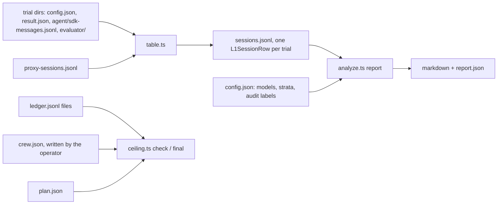

# quick/laneb/l1: probes, analysis and ceiling check for L1

Build unit U2 of the L1 superseding preregistration ([2026-11-03-geva-254-l1-overhaul-prereg-2000](../../../wiki/plans/2026-11-03-geva-254-l1-overhaul-prereg-2000/README.md), section 10). Everything here is keyless: it reads files Lane B already writes and makes no model or Capy API call.



## Pieces

| Path | What it does |
|---|---|
| `probes.ts` | Probes L and I (#169 7.6) over one SDK message log, the S13 background count, the contract hook's block, the read audit for none sessions, and the turn-cap and model-output checks. Probe L passes on a Skill call naming investigate whose base directory lies in the arm's gstack install (a task checkout's own skill never counts), or on a Read or Bash of an `investigate/SKILL.md` whose result holds the first 200 characters of the arm's installed copy. Probe I reads #169 7.2's items 1 to 4: the DEBUG REPORT with its labels, edits and the test rule. A Bash call counts as an edit through #169 7.2's write list (redirects and `tee` inside the work tree, `sed -i`, `perl -i`, `patch`, `git apply` and `git checkout` of paths), after `cd`, `env`, reserved words, subshells and `sh -c` are unwrapped. The S13 count is a background shell, agent or task still running at the final result, so a TaskStop or a kill ends it. |
| `table.ts` | Builds the per-session table from Lane B's trial directories and the proxy's session rows: arm, instrument, part, task, repository, outcome (graded, infra or cap stop, section 6), pass and adherence, both probes, S13, the read audit, the allowance and turn-cap stops, and the evidence fields. It refuses a pin whose `investigate/SKILL.md` prefix differs from the frozen digest. |
| `analyze.ts` | One entry from that table to every endpoint: B1, B3, O5 and the secondaries, both 95% intervals (by task and by repository), the sign-flip p, Holm over B1 and B3, the behavior admission, the gate reading, O5's descriptive line, the probe audit and every verdict branch. Every MDD is read from the merged `power.txt`, pinned by sha256. `audit-sample` lists the sessions the blind reader labels. |
| `ceiling.ts` | Section 9's ceiling check before each launch, with its holdback, and the final read before the results post. |

The per-session row is `L1SessionRow` in [src/types.ts](../../../src/types.ts).

## Commands

```sh
bun quick/laneb/l1/table.ts table-config.json sessions.jsonl
bun quick/laneb/l1/analyze.ts audit-sample sessions.jsonl opus > audit-sample.jsonl
bun quick/laneb/l1/analyze.ts report sessions.jsonl analysis-config.json report.json
bun quick/laneb/l1/ceiling.ts check --ledger ledger.jsonl --crew crew.json --plan plan.json --launch pilot-sol
bun quick/laneb/l1/ceiling.ts final --ledger ledger.jsonl --crew crew.json --plan plan.json --post GEVA-999
```

`ceiling.ts check` prints `CEILING PASS` and exits 0, or `CEILING REFUSE` and exits 1. Bad input exits 2 with an `E_USAGE` line, as do the other two commands.

## Inputs the operator writes

- **table-config.json**: `jobs` (`{dir, instrument, part}`, instrument one of pilot, smoke, f1, tb2), `sessions` (the runs' `proxy-sessions.jsonl` paths), `prefixes` (`{before, after}`, each pin's installed `investigate/SKILL.md`) and an optional `home`.
- **analysis-config.json**: `models` (`{id, status: run | not_run}`), `routed_stratum` (Amendment C's routed F1 tasks), `construction_checks` (true only when U1's checks and Amendment C's dry run passed), `audit` (the reader's labels, or a path to them) and, optionally, the task lists, `tb2_fit_stratum` and `dropped_by_design`.
- **crew.json**: `as_of`, `captain_credits` (the Captain's booked L1 turns) and `threads` (`{code, line: crew | sol | particle, credits, tokens, token_stop, status: open | planned | done}`), read from each L1 thread's Capy counter. The repo never calls a Capy API.
- **plan.json**: `items` (`{item, cap_usd, status: planned | open | done}`, each cap equal to the ledger's) and `leftover` (`{sol, particle}`, each pending, done or refused).

## The ceiling sum

```text
items     every plan item: settled + open reserved, or its cap while it is not done
spent     items + every L1 thread's credits / 1000 + the Captain's booked credits / 1000
holdback  max($400 - crew spend, unspent token stops of open and planned crew threads x measured $ per token)
          + max(0, $40 - Captain spend)
          + max(0, $15 - run-work spend) for Sol and for particle-1 while each is pending
total     spent + holdback; check refuses a launch when total passes $2,000 or another item holds open reservations
```

The measured rate is all L1 thread credits over all L1 thread tokens, or $0.45 per million before any reading. The final read leaves the post thread out of the holdback and prints the largest token stop it can have, so the all-in figure, the Captain and run-work remainders, the other open threads' stops and the post's stop at the measured rate stay at or under $2,000.

## Known gap: per-session hook evidence

Lane B's SDK log carries neither the route hook's line (a UserPromptSubmit hook's context reaches only the API request) nor the contract hook's record file. The contract hook's block does show, as a "Stop hook feedback" user message, and `probes.ts` reads it. `route_hook`, `contract_record` and `contract_check_met` come from `evaluator/l1-evidence.json` when the harness writes it, in the shape `{"route_hook": bool, "contract_record": bool, "contract_check_met": bool | null}`. Until a harness change writes that file, the fields are null, an unrecorded hook counts as not fired, and B1's and B3's exposure steps read FIX-METHOD (exposure).

## Tests

```sh
bun test quick/laneb/tests/l1-probes.test.ts quick/laneb/tests/l1-table.test.ts quick/laneb/tests/l1-analyze.test.ts quick/laneb/tests/l1-ceiling.test.ts
```

The probe fixtures `cli-skill-bg.jsonl` and `cli-kill-agent.jsonl` are sanitized logs of the real Claude Code 2.1.312 under the pinned Agent SDK against a fake upstream. The analysis tests use `tests/fixtures/l1/synthetic.ts`.
