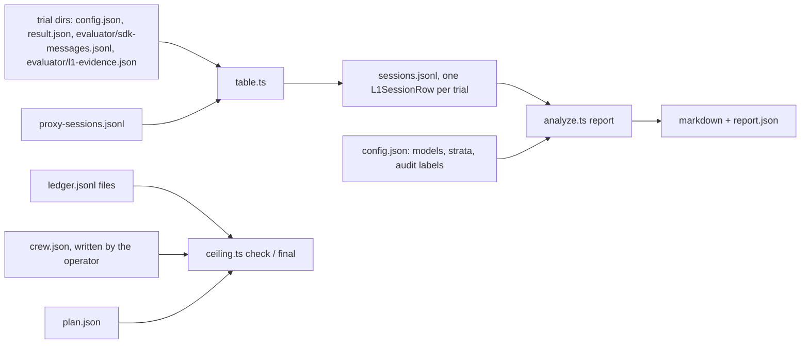

# quick/laneb/l1: probes, analysis and ceiling check for L1

Build unit U2 of the L1 superseding preregistration ([2026-11-03-geva-254-l1-overhaul-prereg-2000](../../../wiki/plans/2026-11-03-geva-254-l1-overhaul-prereg-2000/README.md), section 10). Everything here is keyless: it reads files Lane B already writes and makes no model or Capy API call.



## Pieces

| Path | What it does |
|---|---|
| `probes.ts` | Probes L and I (#169 7.6) over one SDK message log, the S13 background count, the contract hook's block, the read audit for none sessions, and the turn-cap and model-output checks. Probe L passes on a Skill call naming investigate whose base directory lies in the arm's gstack install (a task checkout's own skill never counts), or on a Read or Bash of an `investigate/SKILL.md` whose result holds the first 200 characters of the arm's installed copy. Probe I reads #169 7.2's items 1 to 4: the DEBUG REPORT with its labels, edits and the test rule. A Bash call counts as an edit through #169 7.2's write list (redirects and `tee` inside the work tree, `sed -i`, `perl -i`, `patch`, `git apply` and `git checkout` of paths), after `cd`, `env`, reserved words, subshells and `sh -c` are unwrapped. The S13 count is a background shell, agent or task still running at the final result, so a TaskStop or a kill ends it. |
| `table.ts` | Builds the per-session table from Lane B's trial directories and the proxy's session rows: arm, instrument, part, task, repository, outcome (graded, infra or cap stop, section 6), pass and adherence, both probes, S13, the read audit, the allowance and turn-cap stops, and the evidence fields. It refuses a pin whose `investigate/SKILL.md` prefix differs from the frozen digest, and stamps each row with the sha256 of the `probes.ts` that scored it. |
| `analyze.ts` | One entry from that table to every endpoint: B1 (also on the routed stratum), B3, O5 and the secondaries, each under #169 7.5's coverage rule, both 95% intervals (by task and by repository), the sign-flip p, Holm over B1 and B3, the behavior admission, the gate reading, O5's descriptive line, the probe audit and every verdict branch. Every MDD is read from the merged `power.txt`, pinned by sha256. `audit-sample` lists the sessions the blind reader labels. It refuses a table whose rows were scored by another `probes.ts`. |
| `ceiling.ts` | Section 9's ceiling check before each launch, with its holdback, and the final read before the results post. A crew file or plan with a missing, negative or non-numeric amount, or an unknown line or status, exits 2 instead of passing, and so do a missing ledger file and a done item with no ledger rows. |

The per-session row is `L1SessionRow` in [src/types.ts](../../../src/types.ts).

## Commands

```sh
bun quick/laneb/l1/table.ts table-config.json sessions.jsonl
bun quick/laneb/l1/analyze.ts audit-sample sessions.jsonl claude-opus-5-5 > audit-sample.jsonl
bun quick/laneb/l1/analyze.ts report sessions.jsonl analysis-config.json report.json
bun quick/laneb/l1/ceiling.ts check --ledger ledger.jsonl --crew crew.json --plan plan.json --launch pilot-sol
bun quick/laneb/l1/ceiling.ts final --ledger ledger.jsonl --crew crew.json --plan plan.json --post GEVA-999
```

`audit-sample` and the config's `models` take the model id exactly as the rows carry it, which is the cell's `upstream_model` (for example `claude-opus-5-5`); any other id gives an empty sample. `ceiling.ts check` prints `CEILING PASS` and exits 0, or `CEILING REFUSE` and exits 1. Bad input exits 2 with an `E_USAGE` line, as do the other two commands.

## Inputs the operator writes

- **table-config.json**: `jobs` (`{dir, instrument, part}`, instrument one of pilot, smoke, f1, tb2), `sessions` (the runs' `proxy-sessions.jsonl` paths), `prefixes` (`{before, after}`, each pin's installed `investigate/SKILL.md`) and an optional `home`.
- **analysis-config.json**: `models` (`{id, status: run | not_run}`), `routed_stratum` (Amendment C's routed F1 tasks), `construction_checks` (true only when U1's checks and Amendment C's dry run passed), `audit` (the reader's labels, or a path to them) and, optionally, the task lists, `tb2_fit_stratum` and `dropped_by_design`.
- **crew.json**: `as_of`, `captain_credits` (the Captain's booked L1 turns) and `threads` (`{code, line: crew | sol | particle, credits, tokens, token_stop, status: open | planned | done}`), read from each L1 thread's Capy counter. The repo never calls a Capy API.
- **plan.json**: `items` (`{item, cap_usd, status: planned | open | done}`, each cap equal to the ledger's) and `leftover` (`{sol, particle}`, each pending, done or refused).

## The ceiling sum

```text
items     every plan item: settled + open reserved, or its cap while it is not done
spent     items + every L1 thread's credits / 1000 + the Captain's booked credits / 1000
holdback  max($400 - crew spend, unspent token stops of open and planned L1 threads x measured $ per token)
          + max(0, $40 - Captain spend)
          + max(0, $15 - run-work spend) for Sol and for particle-1 while each is pending
total     spent + holdback; check refuses a launch when total passes $2,000 or any item, its own included, holds open reservations
```

The measured rate is all L1 thread credits over all L1 thread tokens, or $0.45 per million before any reading. The final read leaves the post thread out of the holdback and prints the largest token stop it can have, so the all-in figure, the Captain and run-work remainders, the other open threads' stops and the post's stop at the measured rate stay at or under $2,000.

A part whose VM dies leaves open reserves that never settle: the proxy's sessions file died with the VM, so `ledger.ts reconcile` leaves them open, and the check refuses every launch. Once ubi-runner shows the VM gone, the operator settles each of that part's open reserves at its full reserved amount with `bun quick/laneb/runner/ledger.ts settle --path <ledger> --item <item> --id <id> --usd <reserved amount> --detail <the dead VM>`, then runs the check for the part's one relaunch. Settling at full charges the cap what the open reserve did, so no cap moves, and the measured cost of those sessions is reported as an upper bound. The L1 launcher (U1) enforces the one relaunch.

## Known gap: per-session hook evidence

Lane B's SDK log carries neither the route hook's line (a UserPromptSubmit hook's context reaches only the API request) nor the contract hook's record file. The contract hook's block does show, as a "Stop hook feedback" user message, and `probes.ts` reads it. `route_hook`, `contract_record` and `contract_check_met` come from `evaluator/l1-evidence.json` when the harness writes it, in the shape `{"route_hook": bool, "contract_record": bool, "contract_check_met": bool | null}`. Until a harness change writes that file, the fields are null, an unrecorded hook counts as not fired, and B1's and B3's exposure steps read FIX-METHOD (exposure).

## Tests

```sh
bun test quick/laneb/tests/l1-probes.test.ts quick/laneb/tests/l1-table.test.ts quick/laneb/tests/l1-analyze.test.ts quick/laneb/tests/l1-ceiling.test.ts
```

The probe fixtures `cli-skill-bg.jsonl` and `cli-kill-agent.jsonl` are sanitized logs of the real Claude Code 2.1.312 under the pinned Agent SDK against a fake upstream. The analysis tests use `tests/fixtures/l1/synthetic.ts`.

## L1 launcher

`l1.ts` runs one L1 item (prereg [2026-11-03-geva-254-l1-overhaul-prereg-2000](../../../wiki/plans/2026-11-03-geva-254-l1-overhaul-prereg-2000/README.md), sections 3, 6, 9 and 10) as a set of parts, one after another. Each part is one detached launch of `runner/launch.sh` on an awake host. The waiting agent never runs a controller. It attaches on a timer.

### The awake host

- Type: a dedicated Ubicloud `standard-2` VM made by the pinned `ubi-runner.sh` (`UBI_RUNNER`, checked against `UBI_RUNNER_SHA256` on the agent and again on the host). It is tagged with `UBI_OWNER`, the run thread's code, and has a recovery bundle in `UBI_RECOVERY_DIR`.
- TTL: (parts + 1) x 18 h + 24 h. That is every part and one relaunch at the part VM TTL (16 h) plus 2 h, and a day of slack: 60 h for pilot-opus, 78 h for tb2-opus, 114 h for f1-opus.
- Hours on a ledger item: before the host starts, `host-up` reserves its whole TTL at $0.08 an hour on the item's own ledger as `host-<n>` ($4.80, $6.24 and $9.12). A refusal is a cap stop (exit 9, stderr `CAP_STOP`) and no host starts. `host-down` and `recover` settle it at the hours it was up. If `host-up` fails after the host starts and the host can't be destroyed, the host stays current with its reserve open: `attach` prints `NEXT: host-down (cleanup of a failed host-up is pending)`, `host-up`, `launch`, `relaunch` and `recover` refuse, and `host-down` retries the destroy and settles the hours on the agent's ledger, which never moved. The list price of `standard-2` is $41.89 a month, about $0.057 an hour.
- The ledger: `host-up` moves the item's single ledger file, with its `.bound`, onto the host (`~/l1/ledger/<item>.jsonl`). While the host is up, the agent's copy is gone, a pointer (`<ledger>.host.json`) names the host, and the agent keeps an append-only mirror in `<work>/host/ledger.jsonl`. `host-down` brings the file home.
- What runs there: `host.sh` (one per part, started with `setsid -f`) runs `launch.sh` with the ledger service and the tunnel. Keys sit in `~/.l1-secrets` (mode 0600), never in argv. `host-bootstrap.sh` installs Bun 1.4.4 checked by sha256 and the tools `ubi-runner` needs. The host runs no Docker and no trial.

### Commands

Set `LEDGER` (the item's ledger file, with its approval row at the item's cap), `ARMS` (the folder with `none`, `before`, `after` and `off` tars), `UBI_RUNNER`, `UBI_RUNNER_SHA256`, `UBI_OWNER`, `UBI_RECOVERY_DIR` (on Capy, a private drive folder) and the provider and Ubicloud keys. tb2-opus also needs `TB2_PARTS` and `TB2_PARTS_SHA256` (Amendment C's split and digest).

```
bun quick/laneb/l1/l1.ts prepare <work> --item pilot-opus|f1-opus|tb2-opus
bun quick/laneb/l1/l1.ts host-up <work>
bun quick/laneb/l1/l1.ts launch <work> --part <part>
bun quick/laneb/l1/l1.ts attach <work>             # on a timer; prints NEXT
bun quick/laneb/l1/l1.ts relaunch <work> --part <part>
bun quick/laneb/l1/l1.ts recover <work>            # only after attach prints HOST_LOST
bun quick/laneb/l1/l1.ts host-down <work>
```

- `prepare` checks the frozen inputs by sha256, writes `plan.json` (run id, parts, seeded order, inputs, git head, host TTL) and one run dir per part. Each rectangle of a part is its own Harbor job (`job.json`, `job-2.json`), run one after another by `vm-run.sh`. Arms that share a tar (`tar=before`) share one copy and one manifest.
- `launch` binds the run on the item at the first launch, syncs the part and starts its controller. It refuses a part whose earlier parts have not finished, any part once the item has ended (below), and a part after a loss that has not had its relaunch. Before it starts a part, it salvages any earlier part whose launch.sh exited 7 and has no salvage yet (a relaunch has no relaunch of its own) and classifies that part again from what the salvage pulled.
- `attach` mirrors the ledger, copies the part VMs' recovery bundles, records a part VM and its controller's start time in `<part>.launch.json` when the VM came up after `launch` stopped waiting, pulls a finished part and classifies it (`<part>.result.json`). `host-status` carries each part's `vm-cap-stop` text, launch.sh's record of a refused VM block, so a failed pull can't hide one. A look is a miss only when the host answers neither `host-status` nor a bare ssh. A host that misses 3 looks over 10 minutes or more is lost (exit 5).
- `relaunch` runs once per part, only after a loss (section 6). A controller is lost when it recorded no exit and no process is left in host.sh's session. A lost controller is salvaged first, by a detached `host-salvage` that `relaunch` polls through `host-status`: the batch stops, results are pulled, the leftover ledger service stops, sessions reconcile and the VM's blocks settle. A part whose launch.sh exited 7 keeps its VM, so `relaunch`, `launch` (for an earlier part) and `host-down` salvage it the same way first. After a salvage the part is classified again from what the salvage pulled, so a cap stop the first pull missed still ends the item. When neither launch.sh nor a salvage could pull a part's records, a refused session reserve leaves no trace, so a cap stop counts as possible, and ends the item, if the item's ledger came within one session cap of its cap while the part ran. When the controller never logged its VM, salvage uses the one recovery bundle on the host written since the controller started that no other part names. The relaunch holds only the cells that never started. A cell started once the item's ledger accepted a reserve for one of its sessions. A cap stop is never relaunched. A part that ended early with no loss is infra and is not relaunched.
- `recover` refuses while the host answers ssh. It runs `ubi-runner recover` first and destroys nothing if the part VM still has no local state after it, then confirms the host gone, stops and pulls the running part's VM through its recovery bundle, and rebuilds the rows the mirror lacks from the part VM's records (each marked `recovered`). Then `host-up` starts a new host and `relaunch` continues. When `<part>.launch.json` names no VM, `recover` uses the one recovery bundle copied since the part launched that no host and no part names. If there is none or more than one, the part VM is unknown. If the part VM is unknown or its records are lost too, the item ends incomplete (exit 4) and goes to the Captain. So does a part VM that `ubi-runner recover` reports gone (`RECOVER_GONE`), since its records are lost. The runner reports that once and drops the bundle, so `recover` keeps it in `host/part-vm-gone.json` for a rerun after a refusal. A lost host takes launch.sh's `vm-cap-stop` with it, so `recover` always runs the ledger check: a cap stop counts as possible, and ends the item, if the item's ledger came within one session cap of its cap while the part ran. A VM block ($2.40) is under each item's session cap, so the check covers a refused block. When the running part's result ends the item, `recover` prints `NEXT: none` and exits 4. The accounting is complete only when every session the part opened (a `session_open` in its proxy log, or a session reserve on the mirror) has a closed record and no line of either file is unreadable. Otherwise `recover` keeps each open session's reserve at its cap, names the missing sessions in `host/recover.json` (`missing_sessions`) and ends the item incomplete (exit 4). `host-up` refuses while UBI_RECOVERY_KEY is set, because the host seals part-VM bundles with UBICLOUD_API_KEY.
- `host-down` refuses while a part has not finished or any part's VM reserve is open. Before it destroys the host it brings every part's results home: a salvaged part is classified again, and the files pulled onto the host must match the copy at home by path and size. If a pull fails or the copies differ, it refuses (exit 3) and the host stays up.
- The item has ended once `recover` ended incomplete (`host/recover.json` has `complete: false`), a part ended at a cap stop, or a part ended in a way the prereg does not class (`unclassified` in its result). The one such ending today is vm-run.sh's exit 4: the ledger service did not answer through the tunnel before any trial, and Amendment C must class it. Then `host-up`, `launch` and `relaunch` refuse (exit 3), and `attach` says the item ended incomplete and goes to the Captain. After a cap stop or an unclassified ending, `host-down` still runs.

Exit codes: 0 ok, 2 usage, 3 refused, 4 the item stops incomplete, 5 the host is lost, 9 the ledger refused the host's reserve, 1 anything else. Stderr lines start with a registered code: `E_USAGE` for a bad call or a refusal, `CAP_STOP` for the host's refused reserve, `E_INTERNAL` for anything else.

### Amendment C's dry run

The dry run kills the host, not just the controller: it stops the VM mid-part, then runs `attach` until `HOST_LOST`, `recover`, `host-up` and `relaunch`. `tests/l1-host.test.ts` drives the same path keylessly on a fake host and fake part VMs, with the real `host.sh`, `launch.sh` and ledger service.

### Not in this unit

Per-session hook evidence (route hook fired, contract record written, contract check met) needs a change to the agent's teardown and is not captured here.
