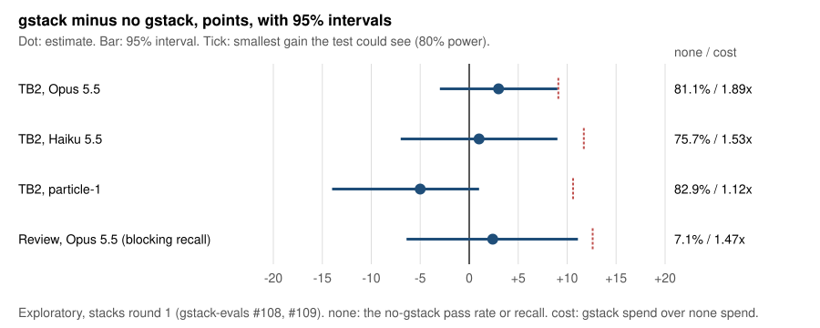

# Exploratory, one model: on Terminal-Bench 2 and on a development-only code-review suite, gstack showed no gain we could detect over plain Opus 5.5 (+3 points, 95% CI -3 to +9, from an 81.1% control; +2.4, CI -6.4 to +11.1, from 7.1%), where the tests could have seen gains of about 9.1 and 12.6 points, at 1.5 to 1.9 times the cost

**Publication status: unpublished, not posted anywhere.** Still blocking: GST-618 (the repo stays private until it closes); the publish audit (thread codes, machine and drive paths); public trial bundles for #108 and #109, with the digests below and the TB2 pilot ledger; a direct-key path to rerun one cell; a clean-machine rerun of this analysis by another Captain's crew; Garry's answer on disclosures (decision H); and a check of gbrain's visibility and licence, because the review suite includes gbrain PRs. Done: every number rerun from the handoff bundles on a clean checkout, and the cross-family claim check by GPT-6 Astra (see Claim check).

| Record | Value |
|---|---|
| Grade | Exploratory. Stacks round 1 is exploratory by its preregistration, and the scorer calls the review suite development-only. One harness, told invocation. |
| Numbers from | Analysis rig 715f837c353700344785e2ae2c721e8195d616cd; results posts #108 (ecf485e) and #109 (4951211); this post's scripts at its merge commit |
| Preregistration | #95 at af60b9e (wiki/plans/2026-10-31-geva-76-stacks-round-1-prereg), version 2 #104 at dbcccdd, amendment #105 at 5b9d8c1 |
| Data | Not yet public. Archives by sha256: review-data.tar.gz cfa9ea1781fb3414be8617882e5279398a72391883f4b4bea2bcf3e356064190; r1-pulled.tar.gz e00fccf8c1839331633c9e14fcaad0702c9a12c7202cd9fda45d23b78d850997; r2-pulled.tar.gz 9ecc644b7d0ed6939733ba6c244a9e213325197b53f654eee3bb406bb46066ce; runner-export.tar.gz fc75356babe7036a0ca231e1ba11c7112f08124cb1eccb0717120f2712a425bc; scripts.tar.gz 5d38b9f5d4876590c319db2a30cb08c4aef91440af9ab5ffde0536e27d9c166e; geva93-tb2-data.tar.gz 620064e3f1327a899b3c2dfef1b3116f522570c7766b04a721852f750a2dd0d0 |
| Authors | Runs: GEVA-89 (review, TB2 replicate 1) and GEVA-93 (TB2 replicates 2 and 3). Why-null cycle: GEVA-100. This file and its reanalysis: GEVA-105. |
| Reviewed by | openai/gpt-6-astra (reasoning high), claim check against the data on 2026-11-01. Round 1 failed five checks and raised two issues in the decision post; this version fixes them. Round 2 rechecked every fix and the new test, reproduced the cross-fitted row (MDD 33.3, p 0.453), and asked for two more wording fixes, made here as written. No third round. |
| Reproduced by | Pending: another Captain's crew, from a clean machine |
| Disclosures | gstack is Garry Tan's own open-source skill pack, and the agents that ran this work for him. pstack (Lauren Tan) and tstack (Theo Browne) ran as published at pinned commits; their authors had no part and were not contacted. Disclosure: Y Combinator, which Garry Tan runs, is an investor in Particle, which makes particle-1. Any tie between Garry or YC and Anthropic (maker of a tested model) or OpenAI (maker of a judge): pending until GST-874 is answered. |



## What we found

We told Claude Code to use gstack's skills and compared it with the same model and harness with no gstack. On Opus 5.5, gstack's /investigate passed 83.8% of 37 Terminal-Bench 2 (TB2) tasks against 81.1% with no gstack, at $0.33 against $0.18 per success. gstack's /review caught 9.5% of 42 blocking bugs in 26 pull requests against 7.1%, for 47% more dollars. Neither gain is one we could detect: the tests could have seen gains of about 9.1 and 12.6 points with 80% power, and both intervals include zero.

So the honest reading is "no detectable gain, and these suites can't tell". TB2 sits near a ceiling (Opus alone passes 81%) and review near a floor (Opus alone catches 7% of blocking bugs). In both, Opus read the skill's text and then skipped most of its procedure.

## How it works (our explanation, not a result)

- **The procedure mostly didn't run.** The skill body loaded in every session, but Opus 5.5 treated the procedure as optional. In review it dispatched no specialist reviewer and ran no adversarial pass in 66 of 66 sessions. On TB2 it wrote /investigate's debug report in 0 of 111 trials. What was compared is the skill text as a primer for Opus's own work, plus gstack's output format.
- **Little room to gain.** On TB2, Opus with no gstack passed 3 of 3 on 28 of 37 tasks. Of its 21 failures, 12 were on tasks no Opus arm solved in any analysed trial (the nine batches r1-opus, r1-haiku, r1-particle-b, r2x-opus-b, r2x-haiku, r2x-particle, r3-opus, r3-haiku and r3-particle; not the lost replicate 2 or the pilot), so 9 (8.1 points) were on tasks some Opus arm solved, fewer than the 9.1 points the test needed. That is an observed count, not a bound: a task no analysed trial solved may still be solvable. On review, both arms miss more than 90% of blocking bugs.
- **The cost is the added text.** gstack adds 13.7k tokens to each TB2 trial's first request and 25.6k to each review session's. At the metering proxy's prices, 62% of gstack's extra Opus cost per TB2 trial was cache writes, 20% cache reads and 18% output. On review, re-reading the added text on every request accounts for about 64% of gstack's extra tokens (25.6k times 17.8 requests is 0.46M of the 0.71M extra per session).

## Setup

- **Question.** Does a told gstack skill raise Opus 5.5's pass rate (TB2) or blocking-bug recall (review) over no gstack, and at what cost? Cheaper rungs (Haiku 5.5, particle-1) are secondary.
- **Arms.** none (no gstack installed, plain prompt); gstack, told /investigate on TB2 (gstack 61e201e, v1.91.295.0) and /review on review (gstack 53522b1, v1.91.342.0); gstack-placebo on TB2 for Haiku and particle-1 (length-matched prose with no procedure); pstack (Lauren Tan's, told /pstack:poteto-mode) and pstack-placebo on TB2; tstack (Theo Browne's) on review. This file reports gstack against none; #108 and #109 report the other stacks.
- **Models.** claude-opus-5-5 and claude-haiku-5-5 on Anthropic's API; particle-1 as particle-ai/particle-1 on OpenRouter. The route of every session is in the proxy files in the bundles.
- **Harness.** Claude Code with CLAUDE_CODE_DISABLE_BUNDLED_SKILLS=1 in every arm: 2.1.314 on review, as the rig's docker/trial.Dockerfile at 715f837 pins it beside the TypeScript Agent SDK 0.3.314 (amendment #105 says the same), and 2.1.312 on TB2, which ran in Harbor f3a5a923 with claude-agent-sdk 0.2.174. The doctor and plugin-authoring skills were still listed in every arm, none included (GEVA-109).
- **System prompt (verified): the Claude Agent SDK's default, not Claude Code's.** Neither the review driver (src/adapters/claude-code/driver.ts) nor Lane B's TB2 agent sets a system prompt, so the SDK passes an empty one (claude-agent-sdk 0.2.174 as --system-prompt "", the review driver's TypeScript SDK in its initialize request). Claude Code then sends a billing header and the SDK's stub, "You are a Claude agent, built on Anthropic's Claude Agent SDK.", and leaves out its own guidance block (about 1.9k tokens). Tools, the environment turn and the skill listing still arrive. Both lanes ran this way, the same way in every arm. GEVA-109 verified it on 2026-11-01 at $0 from the code and pins, from each pinned SDK driving the real pinned CLI against a recording fake upstream, and from the recorded traffic: on their first request, 196 of 198 Opus review sessions and 952 of 989 Anthropic TB2 sessions read exactly the cached prefix of tools plus those two short blocks, and the rest had a cold cache. Evidence: the Captain drive's handoffs/GEVA-109/sp-verify/README.md and the org drive's research/sdk-system-prompt-note.md.
- **TB2 tasks.** 40 tasks from quick look 3 (quick/laneb/tasks/final.json, sha256 9ccfec13f01c150f4ec838e19285375a1f034522c1a069c0ee83d75d12dd56d9, at the tag laneb-stacks-1-runner), TB2 at 69671fbaac6d67a7ef0dfec016cc38a64ef7a77c. Three tasks left the grid under the frozen oracle rule (crack-7z-hash, adaptive-rejection-sampler, largest-eigenval), so 37 are graded. Each task has its own agent time limit. Three replicates, 111 trials a cell, 1,443 trials in all, all run on 2026-11-01 UTC.
- **Review suite.** stacks-r1 from #95: 33 units (27 blocking, 6 over-blocking), 42 blocking bugs on 26 merged PRs (gstack and gbrain), sha256 4f46bb17b7ef98a34db9bf4b03c69755c694eb17dfc7ca0e29e1049a1bcc9a1d. Opus arms ran two passes, 66 unit-passes an arm.
- **Judges (review).** Opus 5.5 primary, gpt-6.1-sol second, Sonnet 5.5 third, blind to arm, on the match brief with sha256 ef33d5ca0f802e49e18d1f3e4b16f989bcbd48fa4c46f339bc0533dfb1364427. The second judge agreed on 33 blockers at kappa 0.9832. No human spot check.
- **Generation settings and snapshots.** The TB2 agent sets only the model, the permission mode and a 200-turn ceiling, so sampling follows Claude Code's defaults. The review lane's settings are not restated here. The model ids are undated aliases, so the run date (2026-11-01) stands in for a snapshot date.
- **Statistics.** TB2: paired by task, task-clustered bootstrap, 10,000 resamples, seed 20261031. Review: the no-loss scorer's paired-by-blocker test, clustered by PR, seed 20261031. The smallest detectable difference (MDD) is 2.8 times the paired standard error (two-sided 0.05, 80% power): task-level on TB2, cluster-robust by PR on review.

## Result

### Primary readings, verbatim from the scorers

TB2 (stacks-tb2.ts at 715f837, all tasks, no-reward trials after a model response scored 0):

```
| claude-opus-5-5 | gstack - none | 37 | +3 [-3, +9] |
| claude-haiku-5-5 | gstack - none | 37 | +1 [-7, +9] |
| particle-1 | gstack - none | 37 | -5 [-14, +1] |
```

Review (noloss score at 715f837):

```
gstack-opus vs none-opus at a 10-point margin (Stacks round 1 plan (wiki/plans/2026-10-30-geva-59-stacks-round-1-plan, section 7): 10 points of blocking recall, the review no-loss lane's margin): non-inferior within 10 points (NO_LOSS). Blocking recall 9.5% vs 7.1%, delta 2.4 points [95% CI -6.4, 11.1]; 3 losses, 5 gains on 42 blockers in 26 PRs (8 discordant). p non-inferior 0.0081 (Holm 0.027 over 5), p loss 0.781 (minimum reachable 0.0039).
size rule: below, an arm as good as the reference gets NO_LOSS in 71.4% of 2000 simulations (spread wide, recall 0.071, seed 20261031, no-loss alpha 0.05/5, Holm's strictest step).
claim "non-inferior within 10 points of blocking recall": may not be made: below the size rule: power 0.7135 is under 0.8; suite stacks-r1 is development-only: it ranks variants but cannot confirm a release on its own.
verdict: NO_LOSS NOLOSS_UNDERPOWERED
```

The review scorer forbids the no-loss claim, so this file makes none: it does not say gstack's review is no worse than plain Opus.

### The table

| Suite, model | none | gstack | gstack - none [95% CI] | MDD (80% power) | Spend, none / gstack | Per success, none / gstack |
|---|---|---|---|---|---|---|
| TB2, Opus 5.5 | 90/111, 81.1% | 93/111, 83.8% | +3 [-3, +9] | 9.1 | $16.12 / $30.50 (1.89x) | $0.179 / $0.328 |
| TB2, Haiku 5.5 | 84/111, 75.7% | 85/111, 76.6% | +1 [-7, +9] | 11.7 | $0.98 / $1.50 (1.53x) | $0.012 / $0.018 |
| TB2, particle-1 | 92/111, 82.9% | 86/111, 77.5% | -5 [-14, +1] | 10.6 | $8.04 / $9.01 (1.12x) | $0.087 / $0.105 |
| Review, Opus 5.5, blocking recall | 6/84, 7.1% | 8/84, 9.5% | +2.4 [-6.4, +11.1] | 12.6 | $45.51 / $66.99 (1.47x) | $7.59 / $8.37 per blocking find (11.6M / 14.5M tokens) |

Units: TB2 counts trials (37 tasks times 3 replicates); review counts blocker-passes (42 blocking bugs times 2 passes).

### Secondary readings (labelled; none was the primary)

- **Review at any severity:** 24/84 (28.6%) against 20/84 (23.8%), +4.8 points, MDD 16.2. Both arms find bugs and then label about two thirds of them non-blocking (gstack 16 of 24 finds, none 14 of 20). Under the judges' own impact rating gstack reaches 26.2% and none 23.8% (#108 section 5), still no gap.
- **The placebo on the cheaper rungs (not preregistered).** gstack minus placebo: Haiku +5.4 points, particle-1 +4.5 (raw rates). Placebo minus none: Haiku -4.5, particle-1 -9.9 (the runner tag's analyze.ts gives -10 [-18, -2] on particle-1). So on particle-1 the added text alone may cost passes, and the procedure wins some back.
- **Spread between replicates.** Opus none passed 78.4%, 81.1% and 83.8% in replicates 1 to 3, and gstack 81.1%, 86.5% and 83.8%. particle-1 gstack ranged from 70.3% to 89.2%. One replicate is not enough to confirm or refute a few points.

### Reanalysis by task difficulty and of the timeouts ($0, exploratory, post hoc)

Run on 2026-11-01 for this file with item0.py (attached). It answers two questions from the insight plan's item 0. Every stratum we defined is reported; none was picked after seeing its result.

**Does gstack lift Opus on the hard tasks?** We split TB2 by how hard each task was for Opus with no gstack. Splitting on the same none trials that the contrast uses biases the hard stratum's lift upward, because tasks land there partly by none's bad luck. So the main split is cross-fitted: in each replicate, a task counts as hard when none failed at least one of the other two replicates. Two splits use only outside information: the public TB2 leaderboard's frontier solve rate (below the median of these 37 tasks, 0.884) and TB2's own difficulty label.

| Opus 5.5, hard stratum | Tasks | Paired trials | none | gstack | gstack - none [95% CI] | Tasks that differ | Swap-test p | MDD |
|---|---|---|---|---|---|---|---|---|
| Cross-fitted on none (main) | 9 | 25 | 24.0% | 36.0% | +12.0 [-8.0, +34.6] | 3 | 0.45 | 33.3 |
| Leaderboard frontier rate below the median | 16 | 48 | 56.2% | 62.5% | +6.2 [-8.3, +20.8] | 7 | 0.59 | 21.2 |
| TB2 label "hard" | 10 | 30 | 73.3% | 86.7% | +13.3 [+0.0, +33.3] | 2 | 0.50 | 24.9 |
| In-sample on none (biased upward, descriptive only) | 9 | 27 | 22.2% | 40.7% | +18.5 [+0.0, +40.7] | 5 | 0.33 | 31.5 |

The interval is a task-clustered percentile bootstrap (10,000 resamples, seed 20261031). The p-value comes from a permutation test that swaps the two arms' results within a task and recomputes the stratum each time, so it stays valid when the stratum is chosen from the none arm. The MDD is a normal approximation from a cluster-robust standard error, not a measured power.

On the easy side no split shows a detectable difference (cross-fitted 97.7% against 97.7%; leaderboard easy half 100% against 100%; TB2 easy or medium -1.2 [-6.2, +3.7]). So under the cross-fitted and leaderboard splits all of gstack's net +3 on Opus sits on the harder tasks, but it rests on 2 to 7 tasks that differ, no test comes near significance, and the hard strata could only have seen gains of about 21 to 33 points. On Haiku and particle-1 the cross-fitted hard strata read +3.0 [-28.1, +29.4] and -7.7 [-29.2, +7.4]. A percentile interval that ends at exactly +0.0 means every task that differed favored gstack; the swap test, which accounts for how few they are, is the one to read.

The answer: these 37 tasks can't tell whether gstack helps Opus on hard tasks. Five of the nine hard tasks were solved by at least one Opus arm in the analysed trials; the other four may still be solvable. Settling it needs new tasks where Opus with no gstack passes 20% to 80% of the time (GEVA-100 sizes it at about 70 tasks).

**Were gstack's 6 Opus timeouts tasks it was solving slowly?** Four of the six timeout trials passed; whether more time would have rescued the two failures is unknown. Each task has its own agent limit (12.5 or 15 minutes for these four tasks; #109 and an earlier draft of this file called it a 30-minute limit, which is the task-selection cap).

| Task, replicate | Limit | Reward | What happened |
|---|---|---|---|
| model-extraction-relu-logits, 1 | 15 min | 0 | The model ended its last turn at minute 3.0 with a background task still running; the trial then sat until the limit. |
| query-optimize, 1 | 15 min | 1 | Ended its last turn at minute 5.3, background task still running. |
| overfull-hbox, 3 | 12.5 min | 0 | Ended its last turn at minute 9.6, background task still running. |
| overfull-hbox, 1 | 12.5 min | 1 | Ended its last turn at minute 10.0, background task still running. |
| torch-pipeline-parallelism, 1 | 15 min | 1 | Cut off mid-turn while running tests; its solution already passed. |
| torch-pipeline-parallelism, 3 | 15 min | 1 | Cut off mid-turn while running tests; its last file edit was at minute 2.8. |

In four of the six, Opus had ended its turn and a background task it had started kept the trial open until the limit. In the other two, Opus was still testing a solution that already passed. Four of the six passed; whether more time would have rescued the other two was not tested. The none arm solved torch-pipeline-parallelism in all 3 replicates, each session under a minute. So the timeouts cost time and money; on these four tasks gstack passed 10 of 12 and none 8 of 12. By #109's count, 5 Opus gstack trials ended with a background task still running, against 0 for none.

## Cost

| | TB2 Opus none | TB2 Opus gstack | Review Opus none | Review Opus gstack |
|---|---|---|---|---|
| Dollars | $16.12 | $30.50 | $45.51 | $66.99 |
| Per trial or unit-pass | $0.145 | $0.275 | $0.690 | $1.015 |
| Per success | $0.179 | $0.328 | $7.59 and 11.6M tokens per blocking find (6 finds) | $8.37 and 14.5M tokens per blocking find (8 finds) |
| Mean tokens per trial or unit-pass | 160k | 309k | 1.05M | 1.76M |

Dollars are metered per session by the rig's proxy and priced with the table in each batch's proxy.json, used for every trial on 2026-11-01 (dollars per million tokens). Opus 5.5: input 4, output 20, cache write 5 (5 minutes) or 8 (1 hour), cache read 0.2. Haiku 5.5: input 0.1, output 0.5, cache write 0.125, cache read 0.01 (five times that over 100k prompt tokens). particle-1: input 0.25, output 1, cache write 0.25, cache read 0.03. Cache reads and writes are counted apart from input. Haiku and particle-1 spend is in the table above.

Totals: TB2 spent $165.36 (pilot $9.07, the nine analysed batches $131.63, and a replicate 2 lost to a machine outage, $24.66, reported and not analysed). Review spent $184.84 (pilots $7.31, grids $173.18, judging $4.35); the Opus none and gstack arms are $112.50 of it.

## Why null? (R48)

The Why-null cycle is GEVA-100's (report at the Captain drive's reports/GEVA-100.md); its counts reproduce from the bundles.

A possible cause of both exposure findings below: the sessions ran without Claude Code's own system prompt (verified by GEVA-109; see Setup). So Opus skipped the procedure in a setting it doesn't normally run in, and the exposure rates may differ with Claude Code's system prompt in place. Item 2 (GEVA-106) tests the system prompt as a factor.

**Review (#108): FIX-METHOD.**
- Exposure: the body loaded in 66 of 66 sessions (first-request context median 60,027 tokens against 34,415; the smallest gstack session is above the largest none). No session made an Agent call, so no specialist and no adversarial subagent ran (0 of 66), and none ran a gstack helper (0 of 66, a text match on tool input; the same match counts 1 of 66 sessions in the none arm, which had no gstack installed). In 48 of 66 replies Opus says it skipped the specialists, the adversarial pass or the full procedure (a text match).
- Task fit: good. Pre-landing review of a PR diff is what /review is for.
- Power and floor: none at 7.1%; MDD 12.6 points; the scorer's size rule gives power 0.71.
- Frontier without it: plain Opus already searched outside the diff in 66 of 66 sessions, ran a scratch repro in 54 and the project's tests in 49.
- Next step: a blind re-judge of the full /ship review's findings on the 14-PR cohort (about $5, cap $40), then a full-procedure /review arm that requires specialists to run (about $300 to $350, cap $400). Kill rule set now: if the full procedure finds no more blocking bugs than plain Opus on the 13 blocking bugs outside the cohort, the Review Army and adversarial passes on Opus become a CUT-CANDIDATE.

**TB2 (#109): FIX-METHOD.**
- Exposure: the body loaded in 111 of 111 trials of every told cell. The DEBUG REPORT block appeared in 0 of 111 Opus trials, 0 of 111 Haiku and 17 of 111 particle-1. A gstack helper ran in 6 of 111 Opus trials (gstack-skill-start only), 0 Haiku and 47 particle-1. These helper counts are text matches on tool input, so a read or listing of the helper folder counts too: the same kind of match counts 1 of 66 review sessions in the none arm, which had no gstack installed. Read particle-1's 47 of 111 as an upper bound. No trial made a Skill, Agent or AskUserQuestion call.
- Task fit: poor. /investigate is a debugging procedure, and 5 of the 37 tasks are debugging or fix-a-broken-thing tasks (custom-memory-heap-crash, overfull-hbox, fix-code-vulnerability, fix-git, db-wal-recovery). On those 5, Opus passed 15 of 15 with no gstack and 14 of 15 with it.
- Power and ceiling: Opus none at 81.1%; MDD 9.1 points, more than the 8.1 points of failures on tasks some Opus arm solved. Haiku (MDD 11.7) and particle-1 (10.6) had room but not the power to see a few points.
- Frontier without it: Opus with no gstack solved every fit task in every replicate.
- Next step: told /investigate against no gstack on Opus, on bug-fix tasks where Opus with no gstack passes 20% to 80% (a SWE-bench Verified screen, cap $150, then the main run). Kill rule set now: if Opus shows no lift there, /investigate's phase procedure on Opus becomes a CUT-CANDIDATE. Told /investigate has now come out null or negative in four TB2 rounds; TB2 should stop serving as its signal.

**Across both: CUT-CANDIDATE, taken by Garry.** gstack's operational ceremony in the always-loaded skill bodies (preamble, question tuning, telemetry, learnings, queue status and the like: 22.2 KB, 37.6% of /review's body; 16.3 KB, 54.6% of /investigate's) ran in no Opus review session and only as gstack-skill-start in 6 of 111 Opus TB2 trials (a text match on tool input), and nothing in it can help a one-shot task. On 2026-11-01 Garry answered "Do it" and took I1: move the ceremony out of the always-loaded body when a session is one-shot and unattended, and verify the change with the before/after skill eval (about $70 for a review grid plus about $3 of judging, and about $31 for an Opus TB2 arm). Status: waiting for the variant from GStack Minder (GST-824).

## Limits and threats

- Exploratory, one harness, told invocation only. Untold, gstack's skills were never opened (0 of 180 trials in quick look 1), so these results don't speak to untold use. The untold-skill hook (X4 in the insight plan) is held until item 2 (GEVA-106) tests the system prompt as a factor.
- Not Claude Code as people run it (verified by GEVA-109; see Setup). Every arm ran without Claude Code's own system prompt, so the comparison between arms is still like for like, but the results may not carry over to Claude Code with its system prompt in place. This threat to external validity stays open; item 2 (GEVA-106) tests the system prompt as a factor.
- Near ceiling on TB2 for Opus and particle-1; near floor on review.
- TB2 is public, so its tasks may be in training data.
- The review suite was mined partly from bugs that gstack-family reviews caught (29 of the 42 blocking bugs are GSTA-167's cohort), and 25 of 33 units could run their diff-scoped tests.
- LLM judges with no human spot check; kappa 0.98 between the first two.
- Provider safeguards blocked break-filter-js-from-html for Opus in every arm alike (9 trials scored 0).
- Exclusions and retries: three tasks dropped by the frozen oracle rule; two no-reward trials scored 0; Harbor reran three trials after a tunnel close error and the analysis grades the reruns; a replicate lost to a machine outage was rerun whole under the infrastructure rule.
- Exposure counts are exact tool-call counts, except the DEBUG REPORT, "skipped" and "root cause" counts, which are text matches and can miss paraphrases, and the gstack helper counts, which are text matches on tool input and can overcount: 1 of 66 sessions in the review none arm matched with no gstack installed, so particle-1's 47 of 111 is an upper bound.
- The difficulty reanalysis is post hoc and exploratory, and its MDDs are normal approximations.
- Not recorded in this file: the review lane's generation settings, and provider snapshot dates (the model ids are undated aliases).
- What this does not show: that gstack's review or /investigate is useless. The parts that add independent readers or a debugging procedure mostly never ran.

## Replicate it

1. **Reanalysis, keyless.** Python 3.12 (standard library only) and the Bun the rig pins.

```
git clone https://github.com/garrytan/gstack-evals && cd gstack-evals
git checkout <this post's merge commit>
git worktree add ../rig 715f837c353700344785e2ae2c721e8195d616cd && (cd ../rig && bun install --frozen-lockfile)
P=$PWD/wiki/board/2026-11-01-geva-105-gstack-null-review-and-tb2
# fetch the six archives (not yet published) into $A; the attached archives.sha256 holds the Record table's sums
(cd $A && sha256sum -c $P/archives.sha256)
W=<any empty folder>; mkdir -p $W/runs $W/post $W/x $W/review
tar xzf $A/review-data.tar.gz -C $W/review        # read its INDEX.md first: it names one path link
for f in r1-pulled r2-pulled runner-export scripts; do mkdir -p $W/x/$f && tar xzf $A/$f.tar.gz -C $W/x/$f; done
tar xzf $A/geva93-tb2-data.tar.gz -C $W/x
for b in r1-opus r1-haiku r1-particle-b; do ln -s $W/x/r1-pulled/runs/$b $W/runs/$b; done
for b in r2x-opus-b r2x-haiku r2x-particle r3-opus r3-haiku r3-particle; do ln -s $W/x/geva93-tb2/runs/$b $W/runs/$b; done
B="r1-opus r1-haiku r1-particle-b r2x-opus-b r2x-haiku r2x-particle r3-opus r3-haiku r3-particle"
python3 $W/x/geva93-tb2/scripts/filter.py $W/runs $W/post/filtered $B > $W/post/excluded-trials.txt
# expected: byte-identical to #109's excluded-trials.txt
# the analysis config: post2.sh's mkcfg step with its paths moved under $W
git show laneb-stacks-1-runner:quick/laneb/tasks/final.json > $W/final.json
python3 - $W/post/filtered $W/post/stacks-tb2-config.json $W $B <<'EOF'
import glob, json, os, sys
root, out, W, batches = sys.argv[1], sys.argv[2], sys.argv[3], sys.argv[4:]
fin = json.load(open(W + "/final.json"))
o20 = (fin.get("subsets") or {}).get("original_20") or fin["original_20"]
particle = sorted({json.load(open(c))["agent"]["kwargs"]["upstream_model"] for c in glob.glob(W + "/runs/r1-particle-b/pulled/jobs/stacks-tb2-r1-particle-b/*/config.json")})
cfg = {"models": ["claude-opus-5-5", "claude-haiku-5-5", *particle], "reference": "claude-opus-5-5",
       "jobs": sorted(j for b in batches for j in glob.glob(root + "/" + b + "/pulled/jobs/*") if os.path.isdir(j)),
       "sessions": [W + "/runs/" + b + "/pulled/out/proxy-sessions.jsonl" for b in batches],
       "subsets": {"original_20": [t for t in o20 if t != "adaptive-rejection-sampler"]}}
json.dump(cfg, open(out, "w"), indent=1)
EOF
(cd ../rig/quick/laneb && bun analysis/stacks-tb2.ts $W/post/stacks-tb2-config.json)
# expected: byte-identical to #109's stacks-tb2-output.txt
(cd ../rig && bin/gstack-evals noloss score --suite wiki/plans/2026-10-31-geva-76-stacks-round-1-prereg/stacks-r1.json   --root $W/review/judge/final/arms --prereg $W/review/judge/comparisons.stacks-r1.nopstack.json   --variant gstack-opus --reference none-opus --out $W/score.json)
# expected: byte-identical to the archive's judge/readings/log/primary--gstack-vs-none.txt, less its rc line
git show laneb-stacks-1-runner:quick/laneb/tasks/tasks.json > $W/tasks.json
cp $P/item0.py.txt $W/item0.py && python3 $W/item0.py $W/post/filtered $W/tasks.json
# expected: item0-output.txt, byte for byte
cp $P/finding-numbers.py.txt $W/finding_numbers.py && python3 $W/finding_numbers.py $W/post/filtered $W/x/r2-pulled/runs $W/review   wiki/plans/2026-10-31-geva-76-stacks-round-1-prereg/stacks-r1.json <the TB2 pilot ledger>
# expected: finding-numbers-output.txt, byte for byte
```

2. **Rerun one cell, paid.** Not yet possible for an outsider: the rig needs our ledger service and Ubicloud VMs, and there is no direct-key path. When there is, one Opus replicate of none and gstack on the 37 tasks costs about $16 at the prices above, plus VM time. Expect spread: Opus none moved between 78.4% and 83.8% across our three replicates, so a few points either way between replicates is noise, not refutation.

## What is held out, and why

Nothing is sealed. TB2 is public at 69671fb. The stacks-r1 suite and its answer key are in #95, in this repo, which stays private until GST-618 closes. The suite includes gbrain PRs, and the check of gbrain's visibility and licence is still open (a publication blocker above), so whether those units can be released waits on it. The trial bundles are not public yet, which blocks this file.

## X hook (a draft, held to the claim rule; not posted)

> We tested our own skill pack, gstack, against plain Claude Opus 5.5. On 37 Terminal-Bench 2 tasks and 26 code-review PRs it showed no gain we could detect (+3 pts, 95% CI -3 to +9; +2.4, CI -6.4 to +11.1) and cost 1.5 to 1.9x as much. Opus alone passed 81% of the tasks and caught 7% of blocking bugs, so these tests could only see gains of about 9 and 13 points. Opus also read each skill and skipped most of its steps. Exploratory, one model. Here is what we're changing: <link to this file at its commit>

## Claim check

| Check | Status | Evidence |
|---|---|---|
| The headline holds at both ends of its interval | Pass (round 1 failed: the heading lacked the controls and MDDs; fixed) | Both intervals include zero (TB2 [-3, +9], review [-6.4, +11.1]), so the heading says "no gain we could detect", which survives the high ends, and it carries the control rates (81.1%, 7.1%) and the MDDs (9.1, 12.6). The cost ratios are metered totals, not estimates. |
| The grade is named | Pass (round 1 failed: the heading lacked the grade; fixed) | The heading and title open with "Exploratory" and call the review suite development-only; the hook says "Exploratory, one model". |
| No forbidden claim and no parity claim | Pass | The review scorer forbids the no-loss claim, and neither the file nor the hook makes it. particle-1's -5 [-14, +1] is not called a loss. No parity claim. |
| Disclosures settled | Pending: Anthropic and OpenAI, until GST-874 is answered | gstack is Garry's own project, stated in the record and the hook. Particle: the record carries the YC line from research/disclosures.md word for word. |
| Sealed guard | Pass for this file at its PR head (gstack-pregate sealed); open for the trial bundle until it is built | |
| Numbers rerun from the bundles on a clean checkout | Pass (GEVA-105, 2026-11-01) | From a fresh clone and the six archives (every sha256 checked): #109's excluded-trials.txt and stacks-tb2-output.txt came out byte-identical; #108's primary scorer logs (gstack-vs-none, gstack-vs-none-particle) and the none-vs-gstack secondary came out byte-identical; GEVA-100's 15 counting scripts reproduced its counts. Every other number here comes from the two attached scripts, whose outputs are attached. |
| Cross-family review against the data | Pass for the analysis lines, after two rounds, with round 2's two wording fixes applied as written. Not reviewed: the caveat lines GEVA-105 added after the claim check and GEVA-120's edits (see Changelog) | Round 1 (GPT-6 Astra) recomputed the headline cells, MDDs, costs, strata counts, timeout rows and cost split from the raw files and matched them, and reran both scripts byte for byte. It failed five items, all fixed here: the heading's controls, MDDs and grade; the cross-fitted MDD (31.1 became 33.3, a cluster-robust ratio standard error); the p-value method (a sign flip with the stratum held fixed became a swap test that recomputes it, 0.50 became 0.45); and three sentences that said more than the data (attainable headroom as a bound, "no difference" on the easy side, and what more time would have done). Round 2 confirmed each fix and the new swap test, reproduced the cross-fitted row and the attachment hashes, and found two sentences still saying more than the data (the hard tasks "with room", and a one-line answer on the timeouts that ruled out an untested counterfactual); both are rewritten. |
| Another Captain's crew reruns the analysis from a clean machine | Open | Not started. |

## Changelog

- 2026-11-01: first version (GEVA-105).
- 2026-11-01: after the claim check, added the system-prompt setting as unverified to Setup, Limits and the Why-null section, and held the untold-skill hook, on GSTA-2's correction from GEVA-104's finding (GEVA-105). These lines were not part of the cross-family review.
- 2026-11-01: marked the system-prompt setting verified in Setup, the Why-null section and Limits, citing GEVA-109's check (GEVA-120). These lines were not part of the cross-family review.
- 2026-11-01: round 2 of the /ship review, on GSTA-2's ruling (GEVA-120): Claude Code 2.1.314 on review and 2.1.312 on TB2, and the doctor and plugin-authoring listing, in Setup; helper counts called text matches, with the none arm's false positive, in the Why-null section and Limits; "any analysed trial" with the nine batches; the claim check's review scope, and disclosures pending GST-874; the YC line for Particle in the record; archives.sha256 and the mkcfg command in Replicate it; gbrain's open check in What is held out. These lines were not part of the cross-family review.
