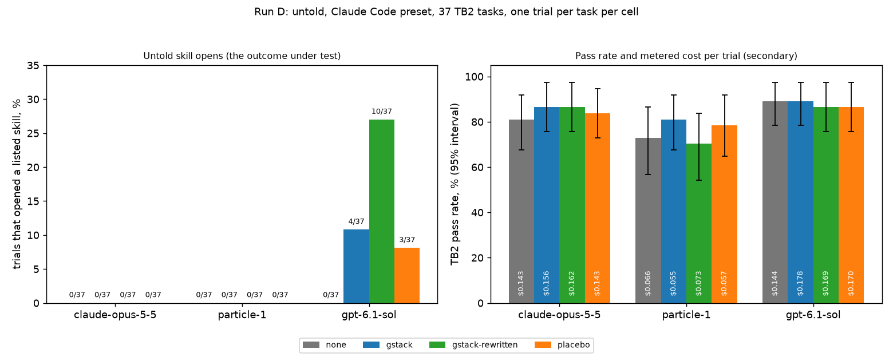

# Saying when to use /investigate raised untold skill opens by 5.9 points pooled (95% CI 1.4 to 10.8), all of it on GPT-6.1 Sol; Opus 5.5 and particle-1 opened no skill in 481 trials

Publication status: unpublished; posting is Garry's. Done: the preregistered run, the frozen analysis, the lost-settle sensitivity, and the author's claim check. Still blocking a post: the /ship review recorded in the PR, the cross-family claim check against the data, a rerun of the reanalysis by another Captain's crew from a clean machine, and a public home for the data bundle.

| Field | Value |
|---|---|
| Grade | Confirmatory for the preregistered primaries (pooled D2, D3 on Opus). The pooled D2 rests on one model in practice: Opus and particle-1 contribute zeros. Per-model D2 rows are exploratory. One task set, one run. |
| Repo commit | Runner tag `laneb-discovery-3-runner`, 025135a48c822fc9f6b95fb76714fb38d0958e1a on 16e075e00398a7d8b9b0236d75f7fe14c98f31a1 |
| Prereg | [2026-11-01-geva-125-untold-discovery-prereg](../../plans/2026-11-01-geva-125-untold-discovery-prereg/README.md), merged in #125 at main 9820b149c3c5b9f12b82edc796871464b3c157c2; analysis-config.json sha256 4178981193c66179dcd2f083f398f7e15b4b4aabf3a8c3968a18e05cd4b46085 |
| Data | geva153-rund-data.tar.gz, sha256 51f09d0cce87e2b17eee52499691c9f854121c75dd19f7be9c6416c954f4cb4b, held by the gstack-evals Captain (handoffs/GEVA-153); not yet public |
| Reviewed by | /ship review of this file, recorded in the PR's receipt. The cross-family claim check is pending. |
| Reproduced by | Pending: another Captain's crew, from a clean machine |
| Disclosures | The gstack, Particle and OpenAI lines, in Disclosures at the end |

## What we found

When nobody tells the agent to use a skill, does it find one? On 37 Terminal-Bench 2 tasks run through Claude Code with gstack installed, GPT-6.1 Sol opened a gstack skill in 7 of 74 trials (9.5%, 95% CI 1.4 to 18.9) with gstack's shipped descriptions. When /investigate's description also said when to use it, Sol opened a skill in 10 of 37 trials (27.0%). Opus 5.5 and particle-1 opened no skill in any of their 481 trials, under either description and, for Opus, under either system prompt.

The preregistered pooled test (D2) counts all three models and finds the rewritten description raised opens by 5.9 points (95% CI 1.4 to 10.8, p 0.039). All of that comes from Sol. The opens did not buy passes: Sol passed 89.2% with no gstack and 86.5% with the rewritten description, and the /investigate procedure's Phase 5 report appeared in none of the 8 trials that loaded it. Claude Code's own system prompt did not change Opus's opens either (D3: 0 against 0, MDD 10.9 to 15.4 points).

## How it works

This section is an explanation, not a result. Claude Code lists every installed skill's name and description in the agent's context, and the agent can call the Skill tool to load one. Sol does call it, and its calls follow descriptions that name the situation in front of it: with the rewritten text, /investigate opened on 4 of the 5 tasks the prereg marks as fitting it and on 4 git or recovery tasks; /cso, gstack's security skill, opened on security-flavored tasks (fix-code-vulnerability, sanitize-git-repo, filter-js-from-html) in all three listing arms, where its description never changed (sol-opens.txt). Opus and particle-1 never called Skill and never browsed the skills folder, so for them the listing reached the prompt (first-request prompt tokens rise by about 2,400 on Opus and 5,800 on particle-1 with gstack installed) and was never acted on. Description wording has nothing to act through on those two models. Why the model families differ is untested here.

## Setup

**Question.** Item 2 of the insight plan: do untold gstack skills get opened, does a description that says when to use a skill raise that, and does Claude Code's own system prompt raise it? Estimands, from the prereg's section 6:

- **D1**, the shipped-description open rate per model: gstack and placebo pooled, preset cells, eligible trials.
- **D2**, the description contrast (primary, pooled across models, one test at alpha 0.05): gstack-rewritten's open rate minus D1's pooled rate, paired by task, pooled over the models that pass the gates.
- **D3**, the system prompt contrast (primary, Opus alone): gstack@claude-code-preset minus gstack@sdk-default open rate, two trials per task per cell.

An **open** is a Skill call naming an installed skill, a Read of a `/.claude/skills/<folder>/SKILL.md` path, or a Bash command that prints one (section 5).

**Arms.** none (an empty skills folder: no gstack installed, the no-gstack arm), gstack (v1.91.295.0 as its setup installs it, #109's tar), gstack-rewritten (the gstack tar with only /investigate's description line replaced by the frozen 319-character text that says when to use it), and placebo (every gstack skill folder with its front matter kept and its body replaced by procedure-free prose of the same token count, so its listing is byte-identical to gstack's). Tar digests are in the prereg's section 3; the grid check confirmed each arm tar equals its committed manifest.

**Models and routes.** claude-opus-5-5 (Anthropic, session cap $5.00), particle-1 (particle-ai/particle-1 on OpenRouter, particle-ai only, $0.50), gpt-6.1-sol (openai/gpt-6.1-sol on OpenRouter, openai only, through OpenRouter's Anthropic-compatible endpoint, $2.50). All three passed their route check on the first attempt (smoke task with a tool result, and a listing session whose reply quotes /investigate's description) for $0.144349. Haiku and Sonnet are not models under test (org R54).

**Harness.** Claude Code 2.1.312 through claude-agent-sdk 0.2.174 under Harbor f3a5a923, `CLAUDE_CODE_DISABLE_BUNDLED_SKILLS=1`, the same prompt wrapper in every arm, untold (no prompt names a skill), turn cap 60. System prompt `claude-code-preset` (Claude Code's own) in every model's cells, plus `sdk-default` (none) on Opus for none, gstack and gstack-rewritten.

**Tasks.** The 37 TB2 tasks #109 analysed (TB2 pinned at 69671fbaac6d67a7ef0dfec016cc38a64ef7a77c). Every batch ran the oracle first; no task failed it, so none was dropped. A fit stratum of 5 tasks that suit /investigate is reported beside the primaries without its own verdict.

**Trials.** One trial per task per cell, plus a second replicate of Opus's two D3 cells: 17 cells, 629 graded trials. Each batch ran on its own fresh Ubicloud standard-30 VM on 2026-11-02 (03:01Z to 07:10Z). Intervals are task-clustered bootstrap percentiles (10,000 resamples, seed 20261101); p values are two-sided Monte Carlo sign-flip tests on per-task differences (100,000 draws, seed 20261101).

**Isolation check (descriptive).** No none-arm transcript names a Capy drive path, a gstack path or a SKILL.md path: 0 of 37 on particle-1, 0 of 74 on Opus (both system prompts), 0 of 37 on Sol, and 0 of 3 route-check none sessions. Every gstack, gstack-rewritten and placebo transcript does, through the listing.

**Analysis inputs.** The frozen analysis-config.json plus the run's paths (analysis-configs.txt): the job folders and proxy session files of the four batches, the Opus second replicate as `replicate_2_jobs`, no in-run oracle drops, the four arm tars, and `listing_check` true for every arm, from the route check's listing sessions and the grid check's manifest match.

## Result



Left: trials that opened a listed skill (the label is the cell's printed rate times 37; Opus cells had 36 eligible trials). Right: pass rate with its 95% interval and metered cost per trial. Both from output-primary.txt.

**Primary readings, verbatim from the scorer** (output-primary.txt):

```
D2 pooled over 3 models (claude-opus-5-5, particle-1, gpt-6.1-sol): +5.9 [+1.4, +10.8] pp over 37 tasks, p 0.0393; MDD 7.5 to 10.3 points (section 11)
Gates beside pooled D2 (every preset cell at least 90% eligible and graded on at least 90% of the run's 37 tasks): claude-opus-5-5 in; particle-1 in; gpt-6.1-sol in
D2 pooled claim: the rewritten description raised opens by +5.9 points, pooled across models
Beside D2, no gstack (pooled over the same models): gstack@claude-code-preset minus none@claude-code-preset, pass +4.5 [-0.9, +10.8] pp; gstack-rewritten@claude-code-preset minus none@claude-code-preset, pass +0.0 [-4.5, +4.5] pp; placebo@claude-code-preset minus none@claude-code-preset, pass +1.8 [-5.4, +9.0] pp
D3 claude-opus-5-5: +0.0 [+0.0, +0.0] pp over 36 tasks, p 1.00, Holm 1.00; MDD 10.9 to 15.4 points (section 11); no claim
Beside D3, no gstack (pooled over claude-opus-5-5): gstack@claude-code-preset minus none@claude-code-preset, pass +5.4 [+0.0, +13.5] pp; gstack@sdk-default minus none@sdk-default, pass +0.0 [-8.1, +8.1] pp
```

The D3 interval is a point because every trial in both cells scored 0 opens, so every bootstrap resample does too; the MDD is the honest size of what the test could miss.

**D1 and the per-model D2 rows** (D2 per model is exploratory, MDD 22.3 to 25.8 points, no claim):

| Model | D1: shipped-description opens | D1 reading | Rewritten cell opens | D2 per model | Fit stratum (5 tasks) |
|---|---|---|---|---|---|
| claude-opus-5-5 | 0 of 72 eligible, 36 tasks | fewer than 8.0% (exact one-sided 95% upper bound) | 0 of 36 | +0.0 [+0.0, +0.0], p 1.00 | D1 0.0%, D2 +0.0 |
| particle-1 | 0 of 74, 37 tasks | fewer than 7.8% | 0 of 37 | +0.0 [+0.0, +0.0], p 1.00 | D1 0.0%, D2 +0.0 |
| gpt-6.1-sol | 7 of 74, 37 tasks | 9.5% [1.4%, 18.9%] | 10 of 37 (27.0%) | +17.6 [+4.1, +32.4], p 0.0393 unadjusted | D1 40.0% [0.0, 80.0], D2 +60.0 [+20.0, +100.0] |

Pooled with equal weight across models (secondary): D1 3.2% [0.5%, 6.3%], rewritten 9.0% [4.5%, 14.4%]. Under sdk-default, Opus's gstack cell opened 0 of 36 eligible trials, and no Opus cell under either prompt browsed the skills folder or opened a built-in skill.

**What Sol opened** (sol-opens.txt; xcheck.txt counts Skill calls straight from the transcripts and agrees: 4, 10 and 3 trials):

| Sol cell | Trials that opened | Skills | Loaded /investigate | DEBUG REPORT (Phase 5) | root cause / hypothesis markers |
|---|---|---|---|---|---|
| gstack | 4 of 37 | /cso 3, /investigate 1 | 1 | 0 | 0 / 0 |
| gstack-rewritten | 10 of 37 | /investigate 8, /cso 2 | 8 | 0 | 4 / 4 |
| placebo | 3 of 37 | /cso 2, /investigate 1 | 1 (placebo body) | 0 | 0 / 0 |
| none | 0 of 37 | | 0 | 0 | 0 / 0 |

Every open loaded the skill's body. The procedure gate (GEVA-100's DEBUG REPORT marker) passed in none of the 10 /investigate loads. Of Sol's trials that opened a skill, 14 of 17 passed; 9 of the 10 in the rewritten cell passed.

**Every preset cell** (output-primary.txt has every count):

| Cell | Pass [95% CI] | $ per trial | $ per success | Median first-request tokens | Session-cap / timeout / turn-cap stops |
|---|---|---|---|---|---|
| Opus none | 81.1% [67.6, 91.9] | 0.143 | 0.177 | 22,619 | 0 / 2 / 0 |
| Opus gstack | 86.5% [75.7, 97.3] | 0.156 | 0.180 | 25,026 | 0 / 0 / 0 |
| Opus gstack-rewritten | 86.5% [75.7, 97.3] | 0.162 | 0.187 | 25,097 | 0 / 0 / 0 |
| Opus placebo | 83.8% [73.0, 94.6] | 0.143 | 0.171 | 25,026 | 0 / 0 / 0 |
| particle-1 none | 73.0% [56.8, 86.5] | 0.066 | 0.091 | 64,227 | 1 / 2 / 1 |
| particle-1 gstack | 81.1% [67.6, 91.9] | 0.055 | 0.068 | 70,049 | 0 / 2 / 2 |
| particle-1 gstack-rewritten | 70.3% [54.1, 83.8] | 0.073 | 0.104 | 70,035 | 2 / 1 / 1 |
| particle-1 placebo | 78.4% [64.9, 91.9] | 0.057 | 0.073 | 70,049 | 0 / 1 / 1 |
| Sol none | 89.2% [78.4, 97.3] | 0.144 | 0.161 | 64,256 | 1 / 0 / 0 |
| Sol gstack | 89.2% [78.4, 97.3] | 0.178 | 0.199 | 70,041 | 1 / 0 / 0 |
| Sol gstack-rewritten | 86.5% [75.7, 97.3] | 0.169 | 0.195 | 70,027 | 0 / 0 / 0 |
| Sol placebo | 86.5% [75.7, 97.3] | 0.170 | 0.197 | 70,041 | 0 / 0 / 0 |

Opus under sdk-default (secondary): none, gstack and gstack-rewritten each passed 83.8% [70.3, 94.6], at $0.139, $0.139 and $0.145 per trial.

**gstack and its variants against no gstack, per model** (pass, exploratory):

| Model | gstack minus none | gstack-rewritten minus none | placebo minus none |
|---|---|---|---|
| Opus (preset) | +5.4 [+0.0, +13.5] | +5.4 [+0.0, +13.5] | +2.7 [-8.1, +13.6] |
| Opus (sdk-default) | +0.0 [-8.1, +8.1] | +0.0 [-8.1, +8.1] | |
| particle-1 | +8.1 [-2.7, +18.9] | -2.7 [-16.2, +10.8] | +5.4 [-8.1, +18.9] |
| gpt-6.1-sol | +0.0 [-8.1, +8.1] | -2.7 [-8.1, +0.0] | -2.7 [-10.8, +5.4] |

On Opus and particle-1 no skill body was ever opened, so any pass difference there comes from the listing text in the prompt or from noise; none of these rows is a preregistered test.

**Retried-after-response sensitivity (section 7).** One Opus trial (sparql-university, gstack-rewritten@sdk-default) was rerun by Harbor after a model response: the first attempt ran 6 requests, its session close returned 500, and the proxy never wrote that session's record. output-recovered.txt adds the record rebuilt from the request log (recovered-sessions.jsonl). It changes two lines: that cell's retried count goes from 0 to 1, and its gstack-rewritten minus none reading with the retried trial scored 0 goes from +0.0 [-8.1, +8.1] to -2.7 [-10.8, +5.4]. No primary reading moves.

## Cost

Metered spend through the proxy, from the proxy session files (cost-output.txt):

| Model | Cell | Metered $ | Input tokens | Output tokens | Cache write | Cache read |
|---|---|---|---|---|---|---|
| particle-1 | none | 2.691 | 4.87M | 657.7k | 0 | 23.45M |
| particle-1 | gstack | 2.053 | 3.93M | 506.3k | 0 | 18.81M |
| particle-1 | gstack-rewritten | 2.708 | 5.09M | 694.7k | 0 | 24.66M |
| particle-1 | placebo | 2.115 | 3.93M | 590.2k | 0 | 18.06M |
| Opus | none (preset) | 5.304 | 472 | 123.7k | 306.0k | 6.49M |
| Opus | gstack (preset) | 5.764 | 478 | 131.2k | 342.2k | 7.14M |
| Opus | gstack-rewritten (preset) | 5.997 | 456 | 133.8k | 399.3k | 6.61M |
| Opus | placebo (preset) | 5.301 | 446 | 131.3k | 266.2k | 6.71M |
| Opus | none (sdk-default) | 5.160 | 448 | 129.0k | 297.7k | 5.45M |
| Opus | gstack (sdk-default) | 5.157 | 436 | 114.9k | 338.8k | 5.82M |
| Opus | gstack-rewritten (sdk-default) | 5.376 | 452 | 119.2k | 362.1k | 5.90M |
| Opus, replicate 2 | gstack (preset) | 5.798 | 466 | 122.5k | 395.2k | 6.85M |
| Opus, replicate 2 | gstack (sdk-default) | 5.545 | 442 | 122.2k | 386.5k | 5.83M |
| Sol | none | 5.310 | 1.2k | 204.0k | 841.8k | 6.76M |
| Sol | gstack | 6.574 | 1.5k | 237.2k | 1.26M | 12.18M |
| Sol | gstack-rewritten | 6.237 | 1.4k | 231.7k | 1.17M | 11.02M |
| Sol | placebo | 6.296 | 1.3k | 198.8k | 1.16M | 8.86M |

Each cell is 37 sessions. Cache tokens are the provider's reported counts, each class priced on its own; OpenRouter reported no cache writes for particle-1. Add $0.145598 for the lost Opus first attempt, which no session file holds, and $0.144349 for the route check. Batches: particle-1 $9.57, Opus $38.20, Opus replicate 2 $11.34, Sol $24.42. **Total metered: $83.68**, against the prereg's $126 cap and a projection of $89.67. The discovery-r1 ledger shows $83.675668 settled in 636 settles and $0 open, one settle made by hand (deviation 4). There were no ledger refusals and no batch-cap stops.

**Price table** (the runner's `quick/laneb/config/proxy.json` at the tag, in force for the whole run on 2026-11-02, per million tokens):

| Model | Input | Output | Cache write (5 min) | Cache write (1 h) | Cache read |
|---|---|---|---|---|---|
| claude-opus-5-5 | $4.00 | $20.00 | $5.00 | $8.00 | $0.20 |
| particle-1 | $0.25 | $1.00 | $0.25 | $0.25 | $0.03 |
| gpt-6.1-sol | $2.00 | $10.00 | $2.00 | $2.00 | $0.10 |

Sol's row is OpenRouter's list price on 2026-11-01 as the prereg froze it. GEVA-128 read particle-1's OpenRouter listing below this table on 2026-11-02, so particle-1's metered spend is an upper bound.

**VM time.** Six Ubicloud standard-30 VMs, 4 h 52 min in all: particle-1 1 h 27 min, Opus 1 h 26 min, Opus replicate 2 44 min, Sol 1 h 9 min, and the two VMs of the failed first Opus attempt 3 min each (deviation 3). All are destroyed, and ubi-runner's list for owner geva153 was empty at 07:13Z.

## Why null? (R48)

Three readings are null or lean negative. Each gets one cycle. The exposure rates sit beside each verdict.

**1. D3 on Opus: the preset changed nothing (0 against 0).** Exposure: the listing reached Opus under both prompts (route check, and first-request tokens with gstack 2,400 above none under each prompt), but Opus opened nothing under either: 0 of 148 trials. Task fit: the same tasks drew 17 opens from Sol, so they offer reasons to open. Power and floor: both cells sit at the floor; the MDD is 10.9 to 15.4 points, so a smaller prompt effect is not ruled out. Frontier competence: Opus passes 81.1% with no gstack under the preset and 83.8% under sdk-default, so it solves most tasks without looking. **Verdict: KEEP.** Earlier untold runs that used the stub prompt did not understate Opus's discovery by more than the MDD, and later untold runs may use either prompt. Exposure beside it: opens 0 of 148 Opus gstack trials.

**2. Opus and particle-1 opened no skill under either description.** Exposure: the listing reached both models (both quoted /investigate's description in the route check), and the rewritten text was in the listing (the dry run confirmed it), yet neither model made a Skill call, browsed the skills folder or opened a built-in skill in any of 481 trials. Task fit: Sol's opens show that the tasks give the rewritten /investigate a reason to be opened. Power: the D1 upper bounds are 8.0% (Opus) and 7.8% (particle-1); the per-model D2 MDD is 22.3 to 25.8 points. Frontier competence: Opus passes 81.1% and particle-1 73.0% with no gstack. **Verdict: KEEP** the rewrite direction that the pooled D2 supports, and record that description text alone does not produce untold use on Opus 5.5 or particle-1. Untold use on those two models needs another route, such as hooks (agenda item 1). Exposure beside it: 0 opens in 481 trials.

**3. Sol's pass rate with the rewritten description: -2.7 points against no gstack [-8.1, +0.0].** Exposure: 10 of 37 rewritten trials opened a skill and 9 of those passed; 4 of the cell's 5 failures came from the 27 trials that opened nothing (23 passed). So the loss does not sit in the trials that read the skill. Task fit: 8 of 10 opens were /investigate on debugging or recovery tasks. Power and ceiling: Sol's control is 89.2%, near the ceiling, and section 12 says benefit after an open cannot carry a verdict at these counts. Frontier competence: Sol solves 33 of 37 tasks with no gstack. **Verdict: KEEP.** No evidence here that an opened skill hurt Sol; the procedure gate passed in no trial, so this run says nothing about whether running /investigate's procedure helps. Exposure beside it: /investigate loaded in 8 of 37 rewritten trials, Phase 5 report in 0 of 8.

## What it means for gstack (section 12)

The pooled D2 was raised, so section 12 reads: saying when to use a skill gets it opened, gstack should rewrite its skill descriptions that way, and the per-model rows say where to look first. Here that is Sol alone. On Opus 5.5 and particle-1 no description wording produced an open, and on Sol the opens did not raise the pass rate or run the procedure to its report. A gstack description rewrite is cheap (the rewritten /investigate line is 259 characters longer than the shipped one), so it is a reasonable change for Sol users, but this run does not show it helps Opus users or that opened skills improve results.

## Deviations from the prereg

1. **Ledger ceiling $200, not section 8's $126.** The proxy reserves each session's full session cap in the ledger before the session opens, so the Opus batches alone hold about $120 of open reserves at once, and a $126 row would have latched a cap stop on reserves, not spend. The Captain set the discovery-r1 approval row to $200, the hard ceiling on settled plus open reserves, and kept the frozen start rule (its $126 is hardcoded in start-rule.ts) gating every launch. Metered spend beside it: **$83.68**, under the $126 the prereg approved.
2. **Batch proxy caps under the Captain's rule.** No batch cap may be lower than 1.4 times its projection plus its maximum open reserves (12 times the session cap), and running caps plus settled must fit under $200; where that leaves a cap pointless, none is set. Worked at the projection and at the 1.4 allowance:

| Batch | Projection | 1.4x | 12 x session cap | Floor | Running caps + settled at launch (projection / allowance) | Cap set |
|---|---|---|---|---|---|---|
| particle-1 | $11.56 | $16.18 | $6.00 | $22.18 | 22.18 + 0.79 = $22.97 / 22.18 + 1.11 = $23.29 | $22.18 |
| claude-opus-5-5 | $42.06 | $58.88 | $60.00 | $118.88 | with replicate 2: 118.88 + 77.18 + 12.35 = $208.41 / + 17.29 = $213.35, over $200 | none ($200, which cannot bind before the ledger) |
| claude-opus-5-5 replicate 2 | $12.27 | $17.18 | $60.00 | $77.18 | same | none ($200) |
| gpt-6.1-sol | $22.98 | $32.17 | $30.00 | $62.17 | 62.17 + 66.69 = $128.86 / 62.17 + 93.36 = $155.53; at launch 62.17 + 59.26 settled = $121.43 | $62.17 |

3. **First Opus attempt ended early on infrastructure; rerun fresh once, whole.** Both Opus VMs exited 5 about 2 minutes in, before any trial or ledger row. The VM driver looks up an arm's digest with a jq select that returns it twice when a batch lists the same arm twice (each arm under two system prompts) with `.tar.gz` arms. Section 7 counts this as an infrastructure early end. Both Opus batches were rerun fresh once, whole, with plain `.tar` arms holding the same bytes; the grid check passed again and the start rule passed for each (bounds $68.60 and $85.78 against $126). No spend, two VMs at 3 minutes each.
4. **One settle written by hand.** The Opus session s-3ac119dfbd14 (the retried trial above) never reached the ledger, so its $5.00 reserve stayed open. It was settled through the ledger service at its request-log cost, $0.145598, with `manual: true` on the row. The analysis's recovered reading adds that session's rebuilt record (Result).
5. **Start-rule notes written in two steps.** `start-rule.ts check --note` exits 1 on the Drive mount after writing its row, because fsync returns ENOTSUP there. Each launch was gated on `check` without `--note` (exit 0), then the note row was written with `--note` and checked to match the gate's output exactly (run-log.txt).

## Limits and threats

- **One model carries the pooled D2.** The pooled test is the preregistered primary and it passes its gates, but Opus and particle-1 add only zeros. Sol's own row (+17.6 [+4.1, +32.4]) is exploratory with an MDD of 22.3 to 25.8 points, so this run makes no per-model claim for Sol.
- **One skill rewritten, one trial per cell.** Only /investigate's description changed. The /cso opens were not caused by the rewrite. Each preset cell has one trial per task.
- **Sol runs inside Claude Code** through OpenRouter's Anthropic-compatible endpoint. Its skill use in Codex or another harness may differ.
- **No benefit shown.** Pass rates and the procedure gate after an open are reported, not tested; the counts are too small for a verdict.
- **Refusals.** In each Opus cell one trial's first request was refused by the provider's safeguards, so it counts as failed and not eligible (section 7), and Opus's D1 runs over 36 tasks. The analysis counts a refusal message in a few other trials that still got responses (output-primary.txt).
- **Public tasks.** TB2 is public, so its tasks may be in the models' training data. That bears on pass rates more than on opens.
- **Stops.** Five sessions hit their session cap (particle-1 3, Sol 2) and are scored as section 7 says. One of them, Sol's gstack trial on filter-js-from-html, had opened /cso and counts as an open.

## Replicate it

1. **Reanalysis (keyless).** Check out tag `laneb-discovery-3-runner` (025135a4), `bun install`, fetch the data bundle (Captain drive handoffs/GEVA-153, not yet public), check SHA256SUMS, extract it, point the job and session paths in analysis-configs.txt at the extracted tree, and run `bun quick/laneb/analysis/discovery-tax.ts <config>`. Expected output: output-primary.txt and output-recovered.txt byte for byte.
2. **Rerun a cell (paid).** There is no direct-key path yet: a rerun needs the ledger service, the metering proxy and a Ubicloud VM, driven by the scripts in phase-scripts.txt. Sol's four cells cost $24.42 metered. Expect run-to-run spread: these are one trial per task.

phase-scripts.txt holds the operator scripts that ran (batch control, watch, ledger supervisor, grid check, the hand settle, config build, cost, the open cross-check, the chart and the bundle), and run-log.txt the run record and the lines they printed, with operator paths shown as `<work>`, `<captain-drive>` and `<ubicloud-skill>`. The record leaves out the VM-side Harbor and trial logs and the ledger rows themselves, which are in the data bundle, and the machine setup that Capy's project image provides. Before reusing batch.sh, note what GEVA-128 found in the same script: its ssh calls turn off host-key checking, and it deletes the key file it copies to the VM only after the run ends.

## What is held out, and why

Nothing. TB2 is public, and every task digest is pinned at the tag. The data bundle is not public yet. TB2's sanitize-git-repo and openssl-selfsigned-cert tasks write secret-shaped fixtures, which the bundle shows as `<redacted-fixture-secret>` or `<redacted-fixture-private-key>` (23 files). Three files still match the pattern scan, each only for the words "BEGIN PRIVATE KEY" in /cso's own text, which lists secret prefixes; they hold no key material. A scan of the bundle for the live values of the four keys the run used found no match.

## X hook (draft)

> Do agents find skills nobody told them to use? We ran gstack untold on 37 Terminal-Bench 2 tasks inside Claude Code. Opus 5.5 and particle-1 opened no skill in 481 trials. GPT-6.1 Sol opened one in 9.5% of trials, and 27% when /investigate's description said when to use it. Pooled lift: +5.9 points [1.4, 10.8], all from Sol, with no pass-rate gain. (link to this file at a pinned commit)

## Claim check

| Check | Status | Evidence |
|---|---|---|
| The headline is true at both ends of its interval | Pass (author check) | At +1.4 the pooled lift is still positive. The headline says all of it is on Sol, which the per-model rows show (Opus and particle-1 at 0 in every cell). |
| The grade is named | Pass (author check) | Record table: confirmatory primaries, carried by one model in practice; per-model rows exploratory. |
| No claim the scorer forbade | Pass (author check) | Per-model D2 makes no claim; D3 makes no claim; no benefit or parity claim. |
| Disclosures settled before the post | Pass (author check) | The gstack, Particle and OpenAI lines from the org disclosures file, word for word, at the end. That file gives Anthropic no line. The X hook carries none. |
| The sealed guard passes | Recorded in the PR | gstack-pregate sealed runs before every push of this branch; the /ship receipt records it. |
| Numbers match the printed outputs | Pass (author check) | Every result number is copied from output-primary.txt, output-recovered.txt, cost-output.txt, sol-opens.txt, xcheck.txt or run-log.txt. Not yet rerun from the data bundle on a clean machine. |
| Cross-family review against the data | Pending | |
| Another Captain's crew reruns the reanalysis | Pending | |

## Changelog

- 2026-11-02: first version (GEVA-153).

## Disclosures

gstack is Garry Tan's own project.

Disclosure: Y Combinator, which Garry Tan runs, is an investor in Particle, which makes particle-1.

Disclosure: OpenAI began through YC Research, which was started by Sam Altman, a former president of Y Combinator. Garry Tan runs Y Combinator.
