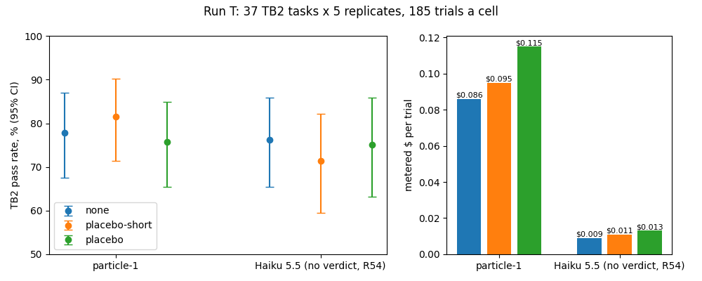

# Told placebo skill text cost particle-1 no TB2 passes we could detect: -2.2 points (95% CI -7.0 to +2.7) on a 77.8% control, MDD 9.1

- We learned that told placebo skill text cost particle-1 no TB2 passes we could detect: placebo minus no gstack was -2.2 points [-7.0, +2.7] on a 77.8% control, with a 9.1-point detectable difference. The interval excludes the earlier exploratory -10-point estimate but not a tax of up to about 7 points. You should not build short skill variants for particle-1 on this evidence alone.
- We learned that shortening the told body from 6,777 to 846 tokens made no difference we could claim on particle-1: placebo minus placebo-short was -5.9 points [-11.9, +0.0] against an 81.6% short-body control, with a family-adjusted p of 0.273 and a preregistered first-step MDD of 10.2 points, a lower bound. You should treat the longer text's worse point estimate as worth watching, not as a claim.
- We learned this from one model, particle-1, with placebo text that has no procedure, under the SDK's stub system prompt rather than Claude Code's own, in one run of 37 public TB2 tasks, where contamination is possible. You should read it as a result about carried text, not about gstack's real skill bodies or any procedure.

## What works

Telling particle-1 to use a skill whose body is 6,777 tokens of on-topic prose with no procedure changed its Terminal-Bench 2 pass rate by -2.2 points (95% CI -7.0 to +2.7) against no gstack at all. This run's interval excludes #109's -10, but not a tax of up to about 7 points. With no gstack, particle-1 passed 77.8% of trials; the test could detect 9.1 points (the prereg's simulated MDD at 5 replicates with the tasks fixed, as Run T ran them; the prereg's scaling gives 8.8, which it calls a lower bound).

## What didn't work

Shortening the told body to 846 tokens gave no difference we could claim: placebo minus placebo-short was -5.9 points [-11.9, +0.0] on particle-1, against an 81.6% short-body control. The longer text did worse at the point estimate, but the family-adjusted p is 0.273, and the preregistered first-step T2 MDD was 10.2 points, a lower bound. Haiku 5.5 ran the same grid; under org rule R54 it is no longer a model under test, so its rows are reported as frozen and carry no verdict.

## How it works

An explanation, not a result. A told skill puts its whole body into every later request of the session. On particle-1 the told placebo made each request larger (the proxy's estimate of the median first request: 105,464 tokens against 57,905 with no gstack) and cost more per trial, and it hit the session cap more often (13 stops against 7). Part of the extra stops come from the rig: the session cap binds on metered prices above particle-1's list prices, and the OpenRouter route counts a token per byte, so stops come earlier than real spend would put them, which pushes toward finding a tax. None of that moved the pass rate by an amount we could see. #109's 10-point gap and quick look 3's +6 now look like run-to-run spread around a small or zero effect, or something that changed at particle-1's provider between runs.

## Result



chart.py.txt draws the chart from analysis-primary.txt: `uv run --no-project --with matplotlib==3.9.2 python chart.py.txt analysis-primary.txt chart.png` gives chart.png byte for byte.

The chart's dollars per trial are metered at the runner's price table, in force for the whole run on 2026-11-01 and 02; particle-1's are upper bounds, because its metered prices are above its OpenRouter list prices.

The primary readings, verbatim from the tag's `analysis/discovery-tax.ts` (analysis-primary.txt), except that the closing cost clause of each particle-1 line is in Agent notes:

```
particle-1 none: graded 185, missing 0, refused 0, retried after a response 0; eligible 100.0%; pass 77.8% [67.6%, 87.0%]; session-cap stops 7 (3.8%), agent timeouts 5; median requests 14, median first-request tokens 57905
particle-1 placebo-short: graded 185, missing 0, refused 0, retried after a response 0; body load 100.0%; pass 81.6% [71.4%, 90.3%]; session-cap stops 9 (4.9%), agent timeouts 8; median requests 16, median first-request tokens 69823
particle-1 placebo: graded 185, missing 0, refused 0, retried after a response 0; body load 100.0%; pass 75.7% [65.4%, 84.9%]; session-cap stops 13 (7.0%), agent timeouts 10; median requests 16, median first-request tokens 105464
T1 (placebo minus none): -2.2 [-7.0, +2.7] pp over 37 tasks; verdict not confirmed, smaller than the lead
T2 (placebo minus placebo-short): -5.9 [-11.9, +0.0] pp, p 0.0908, Holm 0.182; no claim
```

In these lines, "retried after a response 0" is the tag's count from the session files. The true count is 8 (4 on particle-1), because the proxy wrote no session record for a trial whose settle was lost; the retried-after-response sensitivity below adds them back.

**T1 (particle-1, placebo minus none): -2.2 points [-7.0, +2.7]. Not confirmed** (the upper end is not below 0) **and smaller than the lead** (the lower end is above -10). Body load was 100% (185 of 185) in both told cells, so no gate flag.

**T2 (placebo minus placebo-short), the verdict computation.** The runner's own Holm line above (0.182) is not the verdict input, because its holm() sizes the step-down by the models it has. Section 6 freezes the family at three models, with p = 1 for any refused, route-failed, missing or body-load-gated model. DeepSeek is missing (deviation 1), so it enters at p = 1. The raw per-model t2.p values come from analysis-primary.txt:

| Model | T2 (pp) | Raw p | Holm step | Adjusted p | Claim |
|---|---|---|---|---|---|
| particle-1 | -5.9 [-11.9, +0.0] | 0.0908 | 1st of 3: 0.0908 x 3 = 0.2724 (0.2725173 at full precision) | 0.273 | none |
| claude-haiku-5-5 | +3.8 [-2.2, +9.2] | 0.276 | 2nd: max(0.2724, 0.276 x 2 = 0.552) | 0.552 | none |
| deepseek-v4.1-flash-1017 | not run | 1 (missing) | 3rd: max(0.552, 1 x 1) | 1 | none |

The short-body controls were 81.6% on particle-1 and 71.4% on Haiku 5.5. For both models, the preregistered first-step T2 MDD was 10.2 points, a lower bound.

No adjusted p is below 0.05, so no T2 claim is made, in either direction. The claim check's full-precision recomputation gives particle-1's raw T2 p as 0.0908391; the fixed three-model Holm adjustment gives 0.2725173, reported as 0.273. The runner prints p with `toPrecision(3)`, which rounds to nearest, so each raw p can be off by at most half a unit in its third significant digit (0.00005 for 0.0908). That moves particle-1's adjusted p by at most 0.00015, far from 0.05; no rounding could produce a claim.

**Secondary readings, no claims** (analysis-primary.txt):

| Contrast (pp) | particle-1 | Haiku 5.5 (no R48 verdict) |
|---|---|---|
| placebo minus none | -2.2 [-7.0, +2.7] | -1.1 [-7.6, +4.9] |
| placebo-short minus none | +3.8 [-2.2, +9.2] | -4.9 [-11.4, +1.1] |
| placebo minus placebo-short | -5.9 [-11.9, +0.0] | +3.8 [-2.2, +9.2] |

Pooled across the two models that ran, equal weight (secondary; the prereg pooled three): placebo minus none -1.6 [-6.2, +3.0], placebo-short minus none -0.5 [-4.6, +3.2], placebo minus placebo-short -1.1 [-5.1, +2.7].

Haiku 5.5 cells: none 76.2% [65.4, 85.9], placebo-short 71.4% [59.5, 82.2], placebo 75.1% [63.2, 85.9]; body load 100% in both told cells; no session-cap stops in any arm.

**The session-cap mechanism (descriptive).** On particle-1 the told placebo hit the session cap more often: stop rate placebo minus none +3.2 points [+0.5, +6.5], placebo minus placebo-short +2.2 [-1.6, +5.9]. The complete-case contrasts, which drop trials that hit a cap and are biased by that selection, are placebo minus none -1.7 [-7.1, +3.9] and placebo minus placebo-short -5.6 [-11.9, +0.7]. On the OpenRouter route the proxy counts a request's worst-case input at one token per byte, so its refusals come earlier than the provider's own count would put them; particle-1's "first-request tokens" above are outgoing UTF-8 byte counts plus a 1,024-token safety allowance. Haiku uses Anthropic's count plus 64 tokens, giving median admission bounds of 20,560, 24,690 and 34,504, and had no session-cap stops.

**Retried-after-response sensitivity (section 7).** Eight trials were rerun by Harbor after a model response: the first attempt's session ran, the proxy's settle call to the ledger got ECONNRESET through the SSH tunnel, and Harbor reran the trial (particle-1: 3 placebo-short, 1 placebo; Haiku: 3 none, 1 placebo). The proxy never wrote those 8 session records, so the tag's reading from the session files counts 0 retried trials. analysis-recovered.txt adds the 8 sessions, rebuilt from proxy-requests.jsonl (recovered-sessions.jsonl), and scores those trials 0: particle-1 T1 becomes -2.7 [-8.1, +2.7] and particle-1 placebo minus placebo-short -5.4 [-11.9, +1.1]. Neither changes a verdict. The primary readings grade each trial on its rerun, as section 7 says.

**Prior readings, beside T1 and T2 and never pooled:** #109 particle-1 -10 [-18, -2], Haiku -5 [-13, +3]; quick look 3 particle-1 +6 [-2, +15], Haiku +0 [-7, +8], DeepSeek -2 [-9, +6]. Run T's particle-1 reading, -2.2 [-7.0, +2.7], sits between #109's and quick look 3's and excludes #109's point estimate.

## Why null? (R48)

The verdict rests on particle-1 alone. Under org rule R54 Haiku 5.5 is not a model under test, and its rows carry no R48 verdict.

- **Exposure.** The text reached the model: body load was 100% (185 of 185) in both told cells, and the proxy's estimate of the median first request grew from 57,905 tokens (none) to 69,823 (placebo-short) and 105,464 (placebo). The placebo has no procedure, so there is no procedure gate; Run T tests text, not procedure.
- **Task fit.** The question is a tax from carried text, which shows up in long agentic sessions that resend the context on every request. TB2 sessions ran a median of 14 to 16 requests on particle-1, so the tasks exercise it.
- **Power and floor or ceiling.** Control rate 77.8% [67.6, 87.0], off both floor and ceiling. MDD 9.1 points at 5 replicates (the prereg's simulation with the tasks fixed, as Run T ran them). The interval [-7.0, +2.7] excludes the lead's -10, so the test had room to see a tax of that size and did not.
- **Frontier competence.** Run T has no frontier cell. Opus 5.5 passed 81.1% of these tasks with no gstack in #109, a different run; particle-1 passed 77.8% here.
- **Verdict: KEEP.** No evidence that told skill text taxes particle-1 by the size #109 saw, so gstack does not need short variants of its skills for cheap rungs for this reason, and #109's -10 goes down as noise or a run-specific effect (prereg section 12). The one thing worth watching is particle-1's placebo minus placebo-short point estimate (-5.9, adjusted p 0.273), which is not a claim. Next step: none for text length.

## Limits and threats

- One task set: 37 public TB2 tasks, so contamination is possible, and one run. The two prior point estimates on this contrast (#109's and quick look 3's) differed by 16 points, and each lay outside the other run's interval; this run does not identify whether provider changes or sampling caused that spread. Something besides sampling, such as changes at particle-1's provider, may move between runs, and one more run cannot remove that.
- Placebo text, not gstack's real skill bodies. The result is about carried text, not about any procedure.
- The SDK-default stub system prompt, not Claude Code's own prompt.
- The interval does not rule out a tax below about 7 points on particle-1.
- particle-1's metered prices are above its OpenRouter list prices, so per-trial costs are upper bounds; the session cap binds on the metered figure.
- Haiku 5.5 is reported only as preregistered; it carries no verdict under R54.
- DeepSeek, the third preregistered model, did not run, so the pooled secondary reading spans two models.
- The ledger file sat on the Capy Drive mount, where fsync returns ENOTSUP, so its writes were not durable during the run (deviation 4). It closed with no refusals, and its settled total matches the metered totals in cost-output.txt.

## Setup

- **Question.** Does told skill text cost cheap models passes, and does the cost grow with the text's length? Preregistered in #118 (wiki/plans/2026-11-01-geva-106-text-tax-prereg, main 0ffe8d0); this post follows its sections 6 to 8.
- **Arms.** none: an empty `.claude/skills/`, no gstack, plain prompt (tar sha256 8bab4833...). placebo-short: #109's placebo tree with the /investigate body regenerated at 846 tokens, prompt opens with `/investigate` (bb25d3dc...). placebo: #109's told placebo, every gstack v1.91.295.0 skill folder with its body replaced by on-topic, procedure-free prose of the same token count, /investigate at 6,777 tokens, prompt opens with `/investigate` (ff6b909d...).
- **Models and routes.** particle-1 (`particle-ai/particle-1`) on OpenRouter, provider particle-ai only, no fallbacks. Claude Haiku 5.5 (`claude-haiku-5-5`) on Anthropic's API. DeepSeek V4.1 Flash 1017 was preregistered and dropped before its batch (deviation 1).
- **Harness.** Claude Code 2.1.312 driven by claude-agent-sdk 0.2.174 under Harbor f3a5a923, with `CLAUDE_CODE_DISABLE_BUNDLED_SKILLS=1`, the same prompt wrapper in every arm, and the SDK-default system prompt: the 136-character stub, never Claude Code's own system prompt. So this describes Claude Code driven that way, as #109 was. Output cap 32,000 tokens a request.
- **Tasks.** 37 TB2 tasks at 69671fbaac6d67a7ef0dfec016cc38a64ef7a77c: quick look 3's 40 (`quick/laneb/tasks/final.json`, sha256 9ccfec13...) less crack-7z-hash, adaptive-rejection-sampler and largest-eigenval. TB2 is a public repository; the run did not record its licence. The oracle passed every task on both batch VMs, so no task was dropped.
- **Trials.** 3 arms x 37 tasks x 5 replicates per model, as Harbor attempts: 555 per model, 1,110 graded. Pairing unit: the task. Each batch ran on its own Ubicloud standard-30 VM at 12 concurrent trials.
- **Statistics.** 95% percentile intervals from a task-clustered bootstrap (10,000 resamples, seed 20261101). Two-sided Monte Carlo sign-flip p values (100,000 draws, seed 20261101). No model judges: 1,108 trials have TB2 verifier rewards, and two trials without a reward after a model response count as failures under the preregistered rule.
- **Dates.** Route check 2026-11-01 21:33Z. Both batches launched 21:42Z; Haiku's VM was destroyed 2026-11-02 01:20Z and particle-1's 02:12Z.
- **Runner.** Tag `laneb-texttax-2-runner` (6d0e960): #109's runner plus the changes the prereg lists. The batch controller was GEVA-93's batch.sh, which ran #109's grid, with only its owner (geva128), runner path and TTL (12 h) changed; the VM side (vm-bootstrap.sh, vm-run.sh, proxy, Harbor, agent) is the tag's, unchanged (deviation 2).

**Deviations from the prereg**, each recorded in run-log.txt:

1. **DeepSeek dropped.** Its first route try failed: all 11 requests returned 502 "Insufficient Balance" from OpenRouter's deepseek provider, and nothing was charged. The Captain found OpenRouter's own account at DeepSeek out of balance (is_byok false; deepseek endpoint status -5) and ruled that the second try wait for status 0. Before any second try, the Captain dropped DeepSeek under org rule R54 (Garry, 2026-11-01), through section 7's drop path: p = 1 in T2's family. Our one endpoint reading, at 2026-11-01T23:03:45Z, showed the deepseek provider back at status 0 (100% uptime over 30 minutes).
2. **Batch controller.** GEVA-93's batch.sh instead of the tag's launch.sh, on the Captain's word (A1): particle-1's batch outlasts ubi-runner's default 4-hour TTL, and batch.sh runs vm-run.sh detached on the VM so a lost controller can re-attach. Diff from GEVA-93's copy: owner geva128, runner path, TTL 12 h.
3. **Route check, first try.** It stalled before any session opened: Harbor's `docker exec -i` read the shell's terminal and got SIGTTIN. Nothing was spent. The second try ran the same route.sh under setsid with stdin from /dev/null.
4. **Start rule.** `start-rule.ts check --note` wrote passing note rows and then crashed on fsync (ENOTSUP on the Capy Drive mount that holds the ledger; start-rule.ts:94 does not catch it, ledger.ts does). The verdict came from the note rows: both bounds were under the cap.
5. **Ledger-refusal stop.** The Captain added a rule mid-run: a ledger refusal stops its batch with no retries, and refused sessions count as not run. refusal-stop.sh watched each batch. Refusals: 0.
6. **Lost settles.** The 8 ECONNRESET settles were settled by hand on the Captain's word, through the tag's Ledger.settle at their request-log costs.
7. **Disclosure placement.** The prereg prints the YC line beside every particle-1 result; Garry's later rule (2026-11-01) puts disclosures in a closing section, which this post follows.

## Replicate it

1. **Reanalysis (keyless).** Readers cannot rerun this step. It runs `bun quick/laneb/analysis/discovery-tax.ts <config>` at tag `laneb-texttax-2-runner` (6d0e960) over the redacted data bundle, which is not public (see Data in the record table below). Another team reran it from that bundle on a clean machine; see The claim check. From the superseded post's committed attachments, readers can still check three things: chart.py.txt redraws chart.png byte for byte from analysis-primary.txt (the command is under Result), the Holm table under Result follows from the raw p values in analysis-primary.txt, and the cost table in Agent notes follows from cost-output.txt and analysis-primary.txt. analysis-configs.txt gives the configs the reanalysis ran with.
2. **Rerun a cell (paid).** There is no direct-key path yet: a rerun needs the ledger service, the metering proxy and a Ubicloud VM, driven by the phase scripts in phase-scripts.txt. Expect run-to-run spread: the three readings so far span 16 points.

phase-scripts.txt holds the operator scripts that ran, and run-log.txt the lines they printed, with operator paths shown as `<work>`, `<captain-drive>` and `<ubicloud-skill>`. The record leaves out the VM-side Harbor and trial logs and the ledger rows themselves, which are in the operator's private bundle but not the redacted one, and the machine setup that Capy's project image provides (Docker, Bun, uv). It also leaves out two steps: the second redaction pass, which run-log.txt's summary describes but phase-scripts.txt does not hold, and the scan of the bundle against the live key values. The rerun of that scan is in the next section.

Before reusing batch.sh, fix two things. Its own ssh calls (the ledger tunnel and the run commands) turn off host-key checking (`StrictHostKeyChecking=no`, `UserKnownHostsFile=/dev/null`). And it deletes the key file it copies to the VM (`~/.laneb-keys`) only after the run ends, so a controller that stops early leaves the keys on the VM until the VM is destroyed or its 12-hour TTL ends.

## What is held out, and why

Nothing. TB2 is public, and every task digest is pinned in `quick/laneb/tasks/tasks.json` at the tag. The run's data is not public: the redacted bundle named under Data in the record table is not published. TB2's sanitize-git-repo and openssl-selfsigned-cert tasks write secret-shaped fixtures. The redacted bundle holds no key-shaped strings. It shows the fixtures as `<redacted-fixture-secret>` (2,093 times in 30 files), `<redacted-fixture-private-key>` (5 in 4 files) or `<redacted-fixture-private-key-header>` (14 in 6 files), and shows the proxy's session tokens as `<redacted-proxy-session-token>` (29 in 25 files). The operator's first redaction pass missed 1,184 fixture values and 29 proxy session tokens in the private bundle; a second pass on 2026-11-10 replaced them in the redacted bundle. GEVA-128's scan against the live key values, which the record does not hold, found no match. GEVA-155 reran that scan on 2026-11-02 on the private bundle. It extracted the bundle into /dev/shm and ran, for each of ANTHROPIC_API_KEY, OPENAI_API_KEY, OPENROUTER_API_KEY and UBICLOUD_API_KEY, `printenv <name> | grep -rlF -f - <dir> | wc -l`, then `grep -rlE 'BEGIN (RSA |EC |OPENSSH |ENCRYPTED )?PRIVATE KEY' <dir> | wc -l`. Every count was 0, over 13,057 files (`find <dir> -type f | wc -l`).

## Record

Publication status: published in this post, which supersedes [2026-11-02-geva-128-run-t-text-tax-results](2026-11-02-geva-128-run-t-text-tax-results/README.md). Another team's clean-machine rerun, under The claim check, found four mismatches, all corrections this post already carries; none moves a verdict or the headline.

| Field | Value |
|---|---|
| Grade | Confirmatory, as preregistered. The verdict rests on one model, particle-1. One task set, one run. |
| Repo commit | Runner tag `laneb-texttax-2-runner`, 6d0e960feeb9e8430dfef9ca1702223e96a86609 |
| Prereg | [2026-11-01-geva-106-text-tax-prereg](../plans/2026-11-01-geva-106-text-tax-prereg/README.md), merged in #118 at main 0ffe8d0c231e3136d3c8cfade39bd75a30f4eb14 |
| Data | Redacted bundle geva128-runt-public.tar.xz (28,223,024 bytes, 4,445 files, sha256 a310e3783d78ab8b8962059859ff4d5971da4ee3fde01f58a3b58ed58a3fbcea). It is not public. It is a redacted subset of the operator's private bundle, which also stays private. It holds what the reanalysis and the chart read, and leaves out the oracle trials, job-level files, per-trial and verifier logs, proxy and Harbor logs, the ledger and the VM files. On 2026-11-10 another team reran the reanalysis and the chart from it on a clean machine; see The claim check. |
| Reviewed by | The superseded file's /ship review is recorded in PR #132's receipt; the cross-family claim check and this post's scoped recheck are under The claim check below. |
| Reproduced by | Another team, on 2026-11-10, from a clean machine with the published scripts and the redacted bundle: 69 of 92 numbers matched, 4 did not (each a correction this post already carries), and no step printed the other 19. See The claim check. |
| Disclosures | The Particle and gstack lines, in Disclosures at the end |

The superseded post's attachments, which this post names without links, are in [its folder](2026-11-02-geva-128-run-t-text-tax-results/), each pinned by its sha256:

- [analysis-configs.txt](2026-11-02-geva-128-run-t-text-tax-results/analysis-configs.txt), sha256 883616828e0a8b118e8472283679f4b47e8dfcb5f61999055e99a9b98ab697f0
- [analysis-primary.txt](2026-11-02-geva-128-run-t-text-tax-results/analysis-primary.txt), sha256 15dec24ebbf35e74c804eda668e738bca5945b798ae214ecf952295b980842a1
- [analysis-recovered.txt](2026-11-02-geva-128-run-t-text-tax-results/analysis-recovered.txt), sha256 e14cf20ba5a3b5216aa4119217da5fb758827f476d4c33c3516010cc117e2ad0
- [chart.png](2026-11-02-geva-128-run-t-text-tax-results/chart.png), sha256 114743388c54b62aa5713a7e462d168fe0fb2647d3fc7722f0420849c566f64a
- [chart.py.txt](2026-11-02-geva-128-run-t-text-tax-results/chart.py.txt), sha256 6bff6dce00fd20ee2ab2df93ea10f242d96f11fd2d6a0c82c388e030e0db9429
- [cost-output.txt](2026-11-02-geva-128-run-t-text-tax-results/cost-output.txt), sha256 b2934c751e1c2f44fc96de80705d37a2212499cb17bba3dceadfc2f886b7fe00
- [phase-scripts.txt](2026-11-02-geva-128-run-t-text-tax-results/phase-scripts.txt), sha256 52e136ed423a54e1d932590bbe3c97a5f21d3b91c2c07712063adb37230a944c
- [recovered-sessions.jsonl](2026-11-02-geva-128-run-t-text-tax-results/recovered-sessions.jsonl), sha256 5e6f5b42f53ba80c42f4f1c266cec3f4c2554c7aad2aeb8e783a46b06c4c6e7b
- [run-log.txt](2026-11-02-geva-128-run-t-text-tax-results/run-log.txt), sha256 3698a9ce53542ddf2c1c10798188eac626155e3b724a2cf943804dfd19b0ea12

## The claim check

| Check | Status | Evidence |
|---|---|---|
| The headline is true at both ends of its interval | Pass (author check) | At +2.7 there is no tax. At -7.0 a 7-point tax is still possible, which "no passes we could detect" allows and which still excludes #109's -10. The heading gives the control rate (77.8%) and the MDD (9.1). |
| The grade is named | Pass (author check) | Record table: confirmatory, one model. The heading names particle-1. |
| No claim the scorer forbade | Pass (author check) | T2 makes no claim under the frozen Holm family; there is no parity or non-inferiority claim; Haiku carries no verdict under R54. |
| Disclosures settled before the post | Pass (author check) | The Particle and gstack lines from the org disclosures file, word for word, at the end. That file gives Anthropic and DeepSeek no line. The X hook also carries the required short line, "(YC is an investor in Particle)". |
| The sealed guard passes | Recorded in the PR | gstack-pregate sealed runs before every push of this branch; the /ship receipt records it. |
| Numbers match the printed outputs | Pass (author check) | Every result number here is copied from analysis-primary.txt, analysis-recovered.txt, cost-output.txt or run-log.txt, or from the source named beside it. Another team reran them from the redacted bundle on a clean machine on 2026-11-10; see below. Numbers added by the corrections of 2026-11-10 come from the cross-family claim check below. |
| Cross-family review against the data | Done | GPT-6 Astra on 2026-11-10: PASS-WITH-EDITS, headline holds. See below. |
| Another team reruns the reanalysis from a clean machine | Done | 2026-11-10: 69 of 92 numbers matched, 4 did not, and no step printed the other 19. Each mismatch is a correction this post already carries, and none moves a verdict or the headline. See below. |

### Cross-family claim check

GPT-6 Astra checked the superseded page once, on 2026-11-10, against the frozen sources: the prereg as merged, the runner at its tag, the data bundle and the page's attachments. It wrote "Verdict: PASS-WITH-EDITS" and "Headline holds: yes". It checked 129 claim rows: 121 matched, 7 did not fully match, and 1 was not checkable. This post applies every RED and YELLOW correction from that check, listed under Changelog.

### Rerun by another team

On 2026-11-10 another team reran this page's numbers from a clean machine, with the published scripts and the redacted bundle. Every step exited 0, the output matched the expected output byte for byte, and no paid calls were made. Of 92 numbers, 69 matched, 4 did not, and no step prints the other 19, such as operator records, design facts and figures cited from other pages. The four mismatches are all corrections this post already carries:

- The superseded post gave particle-1's family-adjusted T2 p as 0.272, in two places. The run prints 0.2725173, which is 0.273. This post gives 0.273 (RED 3).
- The superseded post said the TB2 verifier graded every trial. Two trials got no verifier reward, one from a verifier timeout and one from an agent timeout, and both are scored as not passing. Setup says so (RED 1).
- The superseded post said its data bundle showed the secret-shaped fixtures redacted. That held only in part: the old bundle still held 1,184 fixture values and 29 proxy session tokens in clear. The redacted bundle holds no key-shaped strings, and What is held out, and why gives its marker counts.

## The X hook (draft)

> Does extra skill text tax a cheap model? Last round particle-1 lost 10 points on Terminal-Bench 2 when told to use a placebo skill. We reran it as a preregistered test: 37 tasks, 5 replicates. Placebo minus no skills: -2.2 points [-7.0, +2.7] on a 77.8% control. No tax we could detect on this test, whose smallest detectable difference was 9.1 points. This run's interval excludes the earlier exploratory -10-point estimate. (link to this file at a pinned commit) (YC is an investor in Particle)

## Changelog

- 2026-11-02: first version (GEVA-128).
- 2026-11-10: supersedes 2026-11-02-geva-128-run-t-text-tax-results, applying the claim check's corrections:
  - RED 1: Setup no longer says the TB2 verifier graded every trial. 1,108 trials have verifier rewards, and two trials with no reward count as failures under the preregistered rule.
  - RED 2: The first-request token figures are now described as cap-admission bounds that include a safety allowance (1,024 tokens on particle-1's byte counts, 64 on Haiku's Anthropic counts), not as exact counts.
  - RED 3: particle-1's family-adjusted T2 p is 0.273, rounded once from the full-precision 0.2725173, not 0.272. This changes What didn't work, the Holm table and Why null.
  - RED 4: The T2 null now gives its short-body controls (81.6% on particle-1, 71.4% on Haiku 5.5) and the preregistered first-step MDD of 10.2 points, a lower bound, in What didn't work, under the Holm table and in the summary. The X hook now gives T1's MDD of 9.1 points.
  - RED 5: The X hook now carries the short line "(YC is an investor in Particle)", and the claim check table says so.
  - YELLOW 1: Limits no longer says the two earlier readings disagree by more than either interval allows. It says each point estimate lay outside the other run's interval, and that this run cannot tell whether provider changes or sampling caused the spread.
  - YELLOW 2: The check asked that the dated receipts for the endpoint prices and the bundle scan be published with the data. The data has no public home, so the receipts are not published and the Data row no longer refers to them.
  - YELLOW 3: Three takeaways now open the post.
- 2026-11-10: this post follows the findings standard's section order of 2026-11-08. What we found splits into What works and What didn't work, Result and Why null move ahead of Setup, the prereg deviations move to the end of Setup, the publication status and record table move to Record with the superseded post's attachment list, and the cross-family claim check joins The claim check.
- 2026-11-10: the rerun by another team adds its result under The claim check. The Data row, Replicate it and What is held out, and why now say the redacted bundle is not public, and What is held out, and why gives its redaction marker counts.

<details>
<summary>Agent notes</summary>

- **Models and routes.** particle-1 (`particle-ai/particle-1`) on OpenRouter, provider particle-ai only, no fallbacks, session cap $0.50. Claude Haiku 5.5 (`claude-haiku-5-5`) on Anthropic's API, session cap $1.00. DeepSeek V4.1 Flash 1017 was preregistered and dropped before its batch (deviation 1).
- **Why the redacted bundle is not committed.** It was scanned on 2026-11-10 before any commit, and every count was 0: fixture values, proxy session tokens, key rules, PEM private key headers and live key values. It is not committed because the repo's sealed guard refuses 4,442 of its 4,445 files as agent transcripts (everything under runs/) and flags local paths in 2,274 files, and pregate's secrets check refuses a file of its size.

**Cost**

Metered spend through the proxy, from the proxy session files and request logs (cost-output.txt):

| Cell | Trials | Metered $ | $ per trial | $ per success | Input tokens | Output tokens | Cache write | Cache read |
|---|---|---|---|---|---|---|---|---|
| particle-1 none | 185 | 15.98 | 0.086 | 0.111 | 40.3M | 3.35M | 0 | 84.8M |
| particle-1 placebo-short | 185 | 17.52 | 0.095 | 0.116 | 45.8M | 3.55M | 0 | 84.2M |
| particle-1 placebo | 185 | 21.33 | 0.115 | 0.152 | 57.9M | 3.85M | 0 | 100.1M |
| Haiku none | 185 | 1.72 | 0.009 | 0.012 | 3.2k | 1.60M | 2.78M | 49.3M |
| Haiku placebo-short | 185 | 2.02 | 0.011 | 0.015 | 3.3k | 1.85M | 3.86M | 54.6M |
| Haiku placebo | 185 | 2.32 | 0.013 | 0.017 | 3.3k | 1.80M | 5.69M | 68.1M |

Cache tokens are the provider's reported counts, each class priced on its own; OpenRouter reported no cache writes for particle-1. Add $0.13 (particle-1) and $0.04 (Haiku) for the 8 first attempts whose settles were lost, and $0.0128 for the route check. Total metered: $61.06 of the $75 cap. The texttax-r1 ledger shows $61.06 settled and $0 open, after the 8 lost settles were settled by hand at their request-log costs (deviation 6). There were no ledger refusals and no batch-cap stops. cost-output.txt's ledger line shows the ledger before those manual settles; run-log.txt's settle-bundle section shows it after.

**Price table** (the runner's `quick/laneb/config/proxy.json` at the tag, in force for the whole run on 2026-11-01 and 02, per million tokens):

| Model | Input | Output | Cache write (5 min) | Cache write (1 h) | Cache read |
|---|---|---|---|---|---|
| particle-1 | $0.25 | $1.00 | $0.25 | $0.25 | $0.03 |
| claude-haiku-5-5 | $0.10 | $0.50 | $0.125 | $0.20 | $0.01 |

The table also holds a long-prompt tier for Haiku above 100,000 tokens ($0.50 in, $2.50 out). OpenRouter listed particle-1 (provider Particle AI) at $0.05 in, $0.50 out and $0.003 cache read when we read it on 2026-11-02 at 02:24Z, so particle-1's metered spend is an upper bound on what it cost.

**VM time.** Two Ubicloud standard-30 VMs: particle-1 4 h 30 min (21:42Z to 02:12Z), Haiku 3 h 38 min (21:42Z to 01:20Z), 8 h 08 min in all. Both are destroyed, and ubi-runner's list and records are empty for owner geva128.

It closed with no refusals, and its settled total, $61.064212, matches the metered totals in cost-output.txt.

The verdict came from the note rows: particle-1 bound $61.65, Haiku $70.46 with particle-1 listed, both under $75.

**Lost settles.** The 8 ECONNRESET settles left $6.00 reserved and open; on the Captain's word they were settled by hand through the tag's Ledger.settle at their request-log costs ($0.17).

One particle-1 replicate of all three arms is about $11 metered.

From the summary: $61.06 of $75.

and cost more ($0.115 a trial against $0.086)

particle-1 none: graded 185, missing 0, refused 0, retried after a response 0; eligible 100.0%; pass 77.8% [67.6%, 87.0%]; session-cap stops 7 (3.8%), agent timeouts 5; median requests 14, median first-request tokens 57905; cost per trial $0.086, per success $0.111

particle-1 placebo-short: graded 185, missing 0, refused 0, retried after a response 0; body load 100.0%; pass 81.6% [71.4%, 90.3%]; session-cap stops 9 (4.9%), agent timeouts 8; median requests 16, median first-request tokens 69823; cost per trial $0.095, per success $0.116

particle-1 placebo: graded 185, missing 0, refused 0, retried after a response 0; body load 100.0%; pass 75.7% [65.4%, 84.9%]; session-cap stops 13 (7.0%), agent timeouts 10; median requests 16, median first-request tokens 105464; cost per trial $0.115, per success $0.152

all 11 requests returned 502 "Insufficient Balance" from OpenRouter's deepseek provider, $0 spent.

</details>

## Disclosures

Disclosure: Y Combinator, which Garry Tan runs, is an investor in Particle, which makes particle-1.

gstack is Garry Tan's own project.
