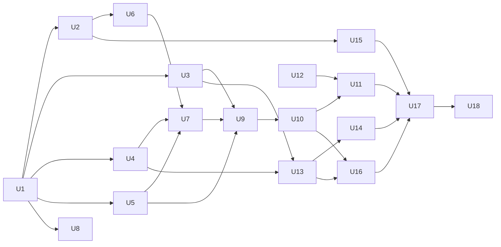

# gstack-evals v1.0: build breakdown for crew threads

GSTA-3, 2026-10-28, from plan v3.2 (approved at autoplan run 2, gate_rev 4, recommendation taken). Each unit below is one crew thread's brief. Units are sized so a thread can finish in one to three days, own a disjoint set of files, and ship one or two PRs. v1.1 units are listed at the end without detail, since their dates come from the M2 feasibility report.

## Rules every unit follows

- Base: garrytan/gstack-evals main (828fc22 or later). Bun and TypeScript. gstack v1.91.295.0 or newer, installed with `--for ship` on any thread that opens a PR.
- Ship gate: run gstack /ship at the PR's exact head so its receipt lands in the PR body, then `gstack-ship-queue ready --pr <n>` and put the READY block in the report. Re-run after any push. The Captain merges; no unit merges.
- `gstack-pregate sealed` before every push, once U1 has committed the sealed config.
- Keyless: every test runs with no API key, on a fake upstream or fake host. Only U11, U16 and U18 spend money, and only after their preregistration PR has merged and their line item is recorded in the ledger with Garry's words. Preregistration and results never share a PR.
- Plan sections are the spec. When a unit finds the plan wrong, it writes a wiki finding and tells the Captain instead of quietly changing the design.
- Implementation ceilings from the plan: M0 and M1a together 150 million tokens, M1b 400 million, M1c 150 million, and at most three gstack-evals implementation threads at once. The schedule below respects that.

## Units at a glance

| Unit | Milestone | Scope in one line | Depends on | Paid |
|---|---|---|---|---|
| U1 | M0 | Repo skeleton, shared types, reason-code registry, CI, sealed pregate config | none | no |
| U2 | M0 | Statistics and preregistration kit, the two stats fixes, the sizing table | U1 | no |
| U3 | M0 | Metering proxy: slot auth, meter ids, allowances, streaming metering, journal, retries | U1 | no |
| U4 | M0 | Budget ledger: two tiers, line items, leases, settle, reconcile, approvals | U1 | no |
| U5 | M1a | Lane A contract reader, sidecar, validate, vacuity rules, lock, init, task and arm schemas | U1 | no |
| U6 | M1a | Verdict engine: scoring, exit codes, ceiling rule, rerun stage, counterexample tests | U1, U2 | no |
| U7 | M1a | skill-eval CLI, base inference, fake host, --example, doctor, preflight, docs | U4, U5, U6 | no |
| U8 | M1a | One-day Harbor spike | U1 | no |
| U9 | M1b | Trial module: isolation, images, network, env, state root, delta grading, cache | U3, U5, U7 | no |
| U10 | M1b | Claude Code and Codex adapters, user simulator, calibration, adjudication, resume | U9 | no |
| U11 | M1b | Lane A shakedown (Phase 1) | U10, U12, ledger line item | $130 |
| U12 | (gstack repo) | office-hours contract tasks, the lock step in diet.md, contract notes | none | no |
| U13 | M1c | Review replay lane: vendored panel, rebuilt runner, token table and export | U3, U4 | no |
| U14 | M1c | Scripted case miner over post-cutoff gstack and gbrain fix PRs | U13 | no |
| U15 | M1c | Parity SD estimate from DeepSWE's published per-task results | U2 | no |
| U16 | M1c | Replay pilot, Martian replication, judge calibration (Phase 1) | U10, U13, ledger line items | $155 |
| U17 | pilot report | Pilot report and the asks for Garry | U11, U14, U15, U16 | no |
| U18 | Phase 2a | The required /review experiment on the mined catalog, plus 22 Martian PRs | U17, Phase 2a cap | $500 to $800 |

## Schedule (at most three gstack-evals threads at once)

| Window | Threads | Notes |
|---|---|---|
| 10-29 | U1, U8 | U1 is small and lands first; U8 touches only spikes/. U12 runs in the gstack repo at any time. |
| 10-30 to 11-04 | U2, U3, U4 | All three branch from U1 and own disjoint folders. M0 exit: CI green and `gstack-pregate sealed` passing. |
| 11-02 to 11-07 | U5, U6 (after U2), U13 (after U3 and U4) | Start each as a slot frees. M1a exit: the interface doc goes to GSTA-36, HARN-1 and GBRA-225. |
| 11-05 to 11-09 | U7, U14, U15 | U15 is small; the U2 thread can take it. |
| 11-08 to 11-16 | U9, then U10 | U9 and U10 stack; the third slot finishes U14 or starts U16's preregistrations. |
| 11-16 to 11-21 | U11, U16 | Paid. They share the ledger but hold different line items, so they run in parallel. |
| 11-21 to 11-25 | U17 | The pilot report. |

The 11-05 to 11-09 and 11-16 to 11-21 windows end after the plan's M1a, M1b and M1c targets (11-07, 11-18 and 11-20). The plan's targets stand, so a unit that needs the end of its window reports the slip to the Captain (note added by GSTA-6 before publication).

## Collision rules

- U1 creates every shared file once, so later units only edit lines they own: NOTICE.md with every planned vendored entry; `src/errors/codes.ts` with every reason code the plan names, one object per code (a unit edits only its own codes' fix and doc text); `bin/gstack-evals` with the full subcommand table pointing at module paths; `src/types.ts` with the cross-unit interfaces (arm spec, Lease, Reservation, the typed outcome taxonomy, the error record); `docs/adapters.md` with a Lane A section (U9) and a Lane B section (U8); empty `schema/`.
- package.json and bun.lock: a unit adds only the dependencies it uses. On a lockfile conflict, merge main and regenerate bun.lock; never hand-merge it.
- `.github/workflows/ci.yml` belongs to U1. Later tests are picked up by `bun test` without editing CI.
- Nobody bumps VERSION or CHANGELOG in a unit PR; the Captain does at release.
- Each unit writes a wiki handoff post at the end (`wiki/board/<date>-<thread>-<slug>.md`, kind handoff or report).

## The units

### U1. Repo skeleton and shared registries (M0)

- Scope: sibling-shaped docs (README, TODOS.md, CHANGELOG.md, VERSION, LICENSE MIT, NOTICE.md); `bin/gstack-evals` dispatcher whose unbuilt commands exit 2 with E_USAGE and "not built yet"; the src/ layout from the plan; `src/errors/codes.ts` with every code in plan v3.2 and a generator for docs/errors.md (code, meaning, fix, side effects, retry safety, resumable); `src/types.ts`; `.gstack/pregate.json` with a sealed config; CI extended to typecheck, `bun test`, `wiki:check` and an errors-doc freshness check.
- Done means: CI green; `gstack-pregate sealed` passes; `gstack-evals --help` lists every planned command; docs/errors.md regenerates with no diff.
- Files: root docs, NOTICE.md, bin/, src/errors/, src/types.ts, schema/ (empty), docs/errors.md, docs/adapters.md (headings only), .gstack/pregate.json, .github/workflows/ci.yml, package.json, tsconfig.json.
- Stacking: first. Every other gstack-evals unit branches from it.

### U2. Statistics and preregistration kit (M0)

- Scope: vendor harness-evals `runner/stats/` (from gbrain-evals 6999ebc9) and `runner/prereg/` with notices. Fix `nonInferiorityP` returning p = 0 when every paired difference is zero. Compare on per-task means (item = cluster = task) so 5 cheap-rung against 3 Opus trials work, with the preregistered missing-cell rule. Exact sign-flip, Holm, task-clustered bootstrap. The decision 9 sizing table as code.
- Done means: keyless tests for both fixes, the 5-versus-3 matrix, one missing cell, and the sizing table reproducing the plan's numbers (95, 214, 343 under the current design; 213 tasks covering SD 0.30, 0.35 and 0.41) and every row of Amendment A2's release-split table (for example 282 and 453 at SD 0.30 and 0.38 for four frozen releases under the current design).
- Files: src/runner/stats/, src/runner/prereg/, tests/stats/, tests/prereg/.
- Parallel with U3, U4, U5 and U8.

### U3. Metering proxy (M0)

- Scope: vendor harness-evals `runner/proxy/metering-proxy.ts` and add what the plan lists: the per-session bearer authenticates one slot, is never persisted or printed, is revoked at slot close and scrubbed from nested causes, and receipts carry a separate public meter id; per-slot model allowlist and allowance; a 429 limiter; native streaming metering for Anthropic Messages and OpenAI Responses; forced `include_usage`; management routes (bind, unbind, finalize) only on an evaluator-side socket with their own credential; binds only to the trial network; writes the cell attempt and reservation id to a journal before forwarding; the single retry owner with finite attempt and elapsed-time budgets; problem-details refusals. The OpenRouter route waits for M2a.
- Done means: fake-upstream tests for slot denial, allowance stop, a trial token refused on the management socket, a meter id that cannot authorize, streaming usage on both protocols, the retry budget and an unknown send that is reconciled, not resent.
- Files: src/runner/proxy/, tests/proxy/.
- Depends on the Lease and Reservation interfaces in src/types.ts, not on U4's code, so U3 and U4 run in parallel.

### U4. Budget ledger (M0)

- Scope: the ledger rewrite. The approval record (`--ledger-record`, `GSTACK_EVALS_LEDGER_RECORD`) as write-once files; the local SQLite ledger (`--ledger`, `GSTACK_EVALS_LEDGER`) with its defaults; caps split into line items, one run per item; leases with id, machine id, amount and expiry; idempotent settle; E_LEASE_UNSETTLED; `ledger reconcile` with the owner's words and a provider usage export; `ledger init|raise --cap --item --words --by --source` mirrored through gstack-approvals, with E_APPROVAL_RECORD; E_LEDGER_PATH on the SQLite tier only; host-neutral E_LEDGER_MISSING; the lease export and settle artifact for the second principal's workflow; docs/budget-ledger.md.
- Done means: tests for two runs racing for one item, a settle failure, a lost settlement acknowledgement, a lost machine (the allowance stays reserved) and the round trip against a fake workflow.
- Files: src/runner/ledger/, tests/ledger/, docs/budget-ledger.md.

### U5. Lane A contract, preflight inputs and lock (M1a)

- Scope: the contract reader (gstack's bare array with its meanings); `validate` with the same rules as gstack's `checkEvalTasks` and a keyless parity test on gstack's committed learn and write-skill files; the `tasks.ext.json` sidecar (user, interactive, judge, timeout_s, env, paths, mutant as {setup, answer}, hidden); the deterministic question-category classifier; the vacuity rules (whole task predicate on the no-op control, safety tasks against their mutant, NEGATIVE_UNVALIDATED without one, never a must_not alone); `--lock` and gate coverage; `skill-eval init`; schema/tasks.schema.json and schema/arms.schema.json, including the loadout kind marked unreviewed (Amendment A1).
- Done means: gstack's committed tasks validate unchanged; a must_not-only control is not refused; a vacuous non-safety task is; a mutant that does not bite is named.
- Files: src/skill-eval/contract/, src/skill-eval/lock/, src/usersim/classifier.ts, schema/tasks.schema.json, schema/arms.schema.json, tests/contract/.

### U6. Verdict engine (M1a)

- Scope: gstack's contract policy as the floor (REGRESSION, SAFETY, WORSE), plus MISS, the sign-flip WORSE, sticky SAFETY_BREAK with FLAKY_SAFETY, UNOPENED, UNCOVERED_GATE_REMOVAL, NOT_NONINFERIOR, the exit-2 set and exit precedence 3, 1, 2, 0; ceiling decided only after every compared arm has run; the one same-tree rerun stage on pooled rounds with its simulated false-negative rate; per-model verdicts; verdict.json as a superset of the contract's file; the versioned error record.
- Done means: the counterexample tests (12 tasks with four degraded, an 11.1-point drop, must not exit 0 with `--margin 5`; perfect before and broken after exits 1 on one and on two models, with the other at ceiling) and the easy-suite test (before passes everything, after breaks a safety task, exit 1).
- Files: src/skill-eval/verdict/, schema/verdict.schema.json, tests/verdict/.
- Stacks on U2.

### U7. skill-eval CLI, fake host and first free steps (M1a)

- Scope: the call and arm-spec grammar; base inference for rendered gstack folders and the narrowed E_LOOSE_GSTACK; LOCK_MISSING that prints the `--lock` command and git steps; effective defaults; `--dry-run` with the worst case in parts; `--example[=miss|safety|unopened|not-measurable|cap-stop]` on the fake host in under 10 seconds; `doctor` (without the image build, which U9 adds); the preflight sequence (keys by name, policy/models.json, ledger, lock, vacuity); `gstack-evals explain <code>`; docs/skill-eval.md written from interface v0.4.
- Done means: diet.md's literal call runs on learn with the fake host; /learn passes preflight on fake Claude and Codex hosts; every example mode writes a real verdict; the interface doc goes to callers through the Captain (M1a exit).
- Files: src/skill-eval/cli/, src/adapters/_fake/, policy/models.json, docs/skill-eval.md, tests/cli/.
- Stacks on U4, U5 and U6.

### U8. Harbor spike (M1a, one day)

- Scope: settle whether Harbor accepts our proxy base URL, baked arms with installs skipped, the separate verifier, the SDK-driven Claude Code agent, its egress allowlist, and an AskUserQuestion round trip to an evaluator-side simulator. Drive Claude Code against a fake upstream that returns scripted tool calls, so no API charges.
- Done means: a wiki finding post with pass or fail per item and the chosen Lane B runner (Harbor or the harness-evals docker fallback); the Lane B section of docs/adapters.md.
- Files: spikes/harbor/ (throwaway), docs/adapters.md (Lane B section), one wiki post.
- Parallel with everything.

### U9. Trial module (M1b)

- Scope: src/trial for Lane A: Docker by default, E_ISOLATION_UNSAFE, explicit `--isolation process`; baked content-addressed image layers and the Dockerfile; the image build in `doctor` with E_IMAGE_BUILD; the internal network with a dual-homed proxy container; the env allowlist; the state root (GSTACK_STATE_ROOT and GSTACK_HOME in a seeded .gstack-home); setup in its own container, the baseline snapshot, the filesystem-delta import and the read-only check runner; the answer key kept out of the agent container; the cache key and E_CACHE_STALE; progress.json; the Capy background-plus-wait recipe.
- Done means: the committed-violation, forbidden-deletion and new-skill grader tests; the tasks-directory canary test; all 12 committed contract tasks replay an oracle and a broken transcript, with every one of /learn's ten checks passing on the oracle and failing on the nop.
- Files: src/trial/, docker/, tests/trial/, docs/adapters.md (Lane A section).
- Stacks on U3, U5 and U7.

### U10. Host adapters, simulator, calibration and adjudication (M1b)

- Scope: the Claude Code adapter on the Agent SDK (stream-json, `canUseTool`, replies by category, approval replies bound to category and effect, the run-time E_USER_TURNS_MISSING catch, skill-opened `calls[]`); the Codex adapter on `codex exec --json` with E_INTERACTIVE_HOST for declared interactive tasks; the calibration checks and their CALIBRATION_* codes; blinded cross-family adjudication; journaled resume and `--repair`.
- Done means: adapter conformance on the fake host (mid-run crash, stale cache, missing key, missing lock, cap stop); question insert, remove and reorder tests in front of an approval; calibration passes on both hosts against the fake upstream.
- Files: src/adapters/claude-code/, src/adapters/codex/, src/usersim/ (except classifier.ts), src/grade/, tests/adapters/.
- Stacks on U9.

### U11. Lane A shakedown (Phase 1, paid)

- Scope: preregistration PR first (prereg plus committed lock). Then /learn on gstack's contract tasks on Opus 5.5 and Haiku 5.5 in Claude Code and on gpt-6.1-sol in Codex, and the shipped office-hours diet (v1.91.289.0: before is its parent commit, after the diet commit) with scripted user turns on Opus 5.5 in Claude Code; calibrations. Results in a separate PR.
- Done means: calibration passes on both hosts; /learn's verdict carries every contract field; the verdict regenerates from receipts; one crew gets a verdict from the docs alone and reports its time to first verdict and every code it hit (M1b exit).
- Files: docs/benchmarks/<run>/ only.
- Paid cap: $130, one line item of the $500 first cap. Needs Anthropic and OpenAI keys and Garry's words in the ledger.
- Stacks on U10 and U12.

### U12. gstack-side contract work (in garrytan/gstack)

- Scope: office-hours' contract tasks.json and tasks.ext.json from GSTA-134's office-hours set; the lock step in /write-skill's diet.md step 6; contract notes offering the state-root convention and a `resumable` field. This is a gstack crew thread through the Captain and the gstack Captain, not a gstack-evals thread.
- Done means: merged in gstack, with gstack's free `test/skill-eval-tasks.test.ts` passing.
- Files (gstack): test/fixtures/skill-evals/office-hours/, the write-skill diet section, docs/designs/SKILL_EVAL_CONTRACT.md.
- Parallel with everything; must land before U11.

### U13. Review replay lane (M1c)

- Scope: vendor GSTA-131's panel into lanes/review-replay/ with credit in the README and each file header; rebuild run.ts on the proxy client and the program ledger (reserve the real maximum, durable item outcomes, stderr and `--json` diagnostics, Lane A's exit codes and STOP line, `--resume` that never resends an unknown outcome, the typed outcome taxonomy); the catalog schema; tables/review-tokens.json and `tokens export` (output plus reasoning tokens, E_TOKENS_COVERAGE, flagged rows on stderr).
- Done means: fake-upstream tests for a cap stop, rejected credentials, transport failures and a resume; a keyless test runs gstack's scripts/review-dispatch-compare.ts on the export.
- Files: lanes/review-replay/, tables/review-tokens.json, tests/replay/.
- Stacks on U3 and U4.

### U14. Scripted case miner (M1c, no API charges)

- Scope: commit the outcome-free inclusion rules first (a fix PR whose diff locates the defect, a reviewable pre-fix head and merge base, a decoy range), then mine gstack and gbrain fix PRs merged after 2026-10-17; audit each case's answer key; label cases short-shelf-life with their first-appearance dates. Public cases only.
- Done means: at least 40 audited cases in the catalog, aiming for 75, each with its audit record; the drop list with reasons.
- Files: scripts/mine-review-cases.ts, lanes/review-replay/catalog/public/, tests/miner/.
- Stacks on U13's catalog schema.

### U15. Parity SD estimate (M1c, no API charges)

- Scope: estimate the per-task SD of (C+gstack minus F+none) from DeepSWE's published per-task results with the plan's formula, and print the decision 9 table at that estimate, including Amendment A2's rows (parity's alpha share, its own tranche, or four frozen releases at 0.0125).
- Done means: a committed note with the estimate, its method and its uncertainty, ready for the pilot report.
- Files: scripts/parity-sd-estimate.ts, docs/benchmarks/2026-11-parity-sd-estimate/.
- Stacks on U2; the U2 thread can take it.

### U16. Replay pilot, Martian replication and judge calibration (Phase 1, paid)

- Scope: three preregistrations, each merged before its results. The replay pilot on public cases (4 arms x 3 trials on Opus 5.5 and Haiku 5.5, with full-pass and effort controls). The 28-PR Martian replication: full gstack /review against the two-sentence baseline, both in the same Claude Code harness, model and tools, on Opus 5.5, with a re-pinned non-Sonnet judge, the decision sentences, the minimum detectable difference at n = 28 and n = 50, and a hand audit of false positives against Martian issue #69. Judge calibration against human labels.
- Done means: each result in its own PR, regenerated from receipts (M1c exit).
- Files: docs/benchmarks/<run>/ only.
- Paid caps: $60, $75 and $20, three line items of the first cap.
- Stacks on U10 (the agentic arms) and U13.

### U17. Pilot report (target 2026-11-25)

- Scope: the prices and variances of Lane A, the replay pilot and the Martian replication; the Martian first read; the mined catalog's size; the SD estimate with the decision 9 table; a proposed Phase 2a cap; the $25 reserve's use, if any.
- Done means: a report PR and a wiki report post; the Captain carries four asks to Garry: the Phase 2a cap; his pick of decision 9's design (three models, or one primary cheap model, at 90% or 80% power), or no parity attempt; how parity shares the sealed alpha under the d1 release budget (Amendment A2: a bigger preregistered share for parity, its own sealed tranche, or more minted tasks), shown at the estimated SD; and his reading of decision 15.
- Files: docs/benchmarks/pilot/report.md, one wiki post.

### U18. Phase 2a, the required /review experiment (v1.0, after the pilot report)

- Scope: preregister and run the /review experiment on the mined catalog: agentic arms on Haiku 5.5 for every case, Opus 5.5 agentic arms on a preregistered subset of 20 to 30 cases at 2 trials, the direct-API arm and both controls on every case; plus the other 22 Martian PRs, run whatever the first read showed. The lane stays descriptive.
- Paid cap: about $500 to $800, asked at the pilot report.

## v1.1, for later briefs

Dated at the M2 feasibility report. M2a: the Lane B runner per the spike, arm images, placebo generator, evaluator-side simulator, gated-effect observation, OpenRouter route, import adapters, then the public feasibility step on the remaining $190 of the first cap and its report. M2b: minting and derivation pipelines, the first authoring batch, coverage maps and the oracle, nop and mutation suites; needs the second principal before anything is sealed. M3: Phase 2b screening, the measured SD, minting to size, sealing and the counted preregistration. M4: Phase 3 and its report. Amendment A1's loadout ladder joins M3 and M4 if a plan review accepts it. Amendment A2's release rules (one pass bit per release, one frozen champion per sealed result, opening counters) apply from the first sealed run in M3, and its keep rule (measured noise floor, clusters lost against gained, candidate hashes, a bit-only proposer channel, top-3 re-confirmation, a cross-family diff reviewer, a one-shot baseline arm and a loop preregistration) governs the factory `compare` loop when it starts. Both amendments are unreviewed until a plan review accepts them.
