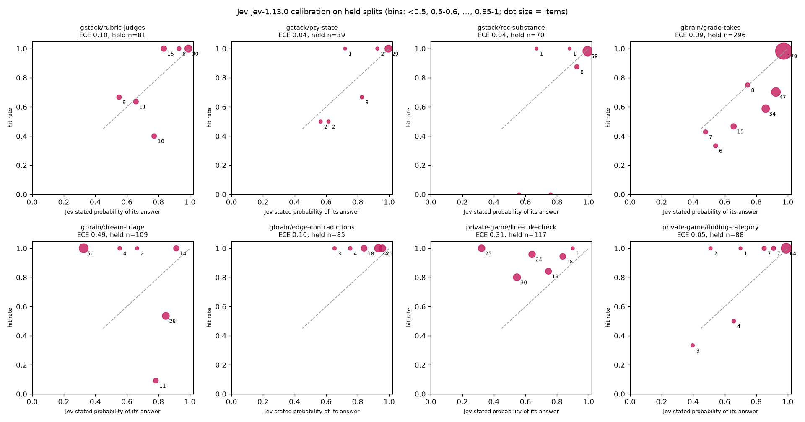

# Routing small agent decisions to Jev cut their cost on all 8 decision points we replayed, and particle-1 alone matched or beat the routing on 7 (exploratory)

- **We learned that routing small decisions to Jev really does cut their cost, and that Jev usually answers in under a tenth of a second.** A cascade that keeps Jev's answer when Jev is confident and sends the rest to particle-1 cost 0.2% to 6.8% of today's model on all 8 decision points we replayed, and Jev answered in 70 to 88 ms at the median. You should look in your agent for model calls that pick from a fixed list of answers, because those are the calls a router can move.
- **We learned that the escalation model alone did as well or better.** particle-1 on its own scored as high as the cascade or higher on 7 of 8 points, at 0.9% to 14.2% of today's cost, and it scored higher than today's model on 6 of 8, measurably on 4 of them, by 5.7 to 16.5 points. It is no frontier replacement: on gstack's long rubric judges it trailed today's judges, Fable 5.1 on 66 of the 81 held items and Sonnet 5.5 on the rest, at -24.7 points [-34.6, -14.8], and Fable 5.1 alone at -16.7 [-27.3, -7.6]. You should run the escalation model alone as an arm before you credit a router with its gains.
- **We learned that the router breaks where its confidence number is wrong or the decision isn't small.** We found no measurable accuracy loss on 7 of 8 points, with the private game's line rule check borderline, which does not show that accuracy held. The cascade came out at -9.9 points [-18.5, -1.2] on gstack's rubric judges, and on gbrain's dream triage Jev's confidence ran backwards, so the threshold picked on the dev split escalated 64% of held transcripts, for +1.8 points [-6.4, +10.1] against today's model. You should plot calibration on your own dev data before you pick a threshold.

This is a descriptive exploration, not a preregistered eval. We replayed 8 decision points from gstack, gbrain and a private game project, with held splits of 39 to 296 items. The cascade's threshold (tau) was tuned on a separate dev split only. Every comparison is paired, with a 95% bootstrap interval, and a missing or unreadable answer counts as wrong. We did not run the article's exact setup: we escalated to particle-1 instead of Kimi K3. Every Jev answer came from jev-1.13.0. We plan a preregistered eval on fresh items.

## What works

**The cost cut is real on every point.** The cascade cost 0.21% to 6.78% of today's model per decision, and Jev alone cost 0.08% to 3.96%. The most expensive cascade was dream triage, which escalated 64% of transcripts and still cost 6.78% of today's Haiku 4.5 call. Today's models here are mostly small ones (Haiku 4.5, Sonnet 4.6), so the saving is large as a ratio but small per call.

**Jev is fast.** Its median answer took 70 to 88 ms, against 0.72 to 5.16 s for particle-1 and 0.87 to 16.5 s for today's model. On the 6 points where the cascade escalated 16% or less, its median stayed at 70 to 83 ms.

**particle-1 alone matched or beat the cascade on 7 of 8 points**, and on two of them the gap is measurable: take grading, +4.7 points [+2.4, +7.4], and dream triage, +7.3 [+1.8, +13.8]. It measurably beat today's model on 4 points: the recommendation judge (+10.0 [+2.9, +18.6]), take grading (+5.7 [+3.0, +8.4]), dream triage (+9.2 [+4.6, +14.7]) and relationship contradictions (+16.5 [+9.4, +24.7]). It cost 0.92% to 14.2% of today's model. What Jev adds on top of particle-1 is speed, plus a further cost cut of 1.17 to 4.42 times on 6 points. On finding category the two cost nearly the same (the cascade about 1% more), and on line rule check the cascade cost 1.27 times more than particle-1, because it escalated 89% of items.

**Take grading is the clearest case for a Jev cascade.** Jev was confident and right on most takes: 179 held takes at a confidence of 0.95 or more, 98.3% of them correct. At tau 0.69 the cascade escalated 9% and came out at +1.0 points [-1.4, +3.4] against Sonnet 4.6, for 1.57% of its cost. A tau tuned for the highest dev accuracy (0.92, 30% escalated) gave +3.0 [+0.7, +5.7] for 2.51% of the cost. particle-1 alone still did better: +5.7 [+3.0, +8.4] for 3.85%.

## What didn't work

**No measurable loss on 7 of 8 points, which does not show that accuracy held.** The cascade came out at -9.9 points [-18.5, -1.2] on gstack's rubric judges. On the private game's line rule check it was borderline at -2.6 [-6.0, 0.0], 3 items worse and none better. That upper bound is exactly 0.0, and under the rule this post uses everywhere, an interval that reaches zero is not a measurable difference. Six of those seven intervals reach below zero, by 1.4 to 6.4 points, so a loss of a few points could hide. This is not a parity test.

**The rubric judges are not small decisions.** They score long artifacts against long rubrics, today on a frontier judge with an 8,192-token budget. Jev alone came out at -11.1 points [-19.8, -2.5], and particle-1 ran out of tokens on 11 of 81 items, each reply stopping at the 8,192-token cap. The two judges gstack still uses in production (24 held items) scored 24 of 24 on every arm, so all of the loss sits in the four judges gstack has since removed.

**Jev's confidence was off on two points.** On dream triage it ran backwards (expected calibration error 0.49): answers with a confidence under 0.5 were right 50 of 50 times, and answers with a confidence of 0.7 to 0.8 were right 1 of 11 times. gbrain scores a transcript by its highest-scoring window and passes it at 0.77, and of the 39 held transcripts that scored 0.77 to 0.9, only 16 were worth keeping. The threshold that matched today's accuracy on the dev split escalated 68% there and 64% of held transcripts, where the cascade came out at +1.8 [-6.4, +10.1]. On line rule check Jev was under-confident (calibration error 0.31), partly because of how we combined its nine answers into one number, and the cascade escalated 89%.

**gbrain's dream triage verdict scores recall, not accuracy.** At gbrain's shipped 0.77 threshold Jev catches every transcript worth keeping (30 of 30) but also sends 23 of 79 routine chats to the writer, so on plain accuracy it came out at -10.1 points [-20.2, 0.0] against Haiku 4.5. particle-1 beat both, at 107 of 109.

**Showing particle-1 Jev's guess did not help.** With the guess, particle-1 scored at or below particle-1 without it on 7 of 8 points and lower on 4 (271 against 273, 66 against 69, 114 against 115 and 87 against 88). It scored higher only on the rubric judges (60 against 57).

**The premise fits these repos poorly.** From our read of each repo at the pinned commit: gstack makes most of its small decisions inside SKILL.md prompts that Claude Code or Codex runs, so there is no separate model call to reroute; the calls that pick from a fixed list sit mostly in its test suite, as judges. gbrain already has this router: a decide layer with a TypeSafe provider and nine decision slots, each with a labelled set, where Jev won 2 of 9 in gbrain's own evaluation (docs/eval/system-one/README.md at the pinned commit). The private game makes no model call when it runs.

## Three bugs this turned up

1. **Token caps sized for models that don't reason cut off a model that does.** particle-1 reasons before it answers. gbrain's dream triage asks for at most 2,048 tokens, and one particle-1 reply here used 1,910 of them. In the arm that showed particle-1 Jev's guess, 2 held dream-triage replies hit the 2,048 cap exactly, came back cut off and were counted wrong. The cascade did not use those two replies, because Jev's confidence there was above tau, so no cascade number changes, and that arm's 107 of 109 counts both as wrong. At gbrain's 600-token judge cap, 8 of 296 held take-grading replies and 3 of 85 relationship replies were cut off; we reran those once at 4,000 tokens. This replay counts a cut-off reply as wrong. gbrain at the pinned commit makes no verdict from one: take grading throws and tries again next cycle, and relationship checks record an error, so there the cost is failed calls and retries.
2. **Auto-applying a verdict on the model's own confidence.** In take grading, particle-1 would have auto-applied 184 held verdicts at gbrain's 0.95 confidence bar, and 18 of them were wrong. Sonnet 4.6 applied 53 with 4 wrong, and Jev 129 with 3 wrong.
3. **Judge-model drift.** gstack's recommendation judge hard-codes Haiku 4.5, so gstack's judge-model setting never reaches it.

## What changed in gstack and gbrain

This section is what the gstack and gbrain maintainers report, and it is outside the attached bundle. gstack reviewed the patches and queued a judge comparison instead of landing a flag-off switch, so nothing landed. One bug fix from this exploration is going into gbrain, and no default model changed. The gbrain fix is the first bug above: it gives particle-1 a token budget that fits a reasoning model when gbrain calls it through OpenRouter.

## How it works

This section is an explanation, not a result. Jev is a "system one" model: you send it state and typed questions, and it returns answers with probabilities. The cascade keeps Jev's answer when Jev's confidence (defined under Setup) is at least tau, and otherwise asks particle-1, showing it Jev's guess. Where Jev's confidence tracks how often it is right, as on take grading (calibration error 0.09), the cascade can skip most escalations. Where it doesn't, the cascade either escalates most items (dream triage, line rule check) or keeps confident wrong answers (rubric judges). Where Jev alone already matched today's model on dev (the terminal-state and recommendation judges and relationship contradictions), tau came out at 0 and the cascade never escalated. particle-1 reasons before it answers, which makes it slower than Jev and sensitive to token caps sized for models that don't reason.

## Result

The chart plots Jev's confidence in its answer, as defined under Setup (the axis calls it Jev's stated probability), against how often that answer was right, on the held split of each point. A dot on the diagonal means the mean confidence matched the hit rate in that bin; bins with few items are uncertain.

Correct answers on the held split:

| Decision point | Today's model | Held items | Today | particle-1 alone | Jev alone | Cascade (share escalated) |
|---|---|---|---|---|---|---|
| gstack rubric judges | Fable 5.1 (one config Sonnet 5.5) | 81 | 77 | 57 | 68 | 69 (12%) |
| gstack terminal-state judge | Haiku 4.5 | 39 | 35 | 38 | 36 | 36 (0%) |
| gstack recommendation judge | Haiku 4.5 | 70 | 62 | 69 | 66 | 66 (0%) |
| gbrain take grading | Sonnet 4.6 | 296 | 256 | 273 | 247 | 259 (9%) |
| gbrain dream triage | Haiku 4.5 | 109 | 97 | 107 | 86 | 99 (64%) |
| gbrain relationship contradictions | Haiku 4.5 | 85 | 71 | 85 | 85 | 85 (0%) |
| private game: line rule check | Opus 5.5 | 117 | 117 | 115 | 106 | 114 (89%) |
| private game: finding category | Opus 5.5 | 88 | 87 | 88 | 84 | 87 (16%) |

Paired difference from today's model in percentage points, with the 95% interval and the counts of items that got worse and better:

| Decision point | particle-1 alone | Jev alone | Cascade | particle-1 minus cascade |
|---|---|---|---|---|
| gstack rubric judges | -24.7 [-34.6, -14.8] (21/1) | -11.1 [-19.8, -2.5] (12/3) | -9.9 [-18.5, -1.2] (11/3) | -14.8 [-25.9, -3.7] (18/6) |
| gstack terminal-state judge | +7.7 [0.0, +17.9] (0/3) | +2.6 [-5.1, +12.8] (1/2) | +2.6 [-5.1, +12.8] (1/2) | +5.1 [-5.1, +15.4] (1/3) |
| gstack recommendation judge | +10.0 [+2.9, +18.6] (1/8) | +5.7 [-2.9, +14.3] (3/7) | +5.7 [-2.9, +14.3] (3/7) | +4.3 [0.0, +10.0] (0/3) |
| gbrain take grading | +5.7 [+3.0, +8.4] (1/18) | -3.0 [-5.7, -0.3] (14/5) | +1.0 [-1.4, +3.4] (5/8) | +4.7 [+2.4, +7.4] (1/15) |
| gbrain dream triage | +9.2 [+4.6, +14.7] (0/10) | -10.1 [-20.2, 0.0] (23/12) | +1.8 [-6.4, +10.1] (10/12) | +7.3 [+1.8, +13.8] (2/10) |
| gbrain relationship contradictions | +16.5 [+9.4, +24.7] (0/14) | +16.5 [+9.4, +24.7] (0/14) | +16.5 [+9.4, +24.7] (0/14) | 0.0 [0.0, 0.0] (0/0) |
| private game: line rule check | -1.7 [-4.3, 0.0] (2/0) | -9.4 [-15.4, -4.3] (11/0) | -2.6 [-6.0, 0.0] (3/0) | +0.9 [-1.7, +4.3] (1/2) |
| private game: finding category | +1.1 [0.0, +3.4] (0/1) | -3.4 [-9.1, +1.1] (4/1) | 0.0 [-3.4, +3.4] (1/1) | +1.1 [0.0, +3.4] (0/1) |

In the last column the counts are items where particle-1 was wrong and the cascade right, then the reverse.

Cost per decision as a share of today's model, and median latency:

| Decision point | particle-1 alone | Jev alone | Cascade | Median latency: today / particle-1 / Jev / cascade |
|---|---|---|---|---|
| gstack rubric judges | 0.92% | 0.08% | 0.21% | 16.5 s / 5.16 s / 80 ms / 83 ms |
| gstack terminal-state judge | 14.2% | 3.96% | 3.96% | 868 ms / 1.30 s / 73 ms / 73 ms |
| gstack recommendation judge | 10.9% | 3.30% | 3.30% | 1.43 s / 2.21 s / 72 ms / 72 ms |
| gbrain take grading | 3.85% | 1.10% | 1.57% | 2.51 s / 1.20 s / 73 ms / 75 ms |
| gbrain dream triage | 7.96% | 3.53% | 6.78% | 1.78 s / 2.83 s / 88 ms / 1.56 s |
| gbrain relationship contradictions | 7.70% | 2.00% | 2.00% | 1.94 s / 1.26 s / 70 ms / 70 ms |
| private game: line rule check | 4.96% | 1.99% | 6.31% | 1.43 s / 1.71 s / 77 ms / 1.66 s |
| private game: finding category | 1.62% | 1.13% | 1.63% | 1.18 s / 715 ms / 71 ms / 74 ms |

Costs are at list prices on 2026-11-09, with particle-1 at the cost OpenRouter reported per call. The bundle carries each call's cost as a share of today's model, not the prices or charges behind it, so a recompute checks the arithmetic from those shares, not the price basis. The cascade's cost and latency include the Jev call on every item plus particle-1 on the escalated ones.

### Gap to a frontier model, and a second judge

Because this result favours particle-1, here is how far it sits from a frontier model, and how the result moves when one judge writes the labels instead of two.

- **Where today's model is a frontier model**, particle-1 trailed today's rubric judges by 24.7 points [-34.6, -14.8] (Fable 5.1 on 66 of 81 held items, Sonnet 5.5 on 15) and Fable 5.1 alone by 16.7 [-27.3, -7.6] (12 items worse, 1 better), and sat at -1.7 [-4.3, 0.0] and +1.1 [0.0, +3.4] against Opus 5.5 on the private game's two points.
- **Where labels came from two frontier models agreeing** (the recommendation judge, relationship contradictions and the private game's two points), Opus 5.5 and GPT-6 Astra labelled every item, each with its own labelling prompt, and we kept only the items where they agreed. One Opus 5.5 label on the recommendation judge was unreadable, and the agreement figures count it as a disagreement. They agreed on 96.7% of recommendation items (Cohen's kappa 0.876, 120 items), 94.7% of relationship items (kappa 0.893, 150), 99.0% of line rule items (kappa 0.986, 200) and 98.0% of finding category items (kappa 0.977, 150). Taking GPT-6 Astra's labels as truth and scoring Opus 5.5's labels as if they were an arm, particle-1 minus Opus 5.5 was +1.4 [-2.8, +5.6] on the recommendation judge, 0.0 on relationship contradictions (85 of 90 each), -1.7 [-4.3, 0.0] on line rule check and +1.1 [0.0, +3.3] on finding category.
- **With one judge's labels as truth** (on the recommendation judge and relationship contradictions the disagreements are kept; on the private game's built items, an item stays only where that judge agreed with how it was built, which leaves 119 of 120 held line-rule items with Opus 5.5's labels and 117 with GPT-6 Astra's, and 89 and 90 of 91 finding-category items), particle-1's lead over today's Haiku 4.5 on the recommendation judge is +6.9 [-1.4, +15.3] with Opus 5.5's labels and +12.5 [+4.2, +20.8] with GPT-6 Astra's, so on Opus's labels it is no longer measurable. On relationship contradictions it is +21.1 [+13.3, +30.0] and +10.0 [+1.1, +18.9]. On line rule check, against today's Opus 5.5, particle-1 comes out at -3.4 [-6.7, -0.8] on Opus's labels and -1.7 [-4.3, 0.0] on Astra's, and the cascade at -4.2 [-8.4, -0.8] and -2.6 [-6.0, 0.0].
- **We ran no frontier model on the terminal-state judge, take grading or dream triage**, so particle-1's gap to the frontier there is unmeasured. Those three points have labels from gstack's tests and gbrain's fixtures, not from models.

### At gbrain's shipped token cap

The take-grading and relationship numbers above give particle-1 a second try at 4,000 tokens when gbrain's 600-token cap cut its reply off (8 of 296 and 3 of 85 held items for particle-1 alone, 10 and 1 for particle-1 shown Jev's guess). Counting those replies wrong, particle-1 alone still beat today's model: +3.4 [+1.0, +5.7] on take grading and +12.9 [+5.9, +21.2] on relationship contradictions, and the take-grading cascade fell to +0.3 [-2.0, +2.7]. The replay's own first cap on line rule check was 1,000 tokens, and 2 particle-1 replies and 3 cascade escalations there were rerun the same way.

## Why it lost where it did

- **Task fit.** The rubric judges are long generations of scores against long rubrics, not small picks from a list, and they lost on every cheap arm.
- **Calibration.** A cascade is only as good as the confidence it routes on. On dream triage and line rule check, Jev's confidence did not track its accuracy, and the threshold picked on dev escalated most items.
- **Power.** Held splits of 39 to 296 items give cascade intervals 4.7 to 17.9 points wide, so this replay can show large gains and losses, and several intervals still allow a loss of a few points. It is not a no-loss result. The bounds move in steps of one item: under a different random draw, the Harness Evals recompute saw 10 printed bounds shift by 0.3 to 2.6 points, and none crossed zero.
- **Frontier model without routing.** On line rule check today's Opus 5.5 scored 117 of 117, so a cheaper arm could only tie or lose there. The other frontier baselines left little room: 87 of 88 on finding category and 77 of 81 on the rubric judges.

## Limits and threats

- **Labels.** Four points rest on two frontier models agreeing, with disagreements dropped (4 recommendation items, 3 of them disagreements and 1 with an unreadable Opus 5.5 label, 8 relationship items, and 3 and 4 on the private game's two points, counting items where the labels disagreed with how the item was built). 24 of the 39 held terminal-state screens are ones gstack's own detectors already classify. In production the model judge sees only screens the detectors could not classify, so these items are likely easier.
- **Synthetic items.** The relationship items and both private-game points use synthetic items. The private game's are stand-ins written fresh for invented games, so they say little about the real game.
- **Cost basis.** Today's model was replayed through its direct API at list prices. In production gstack's terminal-state judge runs through claude -p, which adds Claude Code's system prompt (we estimate about 16,000 tokens a call), so its real cost today is higher and the ratio understates the saving. The rubric judges' cost and latency today come from gstack's logged calibration runs: one logged call for the arm judge, which makes one call per decision; one of the two orders the arm-pair judge runs; and the sum over the three-sample panel for the four workflow judges. That panel runs its samples at the same time, so the summed latency overstates how long today's workflow judges take.
- **Latency.** Jev was called from one machine and the other arms from another, all over the public internet, so treat the latency figures as rough. Medians come from the scorer's percentile function (stats.py.txt), which takes one of the two middle values when the count is even. Averaging the two middle values instead changes three printed figures: particle-1's median on the recommendation judge is 2.35 s, the cascade's on take grading 74 ms, and particle-1's lowest median (finding category) 0.71 s. recompute-output.json and private-game-counts.json give the averaged medians as lat_median_averaged and the retry counts as retried_all_splits. Where particle-1 got a second try at a larger token cap (26 rows on take grading, 8 on relationship contradictions and 9 on the line rule check, dev and held together), the item files keep the second try's latency alone, while the cost counts both tries. Adding the first try's time, which arm-outputs keeps for the public points, changes none of the medians above; we checked the line rule check on its private rows, which the bundle does not carry. The p90 values in the output files, which this post does not print, also use the second try alone, and with both tries they run up to 3% higher.
- **Replay, not production.** The terminal-state judge was called through the API instead of claude -p, the recommendation judge as one call instead of a 3-sample panel, without the JSON schema gstack sends, and the arm-pair judge in one order where gstack runs both and calls a tie unless they agree.
- **One run per item.** No repeats, and temperature as in production.
- **Threshold rule.** tau was the lowest escalation rate that matched today's model's dev accuracy, or the highest dev accuracy where none did (finding category). The candidates were 0, every distinct derived confidence on the dev split, and one value above 1 that escalates every item. On 3 points tau came out at 0, so the cascade was Jev alone.
- **Combining answers.** Jev's confidence is derived from its answers as Setup describes, and that derivation shapes its calibration, most where Jev answered several questions per item (dream triage windows, the nine line-rule answers).
- **The article's setup.** We escalated to particle-1, not Kimi K3, and made no Kimi call.

## Setup

Arms on every point: today's model as each repo calls it, particle-1 alone (particle-ai/particle-1 through OpenRouter), Jev alone (jev-1.13.0 through TypeSafe's API), and the cascade. The cascade keeps Jev's answer when its confidence is at least tau and otherwise asks particle-1, showing it Jev's guess. tau was tuned on the dev split only. Today's model and particle-1 got the repo's own prompt, parser and token cap, except the reruns and the replay differences listed above. Jev got typed questions built from the same inputs, and each point turned its answers into the repo's decision and one confidence, the probability of that decision:

- Terminal-state judge: waiting when Jev's probability of waiting is at least 0.5; its other two states count as not waiting.
- Recommendation judge: pass when the probability of a substance score of 4 or 5 is at least 0.5. An item with no because clause fails at confidence 1, as in gstack.
- Rubric judges: the probability that Jev's score probabilities meet each judge's pass rule (for the workflow judges, the product over dimensions of meeting the floor), pass when it is at least 0.5.
- Take grading: Jev's probability that the take is settled times its outcome probabilities, with unresolvable taking the unsettled share and the not-shown answer; the decision is the most likely of the four.
- Dream triage: the highest window score, pass at 0.77 or more, with confidence the score for a pass and 1 minus the score for a reject.
- Relationship contradictions: conflict when Jev's probability of a conflict is at least 0.5.
- Line rule check: one yes-or-no probability per rule. The top rule when its probability is at least 0.5, with confidence the smallest of that probability and the other rules' probabilities of not applying; otherwise no rule, at 1 minus the top probability.
- Finding category: Jev's chosen category and its probability.

So the confidence the cascade routes on, and the chart plots, is derived from Jev's answers rather than a number Jev gave for the decision itself. Results are on the held split, paired by item, with a 10,000-sample bootstrap (seed 7) for differences and Wilson intervals for single rates.

| Decision point | What it decides | Today's model | Items (dev / held) | Truth |
|---|---|---|---|---|
| gstack rubric judges | Six LLM judges score an artifact against a rubric; code turns scores into pass or fail. Two are in production, four were removed from gstack | Fable 5.1, one config Sonnet 5.5 | 55 / 81 | gstack's hand-labelled calibration corpus |
| gstack terminal-state judge | Is Claude Code, running in a terminal during an end-to-end test, waiting at a question or not | Haiku 4.5 | 26 / 39 | labels asserted by gstack's tests |
| gstack recommendation judge | Does a recommendation's "because" clause have substance (score 4 or 5 of 5) | Haiku 4.5 | 46 / 70 scored (48 / 72 built) | gstack's test labels, construction, and two-model agreement |
| gbrain take grading | Is an old forecast correct, incorrect, partial or unresolvable, given the evidence | Sonnet 4.6 | 118 / 296 | gbrain's take-grading fixtures, gold by construction |
| gbrain dream triage | Is a chat transcript worth sending to the dream writer | Haiku 4.5 | 145 / 109 | gbrain's own S7 triage set and its frozen split |
| gbrain relationship contradictions | Can two live relationships of the same type both hold now | Haiku 4.5 | 57 / 85 scored (60 / 90 built) | two-model agreement on synthetic subjects |
| private game: line rule check | Which rule, if any, a game line breaks | Opus 5.5 | 80 / 117 scored (80 / 120 built) | construction, kept where two models agreed with it |
| private game: finding category | Which category a playtest finding belongs in | Opus 5.5 | 58 / 88 scored (59 / 91 built) | construction, kept where two models agreed with it |

Pinned code: gstack at b6155921, gbrain at 15e3ab8c. The labelling models were Opus 5.5 and GPT-6 Astra. The replay ran on 2026-11-09.

## Replicate it

Every file named below is attached to this post. The recompute needs Python 3 and nothing else.

    cp recompute.py.txt recompute.py && cp stats.py.txt stats.py
    python3 recompute.py . > mine.json

mine.json should match recompute-output.json. For the six gstack and gbrain points, recompute.py also reproduces scores-as-run.json, the output of the scorer that ran (score.py.txt), with each cost turned into a share of today's model.

- items-<point>.json: one line per item, with its split, truth, and each arm's answer, confidence, cost share and latency (for a retried row, the cost of both tries and the latency of the second), plus the two labellers' answers where they exist.
- arm-outputs-<point>.json: every row each model arm wrote, retries and errors included, with the tail of each raw reply.
- jev-request-<point>.json and jev-response-<point>.json: the Jev requests as sent and the raw responses as returned.
- scores-as-run.json, recompute-output.json and private-game-counts.json: scorer output, recompute output, and the private game's counts and digests.
- score.py.txt, stats.py.txt and recompute.py.txt: the scorer that ran, its statistics (unchanged apart from its first line), and the recompute.

A few strings differ from what was sent. jev-request-gstack-rubric-judges.json quotes AWS's documented example access key inside a gstack diff, and this repo's secret scan blocks key-shaped strings, so it reads AKIA-DOCS-EXAMPLE-REMOVED here. Two private project names that appear in gstack's own fixture text read [name removed], one in jev-request-gstack-rec-substance.json and one in jev-request-gstack-rubric-judges.json. Home-folder paths inside fixture text, such as the project folders in gbrain's synthetic transcripts, read ~/ (or %USERPROFILE% for Windows paths), because this repo's publication check blocks local home paths. The prompts for today's model and particle-1 come from the repos at the pinned commits. Paid calls are not repeatable from this bundle: it holds what they returned.

## What is held out, and why

The private game's two points publish counts and sha256 digests only, in private-game-counts.json, which also gives each point's built dev and held split and its exclusions by split. Their items are synthetic, but they were written to mirror the private game's own rules and categories, so we keep them private. By the account of the crew that wrote the stand-ins, nothing from the private repo went to any model vendor; counts and digests cannot show that. There is no held-out set yet; the planned eval will seal one.

## Record

Publication status: published in this post. The claim check below must pass before this merges.

| Field | Value |
|---|---|
| Grade | Exploratory, descriptive, not preregistered |
| Repo commit | gstack b6155921, gbrain 15e3ab8c |
| Prereg | None. We plan a preregistered eval |
| Data | Attached to this post |
| Reviewed by | GPT-6.1 Sol, a cross-lab read (recheck of its edits pending) |
| Reproduced by | The Harness Evals recompute (an independent crew, on a clean machine), and a separate Opus 5.5 recompute |

## The claim check

| Check | Result |
|---|---|
| Cross-lab read of every number and sentence against the attachments (GPT-6.1 Sol) | Every number in the Result tables matched. It asked for 19 edits to wording, labels and attribution, all made in this version. A recheck of those edits is pending |
| Independent recompute of every headline number from the raw files (a separate Opus 5.5 agent with its own scorer) | Every number it checked matched, across the three Result tables and most body figures, except three medians on even counts, where it averaged the two middle values (see Latency) |
| Harness Evals recompute (independent crew, clean machine) | Every number reproduced: the shipped recompute's output byte for byte, 520 of 520 values against its own scorer, all 31 attachment digests and all 1,139 public items. It found the three median differences and four wording issues ("measurably" in the takeaway, the two cut-off dream-triage replies, the unreadable label and the 7 of 8 count), all fixed in this version. Not independently checked: the truth labels against the pinned repos, particle-1's per-call prices, and the private items, of which it checked counts only |

## Changelog

- 2026-11-09: first version.

Agent notes

- Replay run by GEVA-410 (archived) under the jev-explore approvals item; Jev batch sent from the Captain's machine. This post by GEVA-421 for Captain GEVA-2, issue GST-1984 under GST-1961. Eval plan: GEVA-411.
- Patches: gstack's two went to GSTA-36, which queued a judge panel (GST-1976) instead; gbrain's dream-triage fix lands as GST-1977 via GBRA-108; grade-takes-jev-slot not landing.
- Spend sits in the Captain's ledger and the GEVA-410 report. No dollar figures appear here (R79 amendment); cost is shown only as a share of today's model.
- Per-item data came from GEVA-410's machine, copied by GEVA-421; score.py on that data reproduced all eight score files byte for byte before conversion.
- No X hook: the owner posted on 2026-11-09.

## Disclosures

Disclosure: Y Combinator, which Garry Tan runs, is an investor in Particle, which makes particle-1.

gstack is Garry Tan's own project.

gbrain is Garry Tan's own project.
